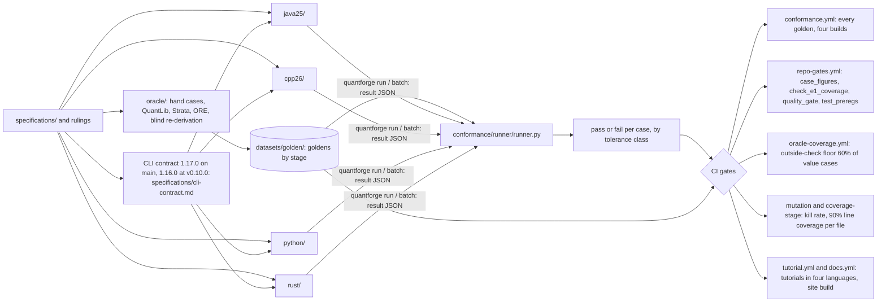

# Architecture

QuantForge is one repository holding four isolated implementations and the neutral parts around them. The plain idea: a spec says what must be true, the oracle says what the answer is, and a runner that knows no finance compares each language's answer with it. Detail is in `architecture/`; decisions are in `architecture/decisions/`; diagrams are in `docs/diagrams/`.

Sources: each spec ends with a `## Sources` section naming the papers, books and standards (BIS MAR21, ARRC and others) it follows; [References](docs/references.md) lists them all by topic with their status.

| Part | Role | May depend on |
|---|---|---|
| `specifications/` | What must be true | Nothing |
| `oracle/` | Expected results, from outside sources and hand cases | Specs, outside libraries. Tests only |
| `datasets/` | Schemas and golden files | Oracle output |
| `conformance/` | Neutral runner and tolerances | Golden files and each CLI's JSON. No financial logic |
| `java25/`, `cpp26/`, `python/`, `rust/` | Four equal implementations | Specs only. Never each other, never the oracle |
| `tools/` | Recorder, forward log, docs site build and Curves gallery | CLI output. No financial logic |

## The whole system in one picture

Plain idea: specifications are the only thing the four builds share. The oracle turns the specifications into expected answers, the golden files hold them, and a runner that knows no finance sends each case to each build's command-line program and compares. Gates in CI refuse a change that breaks a count, a share, a tolerance or a page.

Formal statement: the arrows are the only allowed dependencies (table above). No build reads the oracle, a golden file or another build; the runner compares outputs only through `conformance/tolerances/`; the contract number is the one the runner requires (`CONTRACT` in `conformance/runner/runner.py`: 1.16.0 at v0.10.0, 1.17.0 on main since stage K round 1, read 2026-11-20). Worked example: `exec.impact.sqrt` with quantity 100,000, daily volume 10,000,000, daily volatility 0.02 and coefficient 1 is specified in `specifications/10-execution/impact.md`, written as golden `imp_h-0001` (impact 0.002) by the oracle, and each build's CLI must return 0.002 within its tolerance class; the Python build printed `"impact":0.002` on 2026-11-19 (observed, local). Per-domain flows, one diagram per domain 01 to 12, are in [Diagrams: per-domain flows](docs/diagrams/README.md#per-domain-flows).

## Rules that shape it

- No language is a reference. The oracle is the source of golden results.
- No shared code, FFI or generated maths between implementations.
- The only interface that counts is the CLI: case JSON in, result JSON out.
- Libraries first, services last. Infrastructure arrives as local adapters in stage K; in round 1 that means two scheduled jobs on GitHub Actions and no service (see [Stage K round 1](#stage-k-round-1-platform-pieces-daily-jobs-and-capital-on-main-unreleased)).
- Trading is simulated only. There are no live orders.

The specification remains a shared-error risk: four builds and a hand case can share one misreading. That is why outside libraries are used wherever a licence allows. Validation is self-assessment: there is no second review (owner decision, 2026-11-18).

## Inside one implementation

Stage B adds the pricing framework (`specifications/04-pricing/pricing-framework.md`). The plain idea: terms, cashflows, market data, the model and the answer are five things, kept apart so that one can change without the others. Formally, each language separates instrument, product model, market data, pricing model and valuation result in its API; only the JSON is conformance. Use cases compose these parts and define nothing but their sums.

Stage B calculations are pure functions of their inputs, so stage F can add AD (ADR-0010). Risk is bump and rebuild for now.

## What each stage added

Services and `infra/` do not exist. Domain 12 (platform) has two specs from stage K round 1, the daily paper ledger and the daily curve run (`specifications/12-platform/`), implemented as jobs in `tools/` that send cases to the Python CLI, not as library operations (see [Stage K round 1](#stage-k-round-1-platform-pieces-daily-jobs-and-capital-on-main-unreleased)). Domains 09 and 10 have the stage H slices below.

### Stage A: Foundation

Built domain 01, and the neutral parts: `oracle/`, the CLI contract (`specifications/cli-contract.md`), `conformance/`, and the recorder and forward log in `tools/`. Limits: many golden cases rest on hand or replay sources, and the recorder is not scheduled.

### Stage B: FX and rates slices

Built slices of domains 02, 03, 04, 06 and 08, on top of domain 01 in each language. Build order is overnight curve, then projection, then FX. The [Curves gallery](docs/curves/README.md) shows these curves from real CLI runs. It sits outside the four implementations and only reads CLI output. Limits: inputs are synthetic, risk is bump and rebuild with no AD, and hedges are calculations with no connection to a market.

### Stage C: Equity vol slice

Built domain 05 (volatility) and slices of 02, 04 and 06: the equity forward on funding and borrow curves, Black models, Greeks, smiles, the surface and SABR. The plain idea: a vol is an input to a price model, so the forward and the curves come first, the models next, and smiles and surfaces sit on top. Dividends are carried on `C = D/B` and option PVs discounted on `D` (rulings C2, C3). CLI contract 1.4.0 adds one error, `E_ARBITRAGE`. Limits: inputs are synthetic, options are European only, and arbitrage checks run on given points only.

### Stage D: Curves and fixed income

Built the rest of domain 02 (curves) and slices of 03, 04 and 05, in all four languages, from the specs alone: full SOFR and ESTR OIS with curve jumps, dated overnight compounding and IBOR fallbacks, meeting-date step curves, futures convexity, CSA discounting, index basis, joint bootstrap, regularised and robust fits (D1); bonds, repo, bond futures and sovereign fits (D2); cross-currency basis and NDFs (D3); the ISDA CDS model, index CDS and composite curves (D4); dividend, borrow and financing curves, index dividends, corporate actions and TRS (D5); inflation curves and linkers (D6); caps and swaptions (D7); commodity curves and storage (D8); MBS (D9). The curve object gained optional `jumps`. Operation prefixes and spec files are in `specifications/cli-contract.md` 1.5.0. On the oracle side, `oracle/python/gen_stage_d*.py` write the goldens; `specifications/stage-d-handover.md` lists what language sessions may read. Result: at merge `95cbf11` on 2026-11-07, each of the four implementations passed 5,514 of 5,514 golden cases (value-checked and error cases counted together) locally, 331 of them in stage D's 20 suites, and fuzzing with seed 17 found nothing (`conformance/README.md`). Limits: all inputs are synthetic, and several suites have hand or analytic sources only (`specifications/stage-d-rulings.md`).

### R1: credibility hardening (v0.4.1)

No new pricing; the diagrams are in `docs/diagrams/README.md`. Batch mode becomes normative in `specifications/cli-contract.md` 1.6.0: one result line per input line, in order, each equal bit for bit to `run` on that line, with no state between lines. The wire `contract_version` stays 1.0.0. Stream fixtures live in `datasets/batch/`, apart from the goldens, because they test the stream rather than an operation.

R1 also adds three pieces around the libraries, none of them inside a language tree:
- **Scheduled recorder.** `tools/recorder/record.py` runs on GitHub Actions twice each weekday. Hash-chained rows go to the `forward-log` branch, never to `main`, and no raw bytes leave the runner. `gap_monitor.py` reports missed business days and fails the job if one of the last three has no record.
- **Daily workflows.** `tools/workflows/` holds standard-library scripts with no finance in them: they fetch public data, send cases to one `quantforge --batch` process and compare the results with sanity bands in `sanity_bands.json`. All the maths stays in the CLI, so a workflow tests the same code the goldens test.
- **Governance records.** The edge-case register (`specifications/edge-case-register.md`), the model inventory (`docs/model-inventory.md`), calendar provenance (`datasets/calendar_provenance.json`) and tolerances in money (`conformance/tolerances/money.md`). Each has a scheduled or PR check where one is possible: the calendar expiry job and the outside-oracle floor.

### R2: the risk layer (v0.4.2)

Plain idea: risk is not a new model, it is the existing pricers run again on moved inputs. The risk layer owns the moves and the arithmetic, and owns no pricing rule.

Formally, `specifications/06-risk/par-and-key-rate.md` defines a `product` object (`OIS` or `BOND`) that names an existing pricer, a bump (`bump_bp`, `CENTRAL` or `FORWARD`) and a move:
- **par**: bump quotes, rebuild with `rates.ois.bootstrap`, revalue;
- **key rate**: shift zero rates on a given curve, with `TRIANGULAR` weights or one `PILLAR`, and revalue, with no rebuild;
- **Jacobian**: bump quotes, rebuild, read the pillar zero rates.

`risk.pnl.explain` composes these: two curve builds, one par risk run and a threshold that scales with the move (ruling R2-A3). All of it is bump and revalue (ADR-0010), so each language reuses its stage B to D pricers and adds no new maths. Workflow tools (`pnl_explain.py`, and the stability and rich/cheap jobs) stay free of finance: they send cases to `quantforge --batch` and judge the results.

Worked example: `risk_r2-0001` revalues a 2Y receiver 29 times (value, a central pair for the parallel bump, and a central pair for each of 13 quotes), each through the same `rates.ois.pv` the stage B goldens test.

### Stage E: full volatility, exotics, rates vol, correlation and credit (v0.5.0)

**Status: implemented in all four languages.** At the stage E merge, `597abf2` (2026-11-08), the golden set holds 6,817 cases (value-checked and error cases counted together) in 91 suite files (counted from `datasets/golden/`). C++, Java and Rust each reported 6,817 of 6,817 passing in their final stage E commits (`5af077d`, `a9cd195`, `141245d`; *reported*). Python passed 6,817 of 6,817 through the neutral runner on the merged tree, built from `597abf2` (*observed*, local, Windows, 2026-11-08). Outside oracle under plan rule 11.2.5, counting a case only if every output is a QuantLib 1.44 value (rulings E-A17, E-B28): 557 of the 895 stage E cases, 62.2% (stage E counted error cases in that denominator; under the one definition now used everywhere, value-checked cases only, rule D6, it is 557 of 710, 78.5%: `docs/results.md`) (spec A 280 of 446 in `oracle/outside_register_e_a.json`, spec B 277 of 449 in `oracle/outside_register_e_b.json`; *outside-checked*). All inputs are synthetic, and no model is Validated (`docs/model-inventory.md`).

Slices E1, E2, E3 and E5 (written by the first spec session): New operation families: `vol.svi.*`, `vol.ssvi.to_svi`, `vol.local.*`, `vol.forward.*`, `vol.smile.dynamics`, `vol.volofvol.*` (E1); `fx.option.*`, `fx.delta.*`, `fx.atm.*`, `fx.smile.*` (E3); `vol.heston.*`, `vol.bates.*`, `vol.merton.*`, `vol.slv.*` (E2); `exotic.*` (E5). No new error code. `E_ARBITRAGE` now also covers surfaces, local vol and forward vol. The specs are `specifications/05-volatility/{arb-free-surfaces,local-and-forward-vol,fx-smile,heston-family}.md` and `specifications/04-pricing/exotics.md`. Rulings are E-A1 to E-A24 in `specifications/stage-e-rulings.md`.

Design points:
- Surfaces are SVI slices joined linearly in total variance (ruling E-A4), so Dupire local vol has closed-form derivatives. The stage C grid surface is not used for local vol (E-A8).
- The two reference schemes, SLV leverage and the American FD, are specified step by step. Their goldens test that the four builds agree, not that the scheme has converged (E-A14, E-A23).
- Outside checks for spec A use QuantLib 1.44 through their own convention map (`oracle/python/qf_oracle/convmap_e_a.py`, report `oracle/OUTSIDE_E_A.md`); spec B has a separate map (`oracle/CONVENTION_MAP_E_B.md`). A case counts only if every output is a QuantLib value (E-A17): 280 of 446 spec A cases, 62.8%, at the merge; with spec B, 557 of 895 stage E cases, 62.2% (*outside-checked*).

Slices E4, E6, E7 and E8 (written by the second spec session):

Plain idea: stage E adds models on top of the stage D curves and pricers, not beside them. A swaption cube is the D7 swaption with a vol that depends on strike and node; a caplet strip is D7's cap priced many times; a CDS option is a forward CDS inside Black's formula. Correlation and variance work is closed form or a fixed convex problem.

Formally, spec B owns 22 operations in four groups, each with its own spec page and suite (`specifications/cli-contract.md`, section "Stage E operations, spec B"):
- **E4** `rates.swaption.price_cube`, `rates.cap.strip`, `rates.bondfut.*`, `infl.cap.*` (`05-volatility/rates-vol-cube.md`, suite `ratesvol_e`);
- **E6** `risk.corr.*` (`06-risk/correlation.md`, suite `corr_e`);
- **E7** `vol.garch.*`, `vol.varswap.*`, `vol.vix.*` (`garch.md`, `variance-swaps.md`, `vix-index.md`; suites `garch_e`, `varswap_e`, `vix_e`);
- **E8** `credit.cdsoption.*`, `credit.copula.joint_default`, `credit.lhp.*` (`04-pricing/credit-options-and-copulas.md`, suite `creditopt_e`).

No new error code and no wire-format change; `E_ARBITRAGE` (stage C) is reused for cap quotes that cannot be stripped. Four operations iterate (`vol.garch.fit`, `rates.cap.strip`, the two implied vols) and one converges (`risk.corr.nearest`); each is judged on what it must achieve (repricing, the objective, or a convergence tolerance), never on an iteration path (rulings E-B10, E-B16, E-B18). Goldens give non-money outputs their own tolerance through `output_classes` (ruling E-B14). On the oracle side, `oracle/python/gen_stage_e_b*.py` write the goldens, and `oracle/python/outside_e_b.py` re-prices them in QuantLib through the separate convention table `oracle/CONVENTION_MAP_E_B.md` (plan rule 11.2.5).

Worked example: `ratesvol_e-0006` touches four layers: the stage B curves (input), the D7 swap schedule and annuity (4.27337), the E4 parameter interpolation (`rho = -0.27995` between nodes), the stage C Hagan formula (vol 25.27%) and the D7 Black swaption price (205,137.03 on 10m). Status: implemented in all four languages; 277 of these 449 cases are outside-checked (ruling E-B28, `specifications/05-volatility/stage-e-targets-b.md`).

### Stage F: curve layer, portfolio risk and book (v0.6.0)

Implemented in all four languages, each passing 12,462 of 12,462 golden cases (value-checked, error and invariance cases counted together) on the merged part 2 tree (2026-11-10, observed). What changes in the structure:
- **Curves (domain 02)** take a pluggable interpolation on `S = D/J`: monotone convex, monotonic log cubic, tension spline and hybrid. A joint solver treats several curves as one system and returns the IFT Jacobian. Curves are passed in dependency order, so `dR/dx` is block lower triangular and the cross-curve zeros are exact (ruling F-25).
- **Risk (domain 06)** gains its first non-bump method. `risk.book.ois_sensitivity` defines exact derivatives; Rust computes them on an AAD tape through the IFT, and the other builds by the chain rule (ruling F-29; ADR-0010 still governs every older risk operation). Portfolio risk adds VaR and ES (four methods), the Kupiec, Christoffersen and traffic-light backtests, and FRTB-SA GIRR delta.
- **Portfolio (domain 07)** gets its first operations: the book lifecycle and end-of-day marks, with a new `book` module in each language (name map, ADR-0011).
- **Inputs:** a Real input may be the string `"NaN"`, `"Infinity"` or `"-Infinity"`, and every operation refuses a non-finite input first (rulings F-1 to F-4).
- Public names across the four languages follow one generated name map, with units in names, enums for closed choices, validated constructors and a thread-safety line per type ([ADR-0011](architecture/decisions/ADR-0011-api-style.md)). What must be bit-exact and what is within tolerance is in [docs/determinism.md](docs/determinism.md).

### Stage G: rates models and xVA (v0.7.0)

Implemented in all four languages; on the integration tree `stage-g-int` (2026-11-11, observed on one Windows machine through the neutral runner) each build passed 14,492 of 14,492 golden cases (value-checked, error and invariance cases counted together). What changes in the structure:
- **Pricing (domain 04)** gains term-structure models. Short-rate models (Vasicek, CIR, Hull-White, G2++) share one curve rule: log-linear discount factors with `(0, 1)` first (ruling G-3). Bermudan swaptions and callable bonds run on one lattice scheme (ruling G-18). The LMM prices caplets and swaptions by Rebonato's formula (`04-pricing/lmm.md`).
- **Risk (domain 06)** gains Monte Carlo Greeks (pathwise, likelihood ratio, smoothed digitals), a model-reserve dispersion report and an AAD ladder on a Bermudan (`mc-greeks.md`, `model-reserve.md`, `aad-core.md`).
- **xVA (new, under domain 06)**: exposure is computed first (`xva-exposure.md`), and the adjustments are pure arithmetic on exposure profiles, discount factors and hazard rates (`xva-framework.md`). That split keeps CVA, DVA and FVA testable without a simulation. Portfolio exposure (`xva.exposure.portfolio_hw`, wave 4c) is exact one-factor integration, and ORE's Monte Carlo is the outside check, kept under `oracle/ore/` and never read by a build.
- **CLI**: the 21 stage G operations are listed in `specifications/cli-contract.md` ("Stage G operations") and the generated name map.

### Stage I: hedging (v0.8.0)

Built in all four languages, with 443 golden cases in 21 suites; each build passed 14,935 of 14,935 golden cases (7,413 value-checked, 5,008 error, 1,257 invariance and 1,257 `any` base cases) on the integration tree (2026-11-11, observed; `program/STAGE_I_HANDOVER.md`). What changes in the structure:
- **Hedging (domain 08)** gets its first operations, all built around one solver. `hedge.qp.solve` (weighted least squares with ridge, equalities and bounds, and optional spread, impact, liquidity and margin terms) is the kernel; the Greek, credit, correlation and cross-asset hedges each build a risk matrix from their own pricing and pass it to that solve, and `hedge.frontier.solve` and `hedge.select.solve` call it repeatedly (`specifications/08-hedging/`). The fixed check order (shapes, then domain, then rank, then feasibility) makes the error code of a bad problem the same in every build (rulings I-3, I-14). The cost terms are solved by a sign-state active-set method in Java and C++ and a sign-state correction loop in Rust, so no build caps the instrument count below the 200 of I-4 (I-48), and the result is exact at a switch point (I-54).
- **Reuse of earlier domains:** credit hedges reuse the `credit.cds.price` legs (domain 04), and cross-asset hedges reprice rather than use Greeks, so the risk is a half-difference of prices on a rebuilt curve (I-15, I-21).
- **Errors:** a new code, `E_INFEASIBLE`, for constraints no point satisfies (`specifications/cli-contract.md`); the contract is 1.11.0, which `conformance/runner/runner.py` requires (I-51). `hedge.select.solve` returns `E_LIMIT` above 100,000 candidate subsets (I-53).
- **Tutorials** for stage I import `quantforge_core` modules, as tutorial 1 does; `quantforge.hedge.*` in the name map is a logical name (I-52).

### Stage J wave 1: research tools (v0.9.0)

Built in all four languages and merged to `main` with wave 2 (PR #40, `a148d0e`, 2026-11-14). After wave 1 each build passed 15,215 of 15,215 golden cases (7,504 value-checked, 5,197 error, 2,514 invariance), 99 of them in the four wave 1 suites; after wave 2 the total is 15,315 (`docs/case-figures.md`, checked by `tools/check_case_total.py`). What changes in the structure:

- **Research (domain 11)** gets its first CLI operations, in a new `research` module per language (`python/quantforge_core/research.py`, `rust/crates/quantforge-core/src/research.rs`, `java25/src/main/java/org/quantforge/research/Research.java`, `cpp26/src/core/research.cpp`) with a thin CLI handler beside it. The module depends on nothing above domain 01: a backtest takes prices and target positions, not a pricer, so studies built on it stay outside the four builds (`specifications/11-research/`).
- **Operations:** `research.backtest.run`, `research.cv.purged_kfold`, `research.cv.cpcv_paths`, `research.regime.viterbi`, `research.stats.psr`, `.dsr`, `.pbo`, `.power`; 284 operations in the generated name map after wave 1 (291 after wave 2).
- **Contract:** 1.13.0 at wave 1, no new error code (J-1); 1.14.0 after wave 2. These operations carry their own page limits in place of the general 100,000-element array limit (J-20).
- **Outside checks:** vectorbt, timeseriescv, scikit-learn, skfolio, hmmlearn and statsmodels check 41 of the 63 value cases (65.1%, J-19a, `oracle/OUTSIDE_SHARES.md`); with wave 2, 99 of the 130 stage J value cases (76.2%).

### Stage J wave 2: portfolio construction and risk-model tests (v0.9.0)

Built in all four languages and merged to `main` (PR #40). 100 new golden cases (67 value-checked, 33 error) in `optim_j`, `estim_j`, `esbt_j` and `baumwelch_j` bring the total to 15,315 (`docs/case-figures.md`); every build passes all 100 (2026-11-14, observed through the neutral runner). What changes in the structure:

- **Portfolio (domain 07)** gets optimisation and estimation operations, beside a second module per language for the wave (`python/quantforge_core/research_w2.py`, `java25/src/main/java/org/quantforge/research/Allocation.java`, CLI handler `OpsResearchW2.java`). Like wave 1, it depends on nothing above domain 01: it takes expected returns, a covariance and weights as numbers, never a pricer or a market-data object, and no operation calls another. The pipeline is drawn in [`docs/diagrams/README.md`](docs/diagrams/README.md#portfolio-pipeline).
- **Operations:** `research.portfolio.mean_variance`, `research.portfolio.risk_parity`, `risk.contrib.euler`, `research.estimate.ledoit_wolf`, `research.estimate.black_litterman`, `risk.backtest.es_z2`, `research.regime.baum_welch`; 291 operations in the generated name map.
- **Shared linear algebra:** the symmetry test (`1e-12 max|S|`) and the positive-definiteness test (a Cholesky factorisation with every pivot positive) are fixed by ruling J-W2-3, so every build refuses the same matrices with `E_DOMAIN`. Mean-variance has a unique optimum, and goldens keep a `1e-6` strict-complementarity margin, so `at_bound` is the same for any correct solver (J-W2-4); the method (active set recommended) is free.
- **Determinism of an iterative fit:** Baum-Welch's iteration and stop rule are fixed (J-W2-11), and each golden's tolerance is chosen so every stop test is decided by at least `1e-11`, so every build stops at the same iteration (J-W2-12).
- **Contract:** 1.14.0, no new error code (J-W2-1); every build reports it and the runner expects it. Page limits replace the general array limit (J-W2-14).
- **Outside checks:** 58 of the 67 value cases (J-W2-16, J-W2-23): mean-variance by DAQP, risk parity by cvxpy with Clarabel, Euler by autograd, Ledoit-Wolf by scikit-learn, Black-Litterman by PyPortfolioOpt, Baum-Welch by hmmlearn; the seven `esbt_j` value cases have no free Z2 library (`oracle/OUTSIDE_J.json`). Before those, the generator's exact KKT certificates, scipy SLSQP agreement and pairs of independent algebraic forms were the internal checks (J-W2-15).

### Stage J wave 3 and the curves lane (v0.9.0)

Built in all four languages on branch `stage-j2` (2026-11-15). Wave 3 adds 88 golden cases (56 value-checked, 32 error; `scen_j`, `interpbt_j`, `drift_j` and four `fuzzfix_j` cases), the curves lane 51 (20 value-checked, 31 error; `termfin_j`, `liqcurve_j`) and the hedge rank-cut fix 4 (`hedgecut_j`, J-I.1) and the hedge sign-state and selection fixes 5 (`hedgesign_j`, `selectcost_j`, J-I.2 and J-I.3), the minimum-variance constant-series fix 3 error cases (`minvarconst_j`, J-I.4) and the E1 completion 48 error cases (`e1_j`: a non-finite input for each of 25 wave 3, curves and stage J operations that had none), for 15,514 in all (`docs/case-figures.md`). On the merged tree (2026-11-15, observed through the neutral runner) every build passes all 15,514. What changes in the structure:

- **Wave 3 module per language** (`python/quantforge_core/research_w3.py` and `drift.py`, `rust/crates/quantforge-core/src/research_w3.rs`, `java25/src/main/java/org/quantforge/research/StressDrift.java` with CLI handler `OpsResearchW3.java`, `cpp26/src/core/research_w3.cpp`). Scenario stress sits in risk (domain 06) but takes yields and DV01s as numbers, never a curve object; the interpolation backtests reuse `core.interp.evaluate`; the drift detectors depend on nothing above domain 01.
- **Curves lane module per language** (`term_curves.py`, `term_curves.rs`, `OpsTermCurves.java`, `term_curves.cpp`): the term financing structure extends ruling D22 without changing the stage D operations (J-C-2); the liquidity curve is in execution (domain 10) for stage H reuse (J-C-8).
- **Data:** the shock library `datasets/scenarios/us_treasury_shocks.json` is built by `datasets/scenarios/build_shock_library.py` from Treasury daily par-yield files and checked against H.15 (J-W3-6, J-W3-7); it is the first stored market data an operation's worked example reads.
- **Operations:** `risk.scenario.historical_shock`, `risk.scenario.replay`, `research.backtest.interp_loo`, `research.backtest.surface_holdout`, `research.drift.cusum`, `.page_hinkley`, `.psi`, `.ks` (wave 3); `repo.term.curve`, `eq.forward.term_financed`, `liq.curve.cost` (curves lane); 302 operations in the generated name map.
- **Contract:** 1.15.0 for both lanes (J-W3-1, J-C-1), no new error code; wave 3 page limits J-W3-14; `risk.backtest.traffic_light` `observations` above 1,000,000 is `E_LIMIT` (J-W3-17).
- **Outside checks:** 31 of the 56 wave 3 value cases (numpy `interp` on replays, scipy interpolants, scipy `ks_2samp` exact; `oracle/OUTSIDE_J.json`), none of the curves lane's (J-C-9); stage J as a whole 130 of 212 (61.3%) at v0.9.0, 143 of 215 (66.5%) after the validation evidence pack and the v0.9.1 fuzz-fix value cases (`oracle/OUTSIDE_SHARES.md`).

### Stage H: microstructure and execution (v0.10.0)

Built in all four languages, the `paper.*` operations included. The specs are confirmed (spec version 0.1.0, 2026-11-18; rulings HR-1 to HR-41 in `specifications/stage-h-rulings-w1.md` and `stage-h-rulings-w1b.md`, later rulings up to HR-129 in the other `stage-h-rulings-*.md` files); `tools/gen_name_map.py` counts 358 operations on this tree (2026-11-19), and there are 412 stage H golden cases in `datasets/golden/stage_h/` (205 value-checked, 207 error; `docs/case-figures.md`). What the specs fix about the structure:

- **Domains 09 and 10 get their first slices.** Formula operations (`exec.schedule.*`, `exec.ac.*`, `exec.tca.shortfall`, `exec.impact.*`, `micro.mm.as_quotes`) are pure functions like the rest of the library and sit beside the stage J liquidity curve, which was put in domain 10 for this reuse (J-C-8).
- **Simulated venues.** The lit engine (`exec.sim.lit.run`), dark pool (`exec.sim.dark.run`) and router (`exec.sor.allocate`) are deterministic simulators: integer ticks and lots, a logical event sequence, seeded randomness from `core.rng`, and byte-identical replays in every language. They consume library operations but are not models of prices, so they are kept out of the numerical core in their own module per language, in line with ADR-0006's modular boundaries. Every output carries a "simulated" label fixed in its spec. Whether this boundary needs its own decision record ("simulators are not the library") is still open; it was not decided at the v0.10.0 release and is carried to stage K. See [Simulators](docs/simulators/README.md).
- **Multi-asset conventions and venues (round 4, H-22 to H-24).** One module per language (`multiasset.py`, `multiasset.rs`, `MultiAsset.java`, `multiasset.hpp`) holds the equity, FX and rates conventions (`micro.eq.*`, `micro.fx.*`, `micro.rates.*`), which are exact decimal arithmetic and carry no label (HR-111), and three more simulated venues, which do. (1) The auction, `exec.sim.auction.uncross`, is also called from inside the lit engine: with a `session` and `PHASE` events `exec.sim.lit.run` collects orders in PRE_OPEN, uncrosses at the open, trades continuously, takes on-close orders in PRE_CLOSE and uncrosses again at the close (HR-112); without `session` the engine is unchanged. (2) The FX dealer venue, `exec.sim.fx.stream` and `exec.sim.fx.request`, is a quote stream with a last-look accept or reject, seeded from `core.rng` (HR-97); it has no order book. (3) The futures venue, `exec.sim.fut.run`, converts 32nds to integer ticks and runs the lit engine, then adds fees and a P&L per trader. The dark pool and the router take an `asset_class`; a dark venue for FX or rates is `E_INPUT` (HR-113). Rule dates are data, not code paths: `as_of` and `compliance_date` select the rule text (HR-120). The paper-trading path drives the lit engine, the dark pool and the router only; the auction, FX and futures venues are not on it. See the [multi-asset venues diagram](docs/diagrams/README.md#multi-asset-venues).
- **One order of checks (HR-122).** Every stage H operation validates in the same order in every language: `E_SCHEMA`; `E_LIMIT` for a size limit on the input; a non-finite Real, `E_DOMAIN`; structural `E_INPUT`; `E_DOMAIN`. Suite `rule_h` (40 cases) pins it with requests that break two rules at once.
- **Recorded data.** `micro.book.rebuild` reads the recorded Kraken L2 files as decimal strings (HR-12); the recorder stays in `tools/recorder/`, with no financial logic, and its data never enters git ([Recorded feeds](docs/data/recorded-feeds.md)).
- **Latency (H-9).** The in-process order-book benchmark measures the rebuild and engine paths in each language against targets fixed before any run (`specifications/09-microstructure/low-latency-targets.md`); every table carries "in-process, simulated feed; no network or venue latency". It follows ADR-0011's in-process API style. Result on workload R (the recorded window 2026-11-18 21:49:17 to 2026-11-19 03:49:17 UTC, median of 5 runs, laptop under WSL): correctness passes, timing is a MISS at p99 and p99.9; the targets are unchanged and the miss stays recorded. A fresh measurement on raw venue messages, workload R2, had targets fixed on 2026-11-19 before any timing (HR-130, HR-131 in `specifications/09-microstructure/low-latency-targets.md`), but was not obtained: no recording session in 30 ran an unbroken 6 hours, and the owner ended the attempt on 2026-11-20 (status line under HR-134 in `specifications/stage-h-rulings-audit.md`).
- **Scope added 2026-11-18 (owner):** H-19, outside checks for the stage D value cases and a QuantLib Schedule comparison; H-20, curves against published central-bank curves as consistency checks; H-21, paper trading with simulated fills, positions, cash, daily P&L explain, risk limits, pre-trade checks and a hashed append-only ledger, on the stage H simulators. Never live orders.
- **Simulator layer (wave 2).** The three venues share one shape: decimal strings in, integer ticks and lots inside, a logical event sequence, seeded draws from `core.rng`, and a fixed label on every output. The router calls the venue simulators' cost model, not the venues; paper trading is the only caller that drives all three in sequence. See the [simulator flow](docs/diagrams/README.md#simulator-flow).
- **Paper trading is a Python application above the library.** `python/quantforge_core/paper.py` (book, explain, pre-trade, ledger) and `paper_fills.py` (fills) sit above the library: they call the operations that exist in all four languages (`exec.sim.lit.run`, `exec.sim.dark.run`, `exec.sor.allocate`, `exec.tca.shortfall`) through one dispatch and keep the stateful parts (positions, cash, the ledger file) to themselves. That keeps the four-language contract stateless and lets acceptance test A7 replay every venue golden through the paper path. Round 3 also exposes the stateless steps as CLI operations (`paper.book.apply_fill`, `.end_of_day`, `paper.ledger.append`, `.verify`, `paper.pnl.explain`, `paper.pretrade.check`, `paper.session.run`; goldens `pt_h` 34 and `e1_hpt` 5), in all four languages (Python `cli/ops_paper.py`, Java `org.quantforge.paper.Paper`, C++ and Rust `paper` modules), each reproducing the Python ledger hashes byte for byte. No module under `paper*` imports a network library (test A5). See the [ledger flow](docs/diagrams/README.md#paper-trading-ledger-flow).
- **How the stage was checked.** No free library covers stage H, so the outside check is a blind second-lane re-derivation or a printed paper figure (DR-H2): 160 of 205 value cases, 78.0% (`oracle/OUTSIDE_SHARES.md`). The blind lane reads the same rules, so it catches arithmetic and convention slips, not a wrong rule. A different-model audit (plan rule 14.10-5) reported 0 Critical, 17 Major and 15 Minor findings, all ruled (HR-121 to HR-129); three code faults were fixed, each in all four builds. Self-assessment; no second review (owner decision 2026-11-18).
- **Round 3 operations.** Microstructure estimators (`micro.est.*`, H-4b), venue analytics (`exec.venue.analytics`, H-16), adaptive algorithms (`exec.algo.*`, H-14) and pre-trade and attribution TCA (H-17) are pure functions like the wave 1 formulas. The low-latency book (H-9) is a second implementation of `micro.book.rebuild` in C++, Rust and Java (no CLI operation; Python has none), held to the same answers, with its own benchmark binaries and a CI regression workflow.

### Stage K round 1: platform pieces, daily jobs and capital (on main, unreleased)

**Status.** Merged to main by 2026-11-20 (pull requests #58 and #59), not tagged; released with v1.0.0. The parts toward v1.0.0 followed on 2026-11-20 in pull requests #60 (wrong-way CVA root fix KR-257, xva mutation kill tests), #61 (K-7 release evidence), #62 (K-3 adapters and feed codecs), #63 (wave 2 capital in four builds, K-5 snapshots) and #64 (K-6 soak, rehearsal and capacity), read from the merge commits on main 11ba1b40. The last tag is v0.10.0 (owner decision 2026-11-20: no v0.10.1 tag). Every round 1 operation is implemented and registered in all four builds (CLI contract 1.17.0); the two daily jobs are scheduled on main since 2026-11-20 (pull request #59), and 0 days were recorded as of 2026-11-20 13:00 UTC (`CHANGELOG.md`, "Unreleased, for v1.0.0"). Open audit items are in [`docs/known-issues.md`](docs/known-issues.md). Validation is self-assessment; there is no second review (owner decision 2026-11-18).

| Item | Operation or job | Spec | Goldens or pinned test | Where the code is |
|---|---|---|---|---|
| K-4a bitemporal store | `core.store.bitemporal_query` | `01-core/bitemporal-store.md` | `stage_k/bt_k.json` | the stage K module of each build (Python `quantforge_core/stage_k.py`) |
| K-4b incremental curve update | `curve.bootstrap.par_annual`, `curve.incremental.update` | `02-curves/incremental-update.md` | `inc_k.json` | same module; library entry points on the stage B bootstraps (Python `ois.bootstrap_incremental`) |
| K-4c recalibration triggers | `calib.trigger.check` | `03-calibration/recalibration-triggers.md` | `trig_k.json` | same module |
| K-5a intraday risk with a bound | `risk.intraday.delta_gamma_bound` | `06-risk/intraday-risk-bounds.md` | `idr_k.json` | same module |
| K-5 lock-free snapshots and real-time hedge (KR-280 to KR-288, confirmed 2026-11-20; LF5 timing not run, three CI jobs not yet green, hedge has no goldens or outside check) | library only, not an operation | `12-platform/lock-free-snapshots.md` 1.0.0 | scenario `datasets/scenarios/k5_snapshot.json` (expected values at 10 versions, 1e-9 relative); 1,000 shared moves `k5a_intraday_moves.json` inside the bound in all four builds; race tests under ThreadSanitizer (C++ local and CI, Rust CI only) and jcstress (Java) | Python `quantforge_core/live_snapshot.py` (reference, not lock-free), Rust `live_snapshot.rs`, C++ `live_snapshot.hpp`/`.cpp`, Java `risk/LiveSnapshotCell.java`, `LiveSnapshot.java`; jcstress tests in `java25/src/jcstress` |
| K-8 guard and ladder method | `num.richardson.check`; `method` on the stage G Bermudan operations | `06-risk/bermudan-ladder-k8.md` | `rich_k.json`, `k8_k.json` | the stage G lattice code of each build |
| K-8d SA-CCR | `risk.saccr.ead` | `06-risk/sa-ccr.md` | `saccr_k.json` | Python `quantforge_core/saccr.py` and its ports |
| K-8e FRTB backtesting | `risk.frtb.backtest.zone`, `.desk`, `.count` | `06-risk/frtb-ima-backtest.md` | `btk_k.json`, `tlk_k.json` | Python `quantforge_core/frtb_backtest.py` and its ports |
| K-8a FRTB DRC and RRAO (wave 2) | `risk.frtb.drc_nonsec`, `.drc_sec_nonctp`, `.drc_ctp`, `.rrao` | `06-risk/frtb-drc-rrao.md` | `drc_k.json` | Python `quantforge_core/frtb_drc.py` and its ports; tables generated by `tools/gen_k_w2a_tables.py` for Java |
| K-8f FRTB IMA (wave 2) | `risk.frtb.ima.lh`, `.es_lh`, `.es_stressed`, `.imcc`, `.ses`, `.capital`, `risk.frtb.rfet`, `.rfet.bucket`, `risk.frtb.pla`, `.pla.ks_pvalue` | `06-risk/frtb-ima.md` | `ima_k.json` | Python `quantforge_core/frtb_ima.py` and its ports |
| K-8g CVA capital (wave 2) | `risk.cva.ba`, `risk.cva.sa` | `06-risk/cva-capital.md` | `cva_k.json`, `cva_ke.json`, `df_k.json`, `sacva_k.json`, `sacva_ke.json` | Python `quantforge_core/cva.py` and its ports; tables generated by `tools/gen_k_w2b_tables.py` |
| K-8i leverage ratio and large exposures (wave 2) | `risk.capital.leverage`, `risk.capital.large_exposures` | `06-risk/leverage-large-exposures.md` | `lev_k.json`, `lev_ke.json`, `lex_k.json`, `lex_ke.json` | Python `quantforge_core/leverage.py` and its ports |
| K-3 adapters and simulated feed codecs | platform code, not an operation | `12-platform/adapters.md` 0.2.0 | 17 feed fixtures and 39 malformed inputs in `datasets/feeds/`; `datasets/adapters/records-10000.jsonl` and its SHA-256 | `platform/python/quantforge_adapters/`, `platform/java/aeron-smoke`, `platform/compose/` (section below) |
| K-6 soak, capacity, end-of-day rehearsal | scripts, not operations | `12-platform/soak-eod-capacity.md` 0.2.0 | rules frozen in 1ce167bf; evidence `benchmarks/results/k6/` | `benchmarks/soak/`, `tools/eod/`, `.github/workflows/k6-soak.yml` (section below) |
| KR-257 wrong-way CVA root (stage G operation `xva.wwr.cva_hw`, changed) | `xva.wwr.cva_hw` | `06-risk/xva-framework.md`, `stage-k-rulings-wwr.md` | `stage_g/wwr_g.json` (`wwr_g-0007` to `-0026` new) | the stage G xva code of each build (Python `quantforge_core/xva.py`) |
| K-2 daily paper ledger | job, not an operation | `12-platform/paper-ledger-daily.md` | row hashes pinned in `python/tests/test_paper_daily.py::test_goldens_pl_k` | `tools/paper_daily/`, `.github/workflows/paper-ledger.yml` |
| K-11 daily curve run | job, not an operation | `12-platform/daily-curve-run.md` | none; 38 tests in `python/tests/test_curve_daily.py` (spec acceptance C4) | `tools/curve_daily/`, `.github/workflows/curve-daily.yml` |

Read from the specs and `datasets/golden/stage_k/` on this branch, 2026-11-20. Wave 2 (DRC, RRAO, IMA, CVA capital, leverage and large exposures, the four rows marked wave 2) is implemented in all four builds and on main since pull request #63 (2026-11-20); most of its rulings are PROPOSED (`specifications/stage-k-rulings-w2.md`, `program/STAGE_K_W2_GATE.md`).

#### How the four platform operations fit together

Plain idea: a desk's intraday loop asks four questions. What did we know, and when? Which part of the curve does a new quote change? Has the input moved far enough to recalibrate? What is the P&L of a move, and how wrong can the fast number be? Stage K round 1 answers each with one stateless operation. They are separate operations: no code in the repository chains them, and there is no persistent store or service. The diagram [Stage K platform pieces](docs/diagrams/README.md#stage-k-platform-pieces-how-a-caller-composes-them) shows how a caller would compose them.

Formal statement. Each operation is a pure function of its request (section "Inside one implementation" above). (1) `core.store.bitemporal_query` takes the whole log in the request and answers `(K, V)`: among records with `knowledge_time <= K` and `valid_from <= V < valid_to`, the largest `sequence` wins (KR-2). (2) `curve.incremental.update` takes the previous quotes, the cached discount factors and the new quotes, refuses a cache that is not the bootstrap of the previous quotes bit for bit (`E_INPUT`), copies the pillars before the first changed index and solves the rest again (KR-5). (3) `calib.trigger.check` fires iff `|x_now - x_ref| > k sigma sqrt(d)` and reports the false-alarm rate of the trigger as used, `P(|T_(n-1)| > k)` (KR-232). (4) `risk.intraday.delta_gamma_bound` returns a delta-gamma estimate and a bound that holds against full revaluation in binary64 (KR-234). The state a desk would keep between calls (the log, the cached curve, the last calibration point) stays with the caller.

Worked example (observed 2026-11-20 on branch `k-v1-docs2`, Python build through `uv run --locked quantforge batch`, local laptop, not the acceptance machine; the requests are in the [cookbook](COOKBOOK.md#stage-k-desk-recipes)). (1) A February value of 100, learned 2 January, is corrected to 105 on 1 April: asked as of 15 March the store still answers 100 from record 1, asked as of 1 April it answers 105 from record 3 (the log of `bt_k-0002` moved one year later). (2) The 2-year quote moves from 2.5% to 2.6%: `curve.incremental.update` returns `first_changed_index` 1, `recomputed` 2 and discount factors `[0.9803921568627451, 0.9498146237052325, 0.9146541714397676]`, the same bits as `curve.bootstrap.par_annual` on the new quotes (`inc_k-0002`). (3) Four changes `+1, -1, +1, -1` and a move of 5 fire at `k = 3` (`trig_k-0001`: threshold 3.4641, `false_alarm_rate` 0.0577, `nominal_rate` 0.0027). (4) A 1,000,000 five-year zero at 4% and a parallel move of +1%: estimate -39,913.12, bound 17.06 (`idr_k-0001`); full revaluation gives -39,929.97, an error of 16.85, which is 98.8% of the bound (computed with `math.exp` in binary64; inferred accurate to about 1e-10).

What it does not show: the four answers come from four separate requests. A caller who passes a stale log or a cache from another curve gets a correct answer to the wrong question; only `curve.incremental.update` checks its own input against itself.

#### The daily jobs: data flow, hash chain, verifier and what runs on GitHub Actions

Plain idea: two jobs run on free GitHub runners each US business day. The curve run downloads the Treasury par yield file and fits a Nelson-Siegel curve to it; the paper ledger marks four constant-maturity exposures on the five par yields the recorder already keeps and sends one fixed-rule order to the simulated lit venue. Each writes one row a day to its own branch, each row carries the hash of the row before it, and the head is stamped with OpenTimestamps so that a rewrite of an old row is visible. A verifier that anyone can run replays the rows.

Formal statement (`specifications/12-platform/paper-ledger-daily.md`, `daily-curve-run.md`; rulings KR-70 to KR-107, KR-200 to KR-214, KR-254, KR-255).

| | Daily paper ledger (K-2) | Daily curve run (K-11) |
|---|---|---|
| Workflow | `.github/workflows/paper-ledger.yml` | `.github/workflows/curve-daily.yml` |
| Started by | completion of `recorder.yml`, and cron 03:00 and 06:00 UTC Tuesday to Saturday (KR-206) | cron 23:45 UTC Monday to Friday, 03:30 and 06:30 UTC Tuesday to Saturday |
| Reads | the `forward-log` branch only; no market-data request (KR-70) | the Treasury par yield file and the Fed's fitted-curve file, kept in the runner's memory only (KR-209) |
| Calls | the Python CLI (`exec.tca.pretrade`, `paper.pretrade.check`, `exec.sim.lit.run`, `exec.tca.attribution`, `paper.book.end_of_day` and others) | the Python CLI (`bond.price.from_yield`, `bond.fit.nelson_siegel`, `bond.yield.from_price`) |
| Writes | `ledger/ledger.jsonl` on `paper-ledger`; anchors on `paper-ledger-anchors` | the ledger on `curve-daily`; anchors on `curve-daily-anchors` |
| Never writes | `main`, `forward-log` | `main`, `forward-log` |
| Row label | "paper marks on a fitted curve; not tradable" | "fitted to public US Treasury par yields with a library Nelson-Siegel fit; not an official curve" |
| Verifier | `tools/paper_daily/verify_ledger.py verify` | `tools/curve_daily/verify_chain.py verify` |
| State on 2026-11-20 | 0 of 20 recorded trading days (13:00 UTC) | 0 rows recorded; the one real day tried by hand (2026-11-13) missed the Fed consistency tolerance, RMSE 17.36 bp against 15 bp: a recorded miss of a consistency check, not proof |

The chain rule is the stage H paper-trading rule (HR-45): a row's `hash` is the SHA-256 of its canonical bytes (keys sorted, no spaces, ASCII escapes) with the `hash` field left out, and its `prev` is the hash of the row above; the first row's `prev` is 64 zeros. Both verifiers stop at the first failure and never repair; their reasons are listed in the specs (`HASH`, `LINK`, `SEQ`, `CONFIG`, `MISSING`, `HOLDOUT`, `ANCHOR` and others). The paper ledger's verifier also replays every day in exact decimal from the row's own numbers (`--no-cli`), rebuilds each day through the CLI, checks each row's yields against the recorder log (`SOURCE`) and, for the K-2 count, reads each anchor's Bitcoin block time from a header the verifying person supplies: a day counts only if that time plus two hours is before the day's cut-off (KR-200 to KR-202). The row's own "on time" label is never counted. Diagrams: [daily paper ledger](docs/diagrams/README.md#daily-paper-ledger-run-hash-chain-and-anchor) and [daily curve run](docs/diagrams/README.md#daily-curve-run-fetch-fit-compare-and-chain).

Worked example of the chain rule (observed 2026-11-20, Python build): the one-row ledger of golden `pt_h-0021` with `limit_price` "101" hashes to `72c85984...7e81`, and `paper.ledger.verify` returns `ok` true; the same row with "102", the golden as written, returns `ok` false, `first_bad_seq` 0, `reason` `HASH`, because the stored hash is that of "101" and "102" hashes to `937f6a4d...4e90` (recipe [Catch an edited ledger row](COOKBOOK.md#catch-an-edited-ledger-row-and-recompute-its-hash)). For the daily ledger itself, `python/tests/test_paper_daily.py::test_goldens_pl_k` builds a 30-business-day ledger from synthetic yields (dates from 2027-01-04, invented, not market data) through the real job code and pins its first, second, third and last row hashes; CI runs it in job `python-daily-jobs-bytes` (`.github/workflows/python.yml`).

What runs where: the two jobs run only on GitHub Actions, only in this repository and only for `main`. Everything else in stage K runs where the conformance suite runs: the four CLIs, on CI and on the laptop. A paper-ledger day that cannot be built before its cut-off stops the run with exit code 2; after the cut-off the day becomes a `build_refused` gap and the ledger continues (KR-210).

#### The four-build conformance model, and why two wrong inputs give one error

Plain idea: one specification, one set of expected answers, four independent programs. A runner that knows no finance sends each golden case to each program and compares. For that to work when a request is wrong in two ways at once, every program must check the rules in the same order; otherwise one build would answer `E_DOMAIN` and another `E_INPUT` for the same request.

Formal statement. A golden case holds `operation`, `inputs`, `expected` (an `ok` result with outputs, an `error` with a code, or, for invariance cases, `any` and `same_as`) and a tolerance class (`conformance/tolerances/`). The order of checks is repo-wide (HR-66, applied to stage H by HR-122 and to stage K by KR-230): `E_SCHEMA` (shape, type, an unlisted enum value); `E_LIMIT` (a size limit on the input itself); a non-finite Real, `E_DOMAIN`; structural `E_INPUT` (empty lists, counts, lengths, cross-field consistency); then `E_DOMAIN` for one value outside its domain. Invariance pairs pin two requests to the same answer without an expected number, which is how the deprecated alias `xva.simm.ir_delta` is held to `xva.sbim.ir_delta` (`stage_k/sbim_alias_k.json`, KR-152; it stays in v1.0.0 and is removed in the first release after it, KR-256).

Worked example (goldens `e2_k-0008` and `e2_k-0011`, observed 2026-11-20 in the Python build). `calib.trigger.check` with one change and `k = 0` breaks a structural rule (at least two changes) and a domain rule (`k > 0`): the answer is `E_INPUT`, "changes must hold at least two one-day changes", because the structural step comes first. `risk.intraday.delta_gamma_bound` with no positions and shift `"NaN"` breaks a structural rule and the finite rule: the answer is `E_DOMAIN`, "shift is not finite", because the finite rule comes before the structural step. Each of the four builds must return those codes for the goldens to pass (`conformance.yml`). Wave 2 follows the same order (Python build, measured 2026-11-21): `cap_ke-0008` (`risk.frtb.ima.capital` with desk zone `RED` and `exceptions` -1) answers `E_SCHEMA`, "zone: RED is not listed", before the domain fault; `imcc_ke-0005` (no risk class and a portfolio `es_rc` of 0) answers `E_INPUT`, "classes is empty". The K-3 feed decoders carry the idea down to bytes: each format states a check order and the first fault met wins, with eight `FeedError` codes instead of the CLI's (`specifications/12-platform/adapters.md` section 3); they are platform code, outside the CLI contract.

#### What is simulated or placeholder

Every label below is fixed in a spec and printed on the output or row it qualifies; a claim made from one of these outputs carries its label (read 2026-11-20 with `git grep` in `python/quantforge_core`, `tools` and `specifications`).

| Part | Label, as printed | What it means | Source |
|---|---|---|---|
| Lit matching engine and the multi-asset venues | "simulated venue; not a real exchange" | deterministic simulator; no venue connection | `specifications/10-execution/lit-matching.md`, `auction.md`, `fx-rfq-venue.md`; HR-111 |
| Dark pool | "simulated venue; not a real dark pool" | no real dark-pool data is used | `specifications/10-execution/dark-pool.md` |
| Smart order router (with `report_se`) | "simulated venues; router scored in simulation only" | fill distributions are inputs | `specifications/10-execution/smart-order-router.md` |
| Stage H paper book | "crypto venue; simulated" | simulated fills; never a live order | `specifications/10-execution/paper-trading.md` |
| Recorded crypto book and the H-9 benchmark | "crypto venue; not equities or rates"; "in-process, simulated feed; no network or venue latency" | one venue's public lit book; timings from a local laptop, not the acceptance machine | `specifications/09-microstructure/low-latency-targets.md` |
| Impact and Almgren-Chriss outputs | "assumed parameters; not calibrated to any venue" | parameters are inputs, not fitted | `specifications/stage-h-rulings-w1.md`, HR-10 |
| Intraday risk bound | "latency-aware analytics on simulated data" | zero-coupon positions only | `specifications/06-risk/intraday-risk-bounds.md`, KR-10 |
| Daily paper ledger | "paper marks on a fitted curve; not tradable"; fills "simulated"; pre-trade estimate "placeholder weights" | the order rule ignores the market; no performance claim | `specifications/12-platform/paper-ledger-daily.md` |
| Daily curve run | "fitted to public US Treasury par yields with a library Nelson-Siegel fit; not an official curve"; Fed comparison "consistency check, not proof" | one fitted curve compared with another; neither is the truth | `specifications/12-platform/daily-curve-run.md` |
| Sensitivity-based initial margin (`xva.sbim.ir_delta` goldens, K-8h table) | "placeholder weights" | `RW = 10 x k`, `rho = 1 - 0.1 abs(k - l)`; no ISDA material; not a margin anyone could post | `specifications/06-risk/sbim-placeholder.md`, KR-130, KR-150 |
| Bermudan ladder, both methods | R6 use restriction: not for hedging | `CN_RANNACHER_SMOOTHED` passes acceptance only in-sample at 201/100 | ruling KR-113, `docs/model-inventory.md` |
| K-3 feed codecs and adapter results | "simulated; not a certified implementation; not connected to any venue" | this project's own simplified FIX-, ITCH-, OUCH-, FAST- and MoldUDP64-style formats from recalled public knowledge; symbol `QFSIM`; no venue, broker or vendor connection | `specifications/12-platform/adapters.md` section 3, KR-274, KR-275 (confirmed 2026-11-20) |

Not in the table because they are not simulated: SA-CCR and the FRTB backtesting operations compute the regulator's formulas on the inputs they are given, and their goldens include the Basel published examples (CRE99, MAR99 Table 2). The other inputs in the stage K goldens are synthetic.

#### K-3 adapters and simulated feeds (on main since pull request #62, rulings confirmed 2026-11-20)

Plain idea: the libraries compute; an adapter only carries their inputs and outputs through a piece of infrastructure. So an adapter's test is a round trip, not a number: 10,000 known records go in, come back out, and one SHA-256 over their canonical form must match on both sides. ADR-0006 puts services last, so all of this sits outside the library trees and the libraries build without it.

Formal statement (`specifications/12-platform/adapters.md` 0.2.0; rulings KR-270 to KR-283 in `specifications/stage-k-rulings-k3.md`, confirmed 2026-11-20).

| Part | Where | Depends on | Tested where |
|---|---|---|---|
| Feed codecs QF-FIX-S, QF-ITCH-S, QF-OUCH-S, QF-FAST-S, QF-MOLD-S | `platform/python/quantforge_adapters/feeds/` | Python standard library | locally and in `adapters-codecs`: 17 fixtures, 39 malformed inputs, round-trip properties, random-byte fuzzing |
| Records and content hash | `quantforge_adapters/records.py`, `datasets/adapters/records-10000.jsonl` | the library's `core.rng` (generation only) | locally; canonical form byte-identical to `quantforge_core.snapshot.canonical` over all 10,000 records |
| Adapters and smoke driver | `quantforge_adapters/adapters.py`, `smoke.py`, `services/` | client libraries as optional extras | locally against in-process fakes; containers in `adapter-smoke-*` on GitHub Actions only, **untested until its first run** |
| Compose stacks | `platform/compose/<adapter>/compose.yaml`, `images.lock` | digest-pinned free images | GitHub Actions only |
| Aeron programs | `platform/java/aeron-smoke` (separate Maven project) | `io.aeron:aeron-all` | 10,000 messages over UDP on the laptop (measured 2026-11-20; not in a container); container run in CI only |
| Library isolation | `tools/check_adapter_deps.py`, job `libraries-without-services` | none | repo gates (every pull request) and `adapters.yml` |

Worked example (adapters.md 1.2, measured 2026-11-20 by `platform/python/tests/test_records.py`): the record `{"seq":1,"kind":"quote","body":{"bid":"101.25","ask":"101.26"}}` has the 79-byte canonical form `{"body":{"ask":"101.26","bid":"101.25"},"kind":"quote","seq":#3ff0000000000000}`; the content hash of the one-record list is SHA-256 of those bytes plus a line feed. A store that returns the record with its keys reordered (PostgreSQL `jsonb` does) still matches, because the hash is over the canonical form, not the stored text; a store that changes one character of a price does not. The developer guide is `docs/developer-guides/adapters.md`.

#### K-5 threading model: who writes, who reads, who frees

Plain idea: everything else in the library is a pure function of one request, with no threads and no shared state. K-5 is the one place where threads share memory, and it is kept small on purpose: one writer thread owns the simulated market and publishes complete, read-only snapshots; any number of reader threads (up to 64 registered in C++ and Rust) read whichever snapshot is current. Nobody ever edits a published snapshot. The design question is therefore only when an old snapshot's memory may be reused.

Formal statement (`specifications/12-platform/lock-free-snapshots.md` 1.0.0, KR-280 to KR-288, confirmed 2026-11-20).

| Build | Publish | Read | Who frees an old snapshot | Progress | Race test |
|---|---|---|---|---|---|
| C++ (`live_snapshot.hpp`/`.cpp`) | write a free pool slot with plain writes, then `current.store(f, seq_cst)` | load `current`, announce it in the reader's hazard slot, re-load and retry if it moved | the writer, by reusing only a slot that is neither current nor announced; pool of `R + 2` slots, no allocation after construction | writer wait-free, readers lock-free | ThreadSanitizer, local and CI job `sanitizers-tsan` |
| Rust (`live_snapshot.rs`) | as C++ | as C++ | as C++ | as C++ | ThreadSanitizer, CI job `rust-tsan` only (dated nightly) |
| Java (`risk/LiveSnapshotCell.java`) | build a record with final fields, `AtomicReference.setRelease` | `getAcquire` | the garbage collector | as C++ | jcstress 0.16, CI job `java25-jcstress` |
| Python (`quantforge_core/live_snapshot.py`) | a `threading.Lock` refuses a second writer; frozen dataclass | one reference load | the garbage collector | **not lock-free**; correctness reference only | none |

Each snapshot is 72 bytes and carries a 64-bit checksum over its other fields, so every read can test that it saw one whole snapshot (KR-287); versions must never go down for one reader. The snapshot stores results and does no arithmetic of its own, so every number read through it is bit-identical to calling `risk.intraday.delta_gamma_bound` and the hedge functions directly (KR-284). Not chosen (KR-281): `std::atomic<std::shared_ptr>` (not required to be lock-free, and its reference count writes shared memory on every read), epoch-based reclamation (one stalled reader holds back all reclamation), a third-party crate (no new dependency in the numerical library) and a seqlock (a writer stalled mid-write blocks every reader, and the reader reads racing memory). The sequence is drawn in the [snapshot diagram](docs/diagrams/README.md#lock-free-snapshot-k-5-one-writer-many-readers-hazard-pointers).

Worked example of why `R + 2` slots suffice: with 4 readers there are 6 slots. At the writer's scan at most 4 slots are announced and 1 is current, so at least 1 is free, whatever the readers are doing (pigeonhole). With `R + 1` slots a writer could find every slot held and would have to wait, which would break wait-freedom (inferred from the same count).

Where it stops: the snapshot cell is a library component, not a CLI operation, so the four-build conformance runner never sees it; its checks are the shared scenario `datasets/scenarios/k5_snapshot.json` (expected values at 10 versions, 1e-9 relative), the 1,000 shared moves inside the bound, and the race tests. The three CI race jobs have not yet run green, no timing has been run (latency-aware analytics on simulated data), and the hedge has no goldens (`docs/known-issues.md`).

#### K-6 soak, capacity and the end-of-day rehearsal: where each runs

Plain idea: the conformance suite asks "is each answer right?". K-6 asks three operational questions about the same programs: does a long-lived process stay the same size and keep giving the same answers, how much can it do, and does the daily chain run end to end from a checklist. They are scripts that drive the existing CLIs and write evidence files; nothing in the library changes.

Formal statement (`specifications/12-platform/soak-eod-capacity.md` 0.2.0, KR-217 to KR-221, confirmed 2026-11-20; acceptance frozen in 1ce167bf before the runs).

| Part | Script | Drives | Runs where | Evidence | State (read 2026-11-21) |
|---|---|---|---|---|---|
| Soak | `benchmarks/soak/soak.py`, `analyse.py`, `procstat.py` | one `quantforge batch` process per build, every golden case in a loop, at most 32 in flight | laptop: Python and Java, one at a time, below-normal priority; runner: all four in `.github/workflows/k6-soak.yml` | `benchmarks/results/k6/soak-*.csv`, `.summary.json`, `.verdict.json` | Python: recorded MISS on SLOPE (2.32 MiB/h against 1 MiB/h); Java, C++, Rust: not run |
| Capacity | `benchmarks/soak/capacity.py`, page by `capacity_page.py` | `quantforge batch --timings`: four golden mixes, batches of 10,000 to 1,000,000 lines, ceilings at 10%, 50%, 100% and limit + 1 | laptop: 1 process; runner: 1, 2 and 4 | `benchmarks/results/k6/capacity-*.json`, `docs/capacity.md` | Python and Java rows measured; the planted wrong answer turned the heavy row into `WRONG_RESULT` |
| End-of-day rehearsal | `tools/eod/rehearse.py`, checklist `tools/eod/CHECKLIST.md` | E1 to E8: recorded log, holdout check, curve run and paper ledger as dry runs, intraday risk, page render, site checks, archive | laptop, by hand; reads the recorder's log with `git show`, fetches nothing, writes no ledger branch | `benchmarks/results/k6/eod-<date>-<source>.json` (hashes and aggregates only) | 2026-11-19 recorded date: all eight steps pass; each of seven planted faults fails its own step |

Two design choices matter to an engineer reading the numbers. The soak reads memory only at an idle point (the driver drains the cases in flight every 10 s), so a heavy case's transient peak is not taken for growth; and on Windows the judged series is committed private bytes, not the working set, which Windows trims on its own schedule. The rule's bound is per hour while leaks are per request, so what a soak can see depends on throughput: at the measured Python rate of about 23 cases a second the 1 MiB/h bound only sees an average leak above about 12.7 bytes per case (inferred by arithmetic, [LEARN](LEARN.md#does-it-stay-the-same-size-for-hours-soak-capacity-and-an-end-of-day-rehearsal-k-6)). The [judging diagram](docs/diagrams/README.md#soak-and-end-of-day-rehearsal-k-6-how-a-run-is-judged) shows both rules.

Worked example from `docs/capacity.md` (generated from the files above; local laptop, not the acceptance machine, 2026-11-20): the cheap mix (`core.daycount`, `core.calendar`, `core.compounding`) runs at 7,420.9 cases a second in Python with 16.8 MiB peak, and at 737.2 in Java with 353.5 MiB, because one pass includes start-up and the JVM's start and warm-up dominate a short run; repeated to 1,000,000 lines Java reaches 5,275.4 cases a second against Python's 1,105.4. A ceiling row at `risk.intraday.delta_gamma_bound` with 100,001 positions returns `E_LIMIT` in both builds, as the limit table requires.

#### Wave 2 capital: data flow and what stays with the caller

Plain idea: the 18 wave 2 operations are formulas, not engines. The caller brings jump-to-default amounts, expected shortfalls, stress charges, sensitivities, exposures at default and balance-sheet figures; each operation applies one Basel formula and returns every intermediate with a label. That keeps them in the same shape as every other operation (a pure function of one request), testable against hand cases and a blind re-derivation, and free of any claim about how the inputs were produced.

Formal statement. The operations, specs and goldens are in the stage K table above. The dependencies between them are the caller's: for example the IMA capital takes `imcc_avg`, `ses_avg`, `drc` and the exception count as numbers, and nothing in the repository calls `risk.frtb.ima.imcc`, `.ses`, `risk.frtb.drc_nonsec` or `risk.frtb.backtest.count` to produce them. The one internal reuse is that `risk.frtb.ima.imcc` applies the `es_stressed` formula to each triple. Tables that Java needs as code are generated (`tools/gen_k_w2a_tables.py`, `gen_k_w2b_tables.py`) from `specifications/tables/stage_k/`. Labels: "regulatory formula on caller inputs; not a regulatory return", and for the two balance-sheet operations "simplified leverage ratio (LEV30 subset); not a regulatory return" and "simplified large exposures (LEX subset); not a regulatory return". The [capital map](docs/diagrams/README.md#wave-2-regulatory-capital-which-operation-takes-what) draws it.

Worked example of the caller's chain, with goldens (Python build, measured 2026-11-21): `imcc_k-0001` gives IMCC 13.75 from a portfolio triple and two class triples; a caller feeding an `imcc_avg` of 90 and six exceptions into `risk.frtb.ima.capital` (`cap_k-0002`) gets `m_c` 1.76, `C_A` 173.4 and a total of 252.72 after an amber-desk surcharge of 9.32. The two calls do not know about each other: 90 is an average of past IMCC figures that the caller keeps, which is the same split between stateless operations and caller-held state as the stage K round 1 platform pieces.

What it does not show: a regulator's acceptance. Most wave 2 rulings are PROPOSED; the wave 2 library files are in no mutation cell yet (`docs/known-issues.md`).

#### The wrong-way CVA root fix (KR-257): a released operation changed

Plain idea: `xva.wwr.cva_hw` shipped in v0.7.0. A mutation lane in stage K found it could return an unconverged root without an error, because Newton's method started at `ln h` with no finite bracket. The fix gives a bracket that provably contains the root, a safeguarded Newton step inside it, and two input limits; results inside the old working window move by at most 1.9e-15 relative, results outside it change from wrong to right, and two inputs that used to run now return errors.

Formal statement and evidence: ruling KR-257 (`specifications/stage-k-rulings-wwr.md`, confirmed 2026-11-20); 20 new goldens `wwr_g-0007` to `-0026` from a 130-digit mpmath bisection, seven of them asserted against the closed form for identical exposures; the fix is in all four builds, with a test in each (`python/tests/test_wwr_root_kr257.py`, `rust/.../tests/kills_xva.rs`, `cpp26/tests/test_short_rate_exotics_xva.cpp`, `java25/.../WwrRootTest.java`). The new limits obey the repo-wide error order: golden `wwr_g-0023` has a path of the wrong length and `|b V| > 700`, and the answer is `E_INPUT` (structural) before `E_DOMAIN` for the limit (Python build, measured 2026-11-21). The [diagram](docs/diagrams/README.md#wrong-way-cva-root-kr-257-one-bucket-bracketed) and [LEARN](LEARN.md#wrong-way-risk-cva-and-a-root-that-must-be-bracketed-kr-257) work the reported case.

Why it is in the architecture page: each build had a different failure (Python and Rust silently wrong, Java `E_NON_FINITE`, C++ right only inside a fixed bracket `[-800, 50]`), and all four passed the old goldens because those goldens all sat inside the window where every build happened to work. Four independent builds agree on what the goldens test, not on what they do not.
