# Diagrams

Mermaid, which GitHub draws directly and the site draws in its light or dark theme. The stage J diagrams carry a title and a description for screen readers (`accTitle`, `accDescr`), and the paragraph under it says the same in words. Per-domain flows are added with each domain's specs.

## System

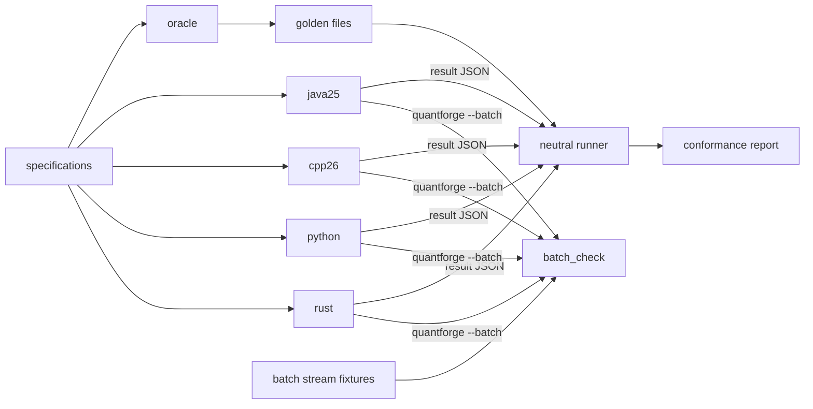

From R1 (contract 1.6.0), batch mode is checked on its own: `datasets/batch/streams.json` feeds `conformance/runner/batch_check.py`, apart from the goldens.

## Domain dependencies

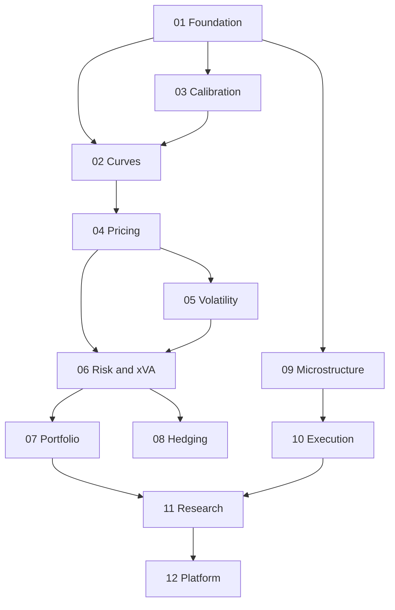

Domain 11 has CLI operations from stage J wave 1 (backtester, purged CV, Viterbi regimes, research statistics). Its `research` module in each build uses only domain 01; the arrows from 07 and 10 are where studies will take their inputs, not code dependencies.

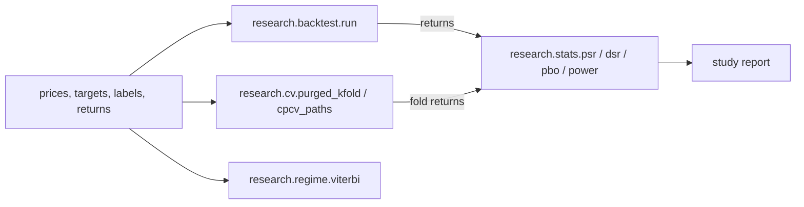

## Data flow

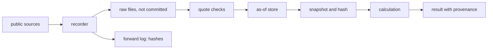

## R1 scheduled jobs

GitHub Actions, free runners, no secrets beyond `GITHUB_TOKEN`. Raw data stays on the runner.

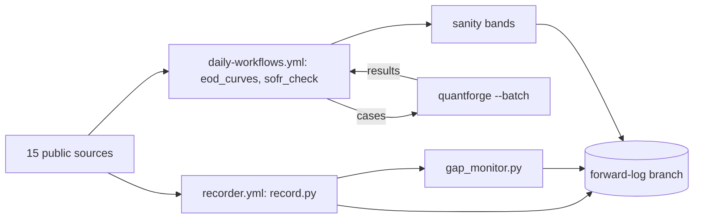

## Curve lifecycle

What stage B builds. Each step is one call to the CLI on the inputs it is given, and nothing is stored between calls. A solve that fails is an error, never a clamped curve.

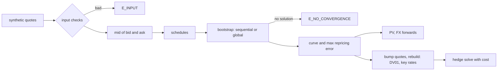

The target for later stages, not built yet: quotes pass the data checks, are frozen in a hashed snapshot, and a curve is published only if its inputs reprice.

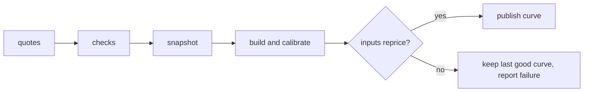

## Valuation parts

The five parts of `specifications/04-pricing/pricing-framework.md`.

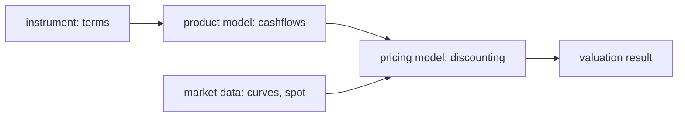

## Conformance flow

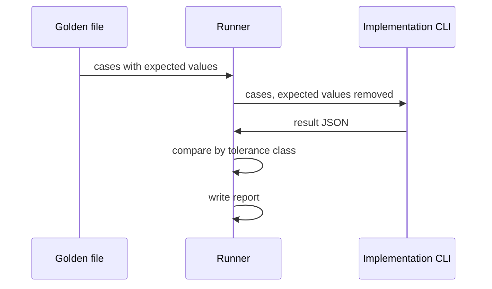

## Stage E: volatility and exotics

Plain idea: stage E builds on the stage D curves and pricers rather than beside them. Each box names its slice and spec page; the goldens for spec A live in `datasets/golden/stage_e/` (446 cases) and for spec B in `datasets/golden/stage_e_b/` (449 cases).

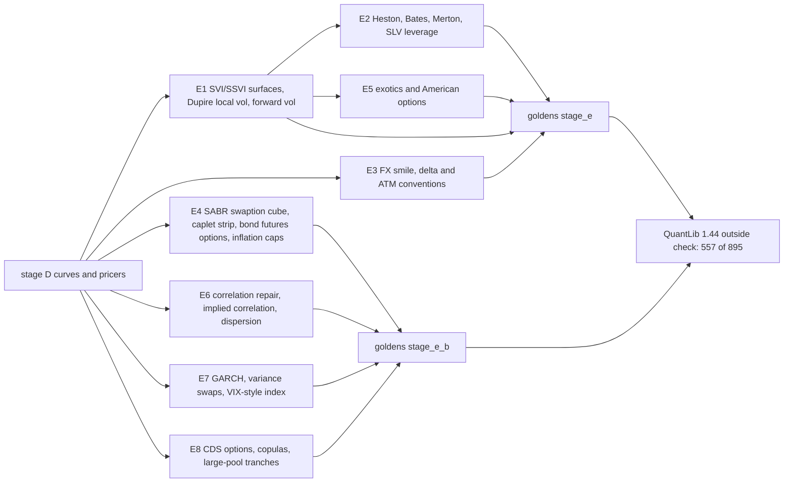

## Stage F: from quotes to capital and the book

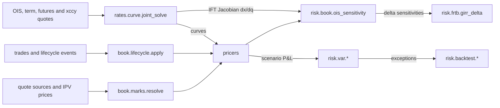

The joint solve feeds both the prices and the Jacobian that AAD carries back to the quotes (ruling F-29). VaR and the backtests work on P&L scenarios; FRTB-SA works on sensitivities. Specs: `02-curves/joint-solve-and-funding.md`, `06-risk/book-sensitivities.md`, `06-risk/var-es-and-backtests.md`, `06-risk/frtb-sa-girr.md`, `07-portfolio/book-lifecycle.md`.

## Stage I: hedging around one solver

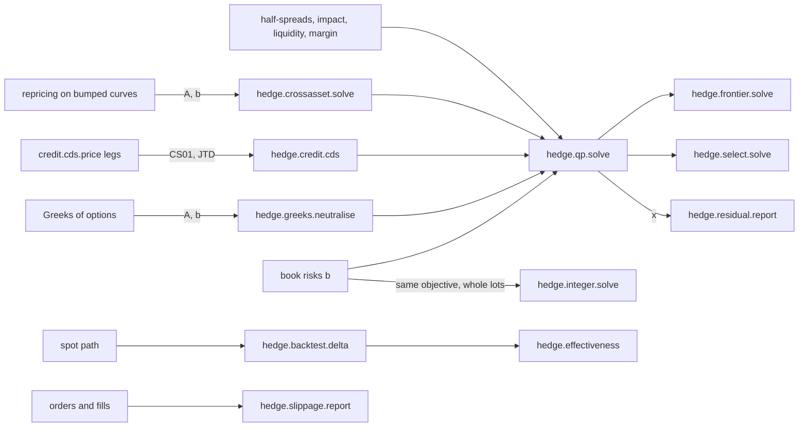

Every hedge that builds a risk matrix passes it to one constrained least-squares solve; the frontier and instrument selection call that solve repeatedly. The checks run in a fixed order, so a bad problem returns the same error code in every build (rulings I-3, I-14). Costs are solved by sign state (long, short or held at zero), with no cap below 200 instruments in the method (I-48), though at v0.8.0 no golden was larger than 6 by 4 (R6-6 adds n = 50 and 200) and exact answers at a switch point (I-54). Specs: `08-hedging/hedge-solvers.md`, `credit-and-correlation-hedges.md`, `cross-asset-hedge.md`, `hedge-costs-and-frontier.md`, `instrument-selection.md`, `dynamic-hedge-and-effectiveness.md`, `hedge-slippage.md`.

## Stage J: research tools

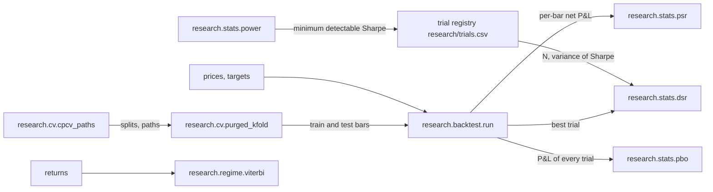

A study fixes its power and trial count first, backtests each trial with costs and a lag, and reports DSR and PBO beside the Sharpe ratio (plan 11.3). Regime labels describe the sample and never feed a signal (spec limitation). Specs: `11-research/backtester.md`, `purged-cv.md`, `regimes.md`, `research-statistics.md`. Worked through in [Tutorial 23](../getting-started/tutorial-23-backtest-honestly.md), [Tutorial 24](../getting-started/tutorial-24-is-the-sharpe-real.md) and the gallery page [Research workflow](../curves/research-workflow.md).

### Backtest timing: signal at t, trade at t + lag, P&L on the bar after

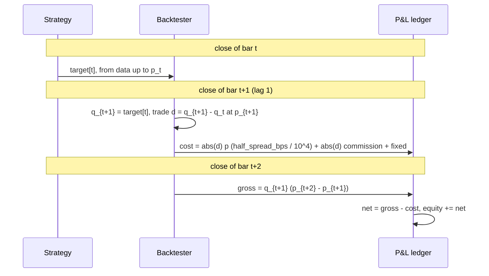

The position that earns a bar's move is the one held before that bar's trade (ruling J-2). A rule computed from `p_t` and traded at `p_t` (lag 0) earns moves it could not have known; the canary in Tutorial 23 makes 21 at lag 0 and loses 10 at lag 1 on the same twelve prices.

### Purged k-fold with an embargo

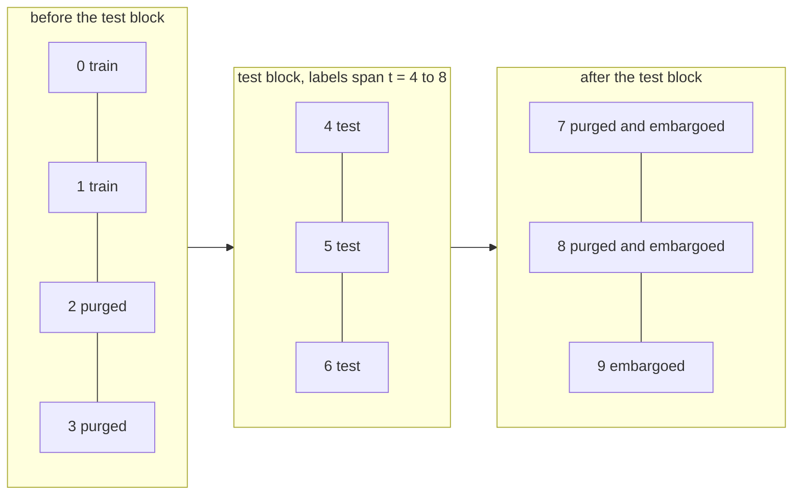

Purging works on both sides of the block and removes any training row whose label window `[t0, t1]` touches the test span; the embargo, `floor(embargo_pct n)` rows, works only after it, where serial correlation carries information forward (rulings J-7, J-8). Numbers from Tutorial 23, `t1 = t0 + 2`, embargo 0.3.

### Combinatorial purged CV: splits to paths

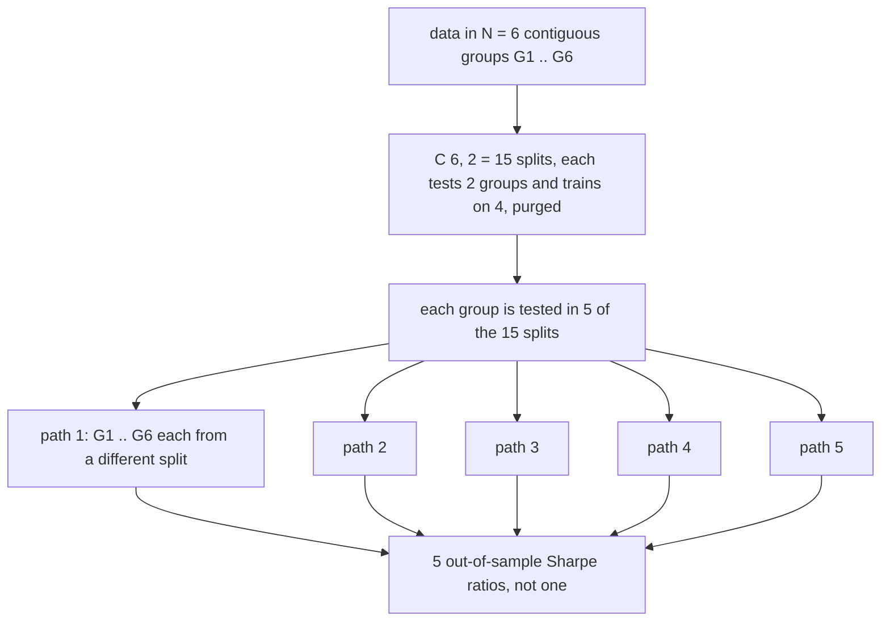

`n_splits = C(N, k)` and `n_paths = k C(N, k) / N`, an integer because `k C(N, k) = N C(N-1, k-1)` (`research.cv.cpcv_paths`; López de Prado 2018, section 12.4). The operation returns the counts; assigning splits to paths is left to the research package.

### Portfolio pipeline

```mermaid
flowchart LR
  accTitle: Stage J wave 2 portfolio pipeline, from returns to a tested risk model
  accDescr: Returns go into Ledoit-Wolf, which gives a shrunk covariance. The covariance and market weights give the prior returns, which Black-Litterman moves towards the investor's views. Mean-variance takes the posterior returns, the covariance and the weight limits and gives weights; risk parity takes the covariance and risk budgets instead and ignores expected returns. Euler contributions split either portfolio's volatility by asset. After the portfolio has been held, its realised losses and the model's VaR and ES forecasts go into the Z2 backtest, and a Baum-Welch fit describes the calm and turbulent regimes of the same period.
  R[returns T x N] --> LW[research.estimate.ledoit_wolf: shrunk Sigma]
  LW --> PI[prior pi = delta Sigma w_mkt, caller]
  PI --> BL[research.estimate.black_litterman: views P, q, Omega]
  BL --> MV[research.portfolio.mean_variance: weights within limits]
  LW --> MV
  LW --> RP[research.portfolio.risk_parity: weights from risk budgets]
  MV --> EU[risk.contrib.euler: volatility by asset]
  RP --> EU
  EU --> H[hold, record losses and VaR, ES forecasts]
  H --> Z2[risk.backtest.es_z2: tail size tested]
  H --> BW[research.regime.baum_welch: regimes of the period]
```

Estimate, optimise, look at where the risk sits, then test the risk model on what happened. Every arrow is an input the caller passes; no operation calls another, so each step can be replaced or checked on its own. The prior `pi` is computed by the caller, as in [Tutorial 25](../getting-started/tutorial-25-build-and-stress-a-portfolio.md); the Z2 and Baum-Welch steps are in [Tutorial 26](../getting-started/tutorial-26-test-es-and-fit-regimes.md). Specs: `07-portfolio/estimation.md`, `07-portfolio/optimisation.md`, `06-risk/es-backtest.md`, `11-research/baum-welch.md` (rulings J-W2-1 to J-W2-15).

### Baum-Welch: the EM loop and its stop rule

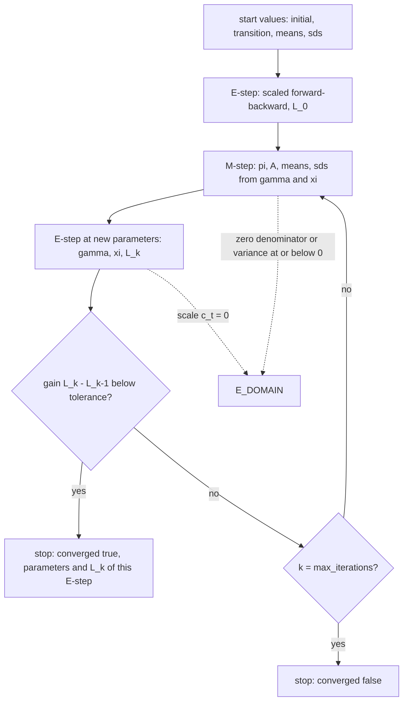

One iteration is an M-step followed by an E-step, and the outputs are the parameters and log-likelihood of the last E-step (ruling J-W2-11). The likelihood never falls [Rab89, DLR77], so gains shrink towards zero; each golden's tolerance sits at least `1e-11` from every gain it tests, so all four builds stop at the same iteration (J-W2-12). In Tutorial 26 a two-state fit on 24 returns stops after iteration 7 with tolerance `1e-6`, and after iteration 3, not converged, with `max_iterations` 3.

### A study's order of work: power and trials before results

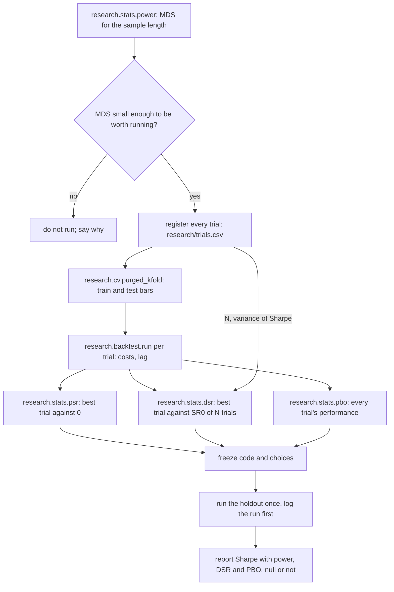

The arrows run one way: nothing computed from the holdout goes back into the choices. This is the order the R3 studies followed (freeze `faadaa4`, run log committed first, one run each; `research/r3/RESULTS.md`), and it is why their null results can be reported at all. [Tutorial 30](../getting-started/tutorial-30-trials-and-power.md) does the power and trial arithmetic; [Tutorial 31](../getting-started/tutorial-31-leakage-and-purging.md) the purging.

### Net P&L against the half spread: the break-even point

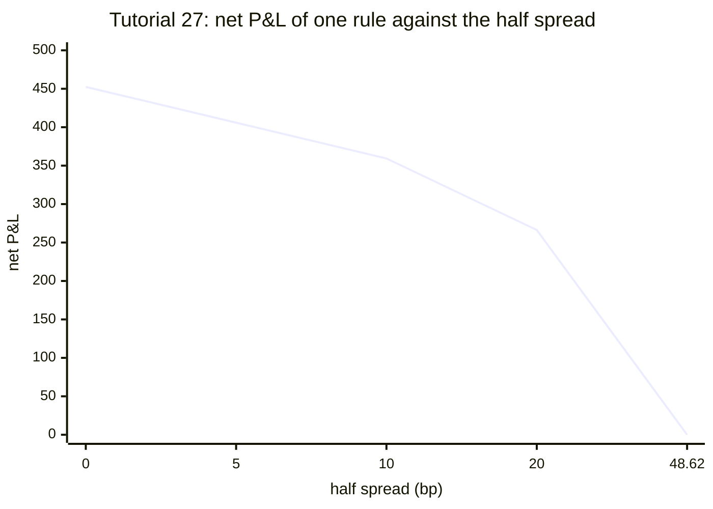

Spread cost is turnover times the half spread over `10^4`, and nothing else in `research.backtest.run` depends on it, so net P&L is a straight line with slope `-turnover / 10^4` (here -9.31 per basis point) and the break-even half spread follows from one costless run: `(461.73 - 9.30) / 9.3056 = 48.62` bp. The points are the printed output of [Tutorial 27](../getting-started/tutorial-27-what-costs-do-to-a-backtest.md); the x-axis is categorical, so the spacing is not to scale.

### Black-Litterman view confidence: one view, five variances

```mermaid
flowchart LR
  accTitle: How the variance of one Black-Litterman view sets the posterior
  accDescr: The prior spread between assets 1 and 2 is 0.038 and the view says 0.08. The prior's variance along the view is 0.0019. The view's weight c is 0.0019 divided by 0.0019 plus Omega. Omega of 1e-8 gives c close to 1 and a posterior spread of 0.08; Omega 0.0002 gives c 0.905 and 0.076; Omega 0.0019 gives c one half and 0.059; Omega 0.019 gives c 0.091 and 0.0418; Omega 1 gives c close to 0 and 0.0381.
  PR[prior spread P pi = 0.038] --> C["c = 0.0019 / (0.0019 + Omega)"]
  V[view q = 0.08, variance Omega] --> C
  C --> O1["Omega 1e-8: c = 1.000, spread 0.0800"]
  C --> O2["Omega 0.0002: c = 0.905, spread 0.0760"]
  C --> O3["Omega 0.0019: c = 0.500, spread 0.0590"]
  C --> O4["Omega 0.019: c = 0.091, spread 0.0418"]
  C --> O5["Omega 1: c = 0.002, spread 0.0381"]
```

The posterior spread is `0.038 + c x 0.042` in every case ([Tutorial 29](../getting-started/tutorial-29-view-confidence.md)); only `Omega / tau` matters for the mean (ruling J-W2-8, `07-portfolio/estimation.md`).

### Purging cost against label horizon

```mermaid
xychart-beta
  accTitle: Training rows kept against label horizon, Tutorial 31
  accDescr: In a middle fold of 100 rows split five ways, purging keeps 80 training rows for a horizon of 0 bars, 70 for 5 bars and 40 for 20 bars.
  title "Tutorial 31: training rows kept in a middle fold, 100 rows, 5 folds"
  x-axis "label horizon (bars)" [0, 5, 20]
  y-axis "training rows kept" 0 --> 80
  bar [80, 70, 40]
```

A middle test block loses about `h` rows on each side to purging, so with 100 rows in five folds a 20-bar horizon leaves 40 training rows of 80. Plain k-fold would keep all 80 and let 160 overlapping labels leak across the five folds ([Tutorial 31](../getting-started/tutorial-31-leakage-and-purging.md); rulings J-7 to J-9).

### Historical shock replay: from a stored move to book P&L

```mermaid
flowchart LR
  accTitle: How a stored historical shock becomes book P&L
  accDescr: A shock of 10, 50 and 20 basis points at 1, 5 and 30 years is interpolated linearly in tenor onto the book tenors 2 and 10 years, giving 20 and 44 basis points. The shocked yields are the old yields plus the applied move over 100. With DV01s of 1,000 and 2,000 per basis point the P&L is minus 1,000 times 20 minus 2,000 times 44, which is minus 108,000.
  S["shock: 1Y 10 bp, 5Y 50 bp, 30Y 20 bp"] --> I["linear in tenor, flat outside (J-W3-4)"]
  I --> A["applied: 2Y 20 bp, 10Y 44 bp"]
  A --> Y["shocked yields = yield + applied / 100"]
  A --> P["pnl = -(1,000 x 20 + 2,000 x 44) = -108,000"]
```

The worked example of `risk.scenario.replay` (`examples/risk_scenario_replay_j.json`, `06-risk/scenario-stress.md`). Tutorial 33 replays the 2008, 2013, 2020 and 2022 Treasury moves from the shock library the same way.

### Drift detectors on a mean shift: CUSUM against Page-Hinkley

```mermaid
xychart-beta
  accTitle: Alarm days of CUSUM and Page-Hinkley after a shift at day 60, Tutorial 33
  accDescr: A ten-day pattern with mean 0 shifts up by 1.5 at day 60. CUSUM with k 0.5 and h 5 alarms on days 64, 70, 76, 82 and 88, five alarms. Page-Hinkley with delta 0.5 and lambda 5 alarms once, on day 64.
  title "Tutorial 33: alarms after a +1.5 shift at day 60"
  x-axis "detector" ["CUSUM", "Page-Hinkley"]
  y-axis "alarms by day 89" 0 --> 6
  bar [5, 1]
```

Both alarm first on day 64, a delay of four days. CUSUM measures against a fixed `mu0`, so after each restart the shift is still there and it alarms every six days (64, 70, 76, 82, 88); Page-Hinkley measures against its own running mean, which absorbs the new level after the restart (J-W3-10, J-W3-11; [Tutorial 33](../getting-started/tutorial-33-stress-test-and-watch-for-drift.md)). Count the first alarm after a break, not the alarms.
### Term financing: from quotes to an equity forward

```mermaid
flowchart LR
  accTitle: How term repo and borrow quotes become an equity forward
  accDescr: Each term repo quote and the funding curve give one pillar of the financing spread S. Borrow quotes give the cumulative fee B. The carry factor C of t is exp of minus Z t minus S plus B, and the forward is spot less dividends carried by C, divided by C at the horizon.
  Q["term repo quotes R_i at T_i"] --> S["S(T_i) = ln(1 + R_i T_i) - Z(T_i) T_i, linear between pillars"]
  Z["funding curve Z(t)"] --> S
  B["borrow quotes b_j"] --> BF["B(T_j) = b_j T_j, never falling"]
  S --> C["C(t) = exp(-Z(t) t - S(t) + B(t))"]
  BF --> C
  C --> F["F = (S_0 - sum A_i C(t_i)) / C(T)"]
```

Flat 4 % funding and one 5 % one-year repo give `S(1) = ln 1.05 - 0.04 = 0.00879`, and spot 100 carries to exactly 105 ([Tutorial 34](../getting-started/tutorial-34-financing-term-structure.md), ruling J-C-5).

### Liquidity cost: impact against timing risk

```mermaid
flowchart LR
  accTitle: The three parts of the liquidity cost curve and the optimal horizon
  accDescr: Cost per unit is the half spread plus impact, which falls as the horizon h grows, plus timing risk, which rises with h. Their sum has a minimum at h star equal to two delta a over b, to the power one over delta plus one half.
  H[horizon h days] --> I["impact a h^-delta, a = Y sigma (Q/V)^delta"]
  H --> T["timing risk b sqrt h, b = z sigma / sqrt 3"]
  I --> C["c(Q, h) = s + a h^-delta + b sqrt h"]
  T --> C
  SP[half spread s] --> C
  C --> HS["h* = (2 delta a / b)^(1/(delta + 1/2))"]
```

For 1,000,000 shares against a 10 million daily volume, `sigma` 2 %, `z = 1.645`, the cheapest horizon is 0.3330 days at 224 bp ([Tutorial 35](../getting-started/tutorial-35-liquidity-curve.md), ruling J-C-8).

## Stage H: execution and microstructure (planned, v0.10.0)

The operations drawn here are specified (spec version 0.1.0, confirmed 2026-11-18) but not merged; the boxes name the operations as the specs fix them. Simulated parts are drawn with dashed borders; real recorded data with a solid border. Specs: `specifications/09-microstructure/` and `specifications/10-execution/`.

### Order lifecycle

```mermaid
flowchart LR
  accTitle: Order lifecycle from parent order to cost analysis
  accDescr: A parent order is cut into child orders by a schedule, TWAP, VWAP or POV, or by an Almgren-Chriss trajectory. A router splits each child across simulated venues, a lit engine and a dark pool. Their fills go to implementation shortfall analysis, which compares them with the decision, arrival and end prices.
  PO[parent order X, side, decision price] --> SCH["exec.schedule.twap / vwap / pov<br/>exec.ac.trajectory"]
  SCH -->|child slices| SOR["exec.sor.allocate"]
  SOR -->|market and limit lots| LIT["exec.sim.lit.run"]
  SOR -->|dark lots| DARK["exec.sim.dark.run"]
  LIT -->|fills| TCA["exec.tca.shortfall"]
  DARK -->|fills| TCA
  LIT -.->|lit mid| DARK
  classDef sim stroke-dasharray: 5 5
  class SOR,LIT,DARK sim
```

Each step has one owner: the schedule and trajectory operations decide how much to trade when, the router decides where, the simulated venues decide what fills, and `exec.tca.shortfall` measures the cost afterwards. Worked through in [Tutorial 36](../getting-started/tutorial-36-slice-an-order.md) to [Tutorial 38](../getting-started/tutorial-38-implementation-shortfall.md).

### Matching engine state

```mermaid
flowchart TB
  accTitle: Lit matching engine book state and order handling
  accDescr: Each side of the book holds price levels; each level holds a first-in first-out queue of orders. An incoming order trades against the best opposite level while it is marketable, at the resting order's price, displayed orders first by arrival, then pegged hidden orders, then iceberg hidden quantity. What is left rests, is cancelled, or is rejected according to its type.
  IN[incoming order] --> M{marketable?}
  M -->|yes| T["trade at resting price<br/>displayed by seq, then PEG_MID, then iceberg hidden"]
  T --> M
  M -->|no, LIMIT or ICEBERG or PEG| R[rest at the back of its level's FIFO queue]
  M -->|no, IOC or MARKET| C[cancel the remainder]
  IN -->|FOK, not fully fillable| X1[reject: FOK_UNFILLABLE]
  IN -->|POST_ONLY that would cross| X2[reject: POST_ONLY_WOULD_CROSS]
  subgraph Book["book, one instrument, integer ticks"]
    B1["bid level p: order seq 3, seq 7, seq 9"]
    A1["ask level p + 1: order seq 2, seq 5"]
  end
  R --> Book
```

Price-time priority: best price first, then arrival order (`seq`) within a price. A quantity decrease keeps `seq`; a price change or increase takes a new one; an iceberg refresh joins the back of the queue (rulings HR-25 to HR-28, after CME's FIFO steps). Every output is labelled "simulated venue; not a real exchange". Spec: `10-execution/lit-matching.md`.

### Simulated venue topology

```mermaid
flowchart LR
  accTitle: Simulated venues and the one real data source
  accDescr: The recorded Kraken book is the only real data. It can supply a reference mid to the simulated dark pool. Two simulated lit engines with different fees and one simulated dark pool form the multi-venue world in which the router is scored, driven by planted order flow from a seeded random number generator. A fill simulator for passive orders sits beside the lit engines.
  KR["Kraken L2 book, recorded<br/>crypto venue; not equities or rates"]
  FLOW["planted order flow<br/>core.rng, fixed seed"]
  L1["lit engine A"]
  L2["lit engine B, other fees"]
  DP["dark pool"]
  FS["queue fill model<br/>Cont-Stoikov-Talreja"]
  RT["router exec.sor.allocate"]
  FLOW --> L1 & L2 & DP
  KR -.->|lit mid, labelled| DP
  L1 & L2 --> FS
  RT --> L1 & L2 & DP
  classDef sim stroke-dasharray: 5 5
  class FLOW,L1,L2,DP,FS,RT sim
```

Only the Kraken box is real data, and it is a single lit venue: it is never routed across. The router comparison against single-venue routing is a result inside this simulated world (ruling HR-40). See [Simulators](../simulators/README.md).

### Shortfall decomposition

```mermaid
flowchart LR
  accTitle: Implementation shortfall from decision price to end price
  accDescr: The decision price is set when the order is decided. Delay cost is the move from decision to arrival on the filled quantity. Execution cost is the fills against the arrival price. Opportunity cost is the unfilled quantity times the move from decision to end price. Fees are added. The four parts sum to the total.
  PD["decision price P_d"] -->|delay = s Q (P_0 - P_d)| P0["arrival price P_0"]
  P0 -->|execution = s sum q_i (p_i - P_0)| F["fills (q_i, p_i)"]
  PD -->|opportunity = s (X - Q)(P_c - P_d)| PC["end price P_c"]
  F --> TOT["total = delay + execution + opportunity + fees"]
  PC --> TOT
```

For a buy of 1,000 with 800 filled, delay 80, execution 100, opportunity 200 and fees 5 give a total of 385, 38.5 bp (golden `tca_h-0001`, [Tutorial 38](../getting-started/tutorial-38-implementation-shortfall.md), ruling HR-8).

### AC frontier: cost against variance

```mermaid
flowchart LR
  accTitle: Almgren-Chriss frontier, two points from the goldens
  accDescr: At zero risk aversion the straight-line schedule has expected cost 662,500 and variance 1.083e12. At risk aversion 1e-6 the sinh schedule has expected cost 911,227 and variance 3.641e11. Raising risk aversion moves along the frontier towards lower variance and higher cost.
  A["lambda = 0, straight line (TWAP)<br/>E = 662,500, V = 1.083e12"] -->|raise lambda| B["lambda = 1e-6, sinh schedule<br/>E = 911,227, V = 3.641e11"]
  B -->|raise lambda further| C["towards selling at once<br/>higher E, lower V"]
```

The risk-neutral end of the frontier is the TWAP schedule (ruling HR-5). Values from goldens `ac_h-0001` and `ac_h-0002` on the paper's test parameters ([AC00] Table 1); see the [frontier page](../curves/ac-frontier.md).

### Simulator flow

```mermaid
flowchart LR
  accTitle: How a simulated venue turns inputs into labelled outputs
  accDescr: Inputs arrive as decimal strings: tick and lot sizes, events, fee schedule, and optionally a recorded book snapshot and a seed. They are converted to integer ticks and lots and sorted into a logical event sequence. The engine, lit, dark or router cost model, processes events one at a time, drawing any randomness from core.rng with the given seed. Outputs are converted back to decimal strings and every output gets the simulated label.
  IN["inputs as decimal strings<br/>tick, lot, events, fees"] --> INT["integer ticks and lots<br/>off-grid input is an error"]
  SNAP["recorded book snapshot, optional"] --> INT
  SEED["seed for core.rng"] --> ENG
  INT --> SEQ[logical event sequence]
  SEQ --> ENG["engine: exec.sim.lit.run, exec.sim.dark.run,<br/>or the exec.sor.allocate cost model"]
  ENG --> OUT["fills, rejects, book, fees<br/>as decimal strings"]
  OUT --> LBL["label on every output<br/>simulated venue; not a real exchange"]
  classDef sim stroke-dasharray: 5 5
  class INT,SEQ,ENG,OUT sim
```

The same inputs and seed give byte-identical outputs in every language; that is what lets paper trading replay a venue's goldens through its own path (test A7). Specs: `10-execution/lit-matching.md`, `dark-pool.md`, `smart-order-router.md`.

### Paper-trading ledger flow

```mermaid
flowchart TB
  accTitle: Paper trading from order to ledger and daily explain
  accDescr: An order first meets the deterministic pre-trade check. A rejection is written to the ledger as a REJECT record. An accepted order is written as ORDER and sent to a simulated venue seeded with the recorded book snapshot. Fills update the book's positions and cash and are written as FILL records; remainders are written as CANCEL. When the order is final, a TCA record is written. At the end of the day the book is marked to the close, financing is posted, and an EOD record carries the P&L explain. Every record carries the hash of the record before it.
  O[order, mode simulated] --> PT{"pre-trade check<br/>HR-49, eight checks"}
  PT -->|rejected| R[REJECT record]
  PT -->|accepted| OR[ORDER record]
  OR --> V["simulated venue<br/>LIT, DARK or SOR"]
  SN["recorded snapshot at order time"] -.-> V
  V -->|fills| B["book: positions, average cost, cash"]
  V -->|fills| F[FILL records]
  V -->|IOC or close remainder| C[CANCEL record]
  F --> T["TCA record<br/>exec.tca.shortfall"]
  B --> E["EOD record<br/>market + trading + fees + financing = NAV change"]
  R & OR & F & C & T & E --> L[("ledger, JSON Lines<br/>each record hashes the one before")]
  classDef sim stroke-dasharray: 5 5
  class V sim
```

Only the snapshot is real data, and it is read, never traded against. The ledger lives in the `forward-log` branch, not `main` (HR-46). The book, explain, checks and ledger are on `stage-h2`; the venue fill path is available from v0.10.0. Worked through in [Tutorial 44](../getting-started/tutorial-44-paper-trading.md). Spec: `10-execution/paper-trading.md`.

### Order lifecycle in paper trading

```mermaid
stateDiagram-v2
  accTitle: States of a paper order
  accDescr: A new order is either rejected by the pre-trade check or accepted as NEW. A NEW order can be partially filled, filled, or cancelled. A partially filled order can fill further, become filled, or have its remainder cancelled, either at once for IOC or at the daily close for a resting order.
  [*] --> REJECTED: pre-trade check fails
  [*] --> NEW: accepted
  NEW --> PARTIALLY_FILLED: fill below quantity
  NEW --> FILLED: fill for the whole quantity
  NEW --> CANCELED: IOC with no fill, or daily close
  PARTIALLY_FILLED --> PARTIALLY_FILLED: further fill
  PARTIALLY_FILLED --> FILLED: last fill
  PARTIALLY_FILLED --> CANCELED: IOC remainder, or daily close (HR-48)
  FILLED --> [*]
  CANCELED --> [*]
  REJECTED --> [*]
```

State names follow the FIX 4.4 ExecutionReport vocabulary, recalled in the spec and used for names only. A fill above the remaining quantity is `E_INPUT`, so there is no overfilled state. Every final state writes one `TCA` record, except a rejection, which never reached a venue.

### Crypto data path: recorder to aggregate

```mermaid
flowchart LR
  accTitle: Crypto order book data path from recorder to published aggregate
  accDescr: The recorder subscribes to Kraken's public book at 100 levels and writes per-second snapshots with the venue checksum result, trades and gap rows to local files, never to git. The study first checks the recorded dates against the prereg holdout. The book rebuild counts checksum agreement, crossed books and gaps. The study then computes its statistics and publishes aggregates only, labelled crypto venue.
  WS["wss://ws.kraken.com/v2<br/>book depth 100, trades"] --> REC["tools/recorder/crypto_l2.py"]
  REC --> FILES["local gzip JSON lines, per symbol per hour<br/>snapshot + ok flag, trades, gap rows"]
  FILES --> HD{"dates outside the prereg holdout?"}
  HD -->|yes| RB["micro.book.rebuild<br/>checksum, crossed, gaps counted"]
  HD -->|no| STOP[not read]
  RB --> ST["study: impact proxy, walk-the-book"]
  ST --> AG["aggregates only<br/>crypto venue; not equities or rates"]
```

The crypto files carry no hash chain yet; integrity rests on the per-row checksum flag and the gap rows ([Recorded feeds](../data/recorded-feeds.md)). Raw messages exist for one 14-minute sample only (ruling HR-11).
