# Diagrams

Mermaid, which GitHub draws directly and the site draws in its light or dark theme. The stage G, H and J diagrams and the per-domain flows carry a title and a description for screen readers (`accTitle`, `accDescr`), and the paragraph under each says the same in words. One flow per domain, 01 to 12, is in [Per-domain flows](#per-domain-flows) at the end of this page (added in stage K, plan 14.5); the stage sections show how each stage's operations fit together.

## System

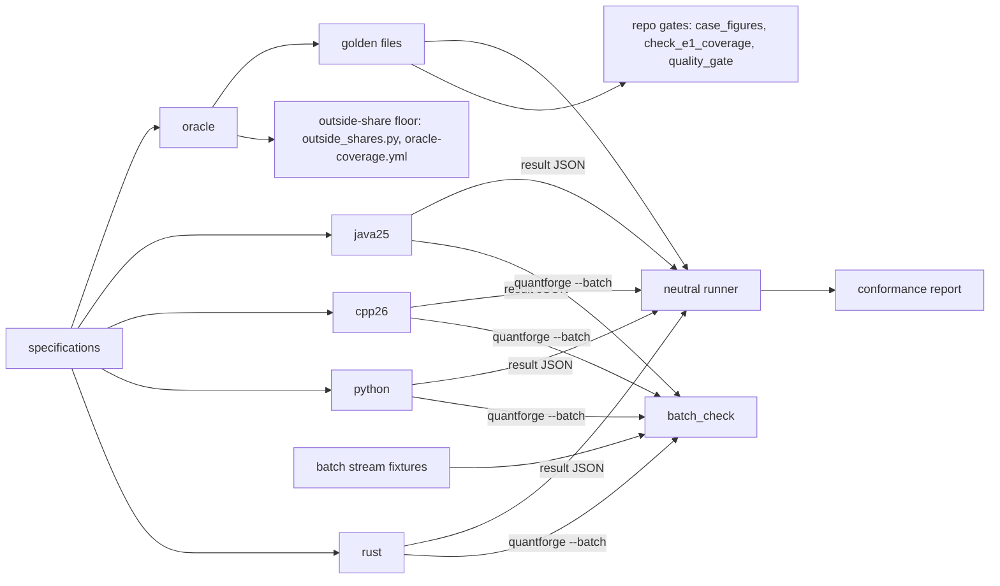

From R1 (contract 1.6.0), batch mode is checked on its own: `datasets/batch/streams.json` feeds `conformance/runner/batch_check.py`, apart from the goldens. The gates on the right are CI checks on the golden set and the oracle, not on any build: `repo-gates.yml` runs `tools/case_figures.py --check` (case totals by class), `tools/check_e1_coverage.py` (every operation with a Real input has a non-finite-input golden) and `tools/quality_gate.py`; `tools/outside_shares.py` and `oracle-coverage.yml` hold the 60% outside-library floor on value-checked cases (`oracle/OUTSIDE_SHARES.md`).

## Domain dependencies

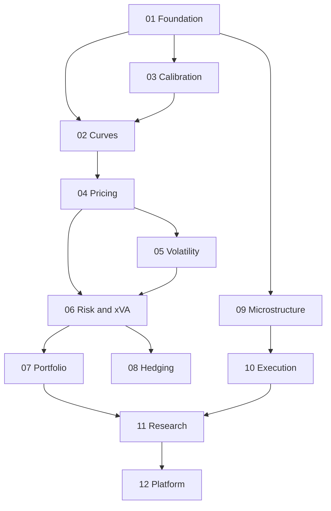

Domain 11 has CLI operations from stage J wave 1 (backtester, purged CV, Viterbi regimes, research statistics). Its `research` module in each build uses only domain 01; the arrows from 07 and 10 are where studies will take their inputs, not code dependencies.

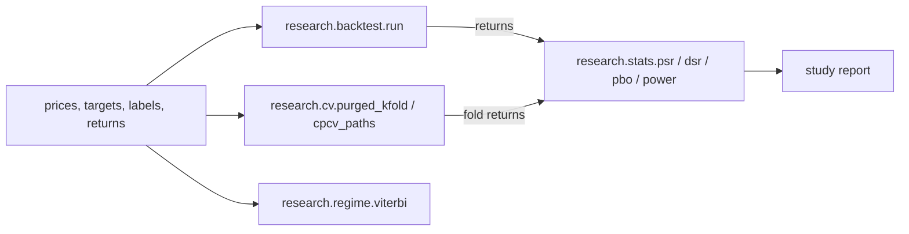

## Data flow

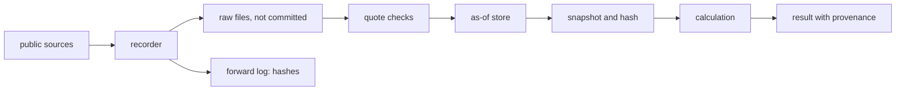

## R1 scheduled jobs

GitHub Actions, free runners, no secrets beyond `GITHUB_TOKEN`. Raw data stays on the runner.

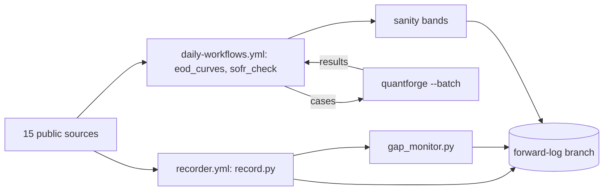

## Curve lifecycle

What stage B builds. Each step is one call to the CLI on the inputs it is given, and nothing is stored between calls. A solve that fails is an error, never a clamped curve.

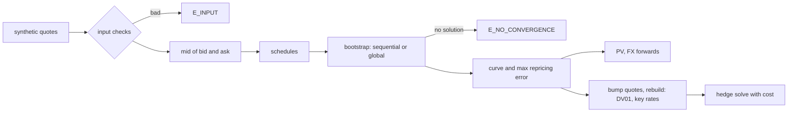

The target for later stages, not built yet: quotes pass the data checks, are frozen in a hashed snapshot, and a curve is published only if its inputs reprice.

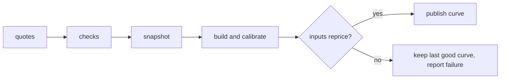

## Valuation parts

The five parts of `specifications/04-pricing/pricing-framework.md`.

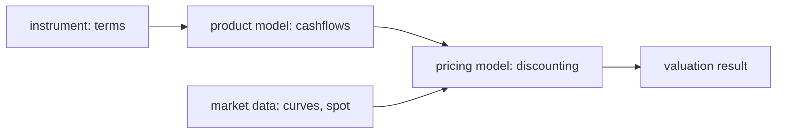

## Conformance flow

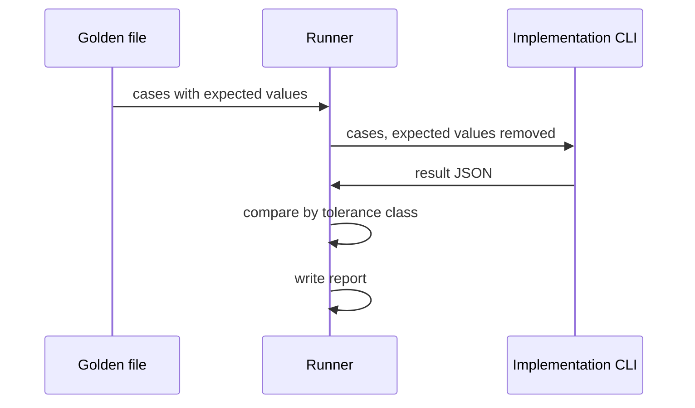

## Stage E: volatility and exotics

Plain idea: stage E builds on the stage D curves and pricers rather than beside them. Each box names its slice and spec page; the goldens for spec A live in `datasets/golden/stage_e/` (446 cases) and for spec B in `datasets/golden/stage_e_b/` (449 cases).

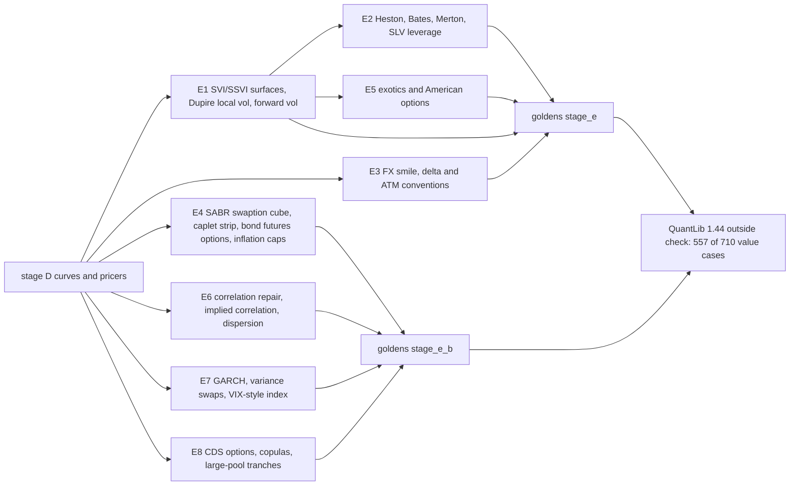

## Stage F: from quotes to capital and the book

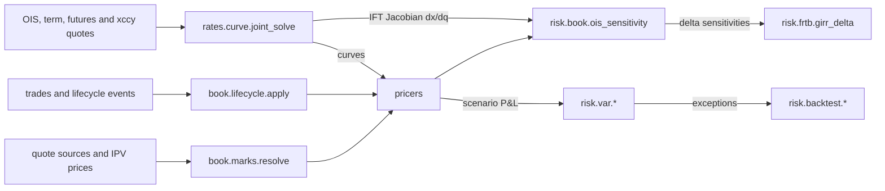

The joint solve feeds both the prices and the Jacobian that AAD carries back to the quotes (ruling F-29). VaR and the backtests work on P&L scenarios; FRTB-SA works on sensitivities. Specs: `02-curves/joint-solve-and-funding.md`, `06-risk/book-sensitivities.md`, `06-risk/var-es-and-backtests.md`, `06-risk/frtb-sa-girr.md`, `07-portfolio/book-lifecycle.md`.

## Stage G: rates models and xVA

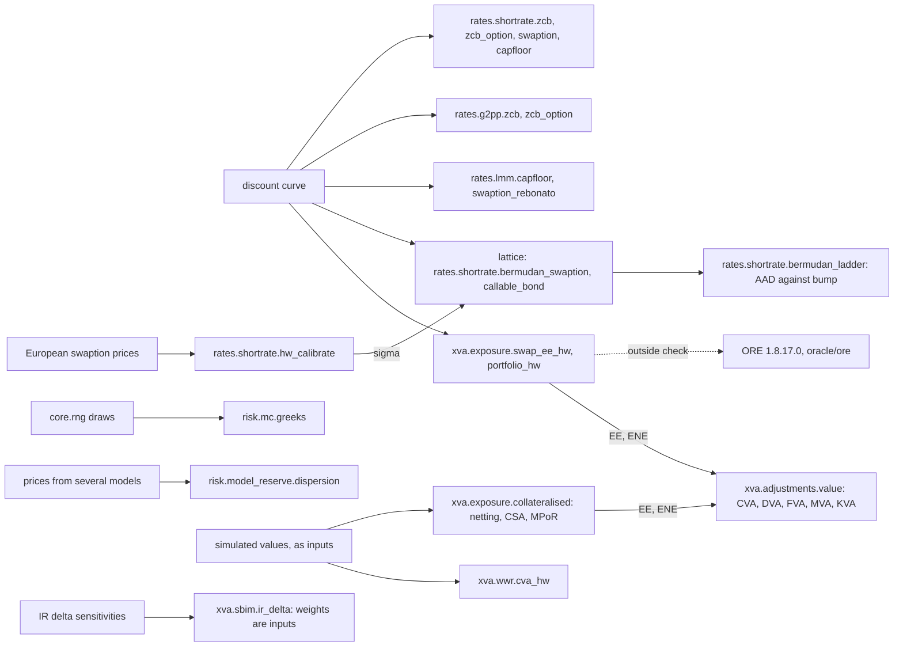

Plain idea: stage G prices rates options under term-structure models, then turns exposure into valuation adjustments. Exposure is computed first and the adjustments are pure arithmetic on exposure profiles, discount factors and hazard rates, so CVA, DVA and FVA can be checked exactly without a simulation (`xva-framework.md`). Short-rate models and G2++ are in `04-pricing/short-rate-models.md`, the LMM in `04-pricing/lmm.md`; `rates.shortrate.hw_calibrate` fits `sigma` to European swaption prices with `a` fixed (ruling G-17), and the Bermudan swaption and callable bond run on one lattice scheme (G-18). The AAD ladder differentiates the discrete scheme at the case's grid and is checked against a Richardson bump reference (`06-risk/aad-core.md`, G-9); it is not for hedging at the default grid. `risk.mc.greeks` (pathwise, likelihood ratio, smoothed digitals) and the model-reserve dispersion report are in `mc-greeks.md` and `model-reserve.md`. Portfolio exposure is exact one-factor integration, and ORE's Monte Carlo is the outside check, kept under `oracle/ore/` and never read by a build (`xva-exposure-portfolio.md`, G-42). Collateral follows a CSA with thresholds, minimum transfer amount and a lag of `mpor_steps` (G-40). The sensitivity-based margin uses risk weights and correlations given as inputs; its goldens use placeholder weights from a stated rule (G-43, KR-150); wrong-way CVA uses the Hull-White hazard `exp(a(t) + b V(t))` (G-44). Every input is synthetic.

## Stage I: hedging around one solver

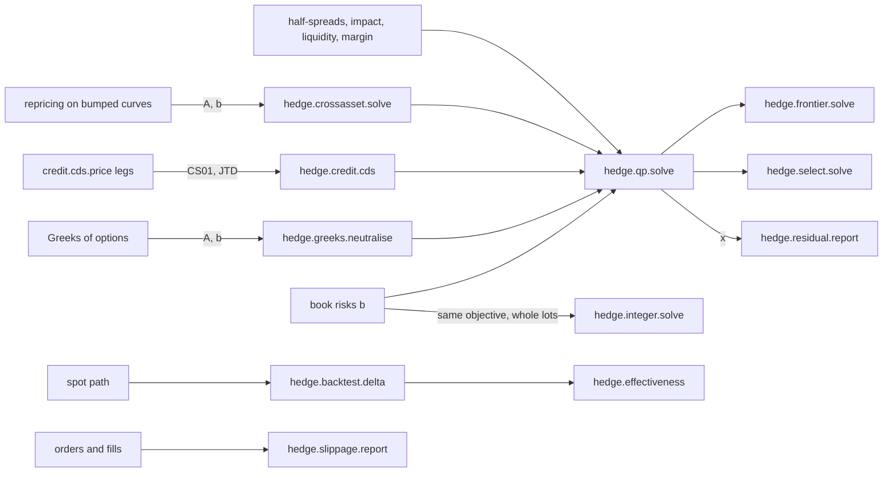

Every hedge that builds a risk matrix passes it to one constrained least-squares solve; the frontier and instrument selection call that solve repeatedly. The checks run in a fixed order, so a bad problem returns the same error code in every build (rulings I-3, I-14). Costs are solved by sign state (long, short or held at zero), with no cap below 200 instruments in the method (I-48), though at v0.8.0 no golden was larger than 6 by 4 (R6-6 adds n = 50 and 200) and exact answers at a switch point (I-54). Specs: `08-hedging/hedge-solvers.md`, `credit-and-correlation-hedges.md`, `cross-asset-hedge.md`, `hedge-costs-and-frontier.md`, `instrument-selection.md`, `dynamic-hedge-and-effectiveness.md`, `hedge-slippage.md`.

## Stage J: research tools

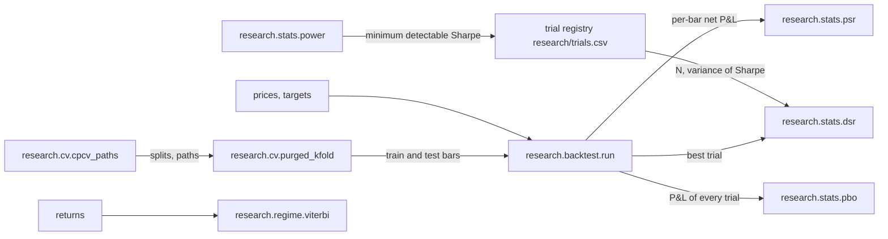

A study fixes its power and trial count first, backtests each trial with costs and a lag, and reports DSR and PBO beside the Sharpe ratio (plan 11.3). Regime labels describe the sample and never feed a signal (spec limitation). Specs: `11-research/backtester.md`, `purged-cv.md`, `regimes.md`, `research-statistics.md`. Worked through in [Tutorial 23](../getting-started/tutorial-23-backtest-honestly.md), [Tutorial 24](../getting-started/tutorial-24-is-the-sharpe-real.md) and the gallery page [Research workflow](../curves/research-workflow.md).

### Backtest timing: signal at t, trade at t + lag, P&L on the bar after

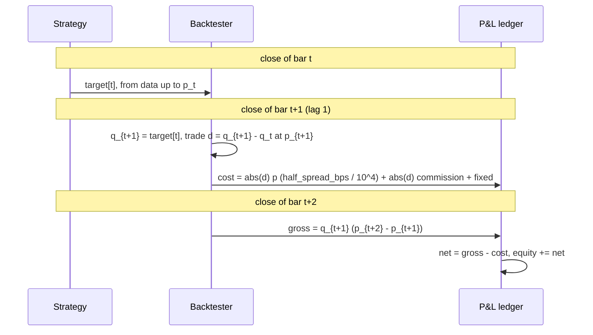

The position that earns a bar's move is the one held before that bar's trade (ruling J-2). A rule computed from `p_t` and traded at `p_t` (lag 0) earns moves it could not have known; the canary in Tutorial 23 makes 21 at lag 0 and loses 10 at lag 1 on the same twelve prices.

### Purged k-fold with an embargo

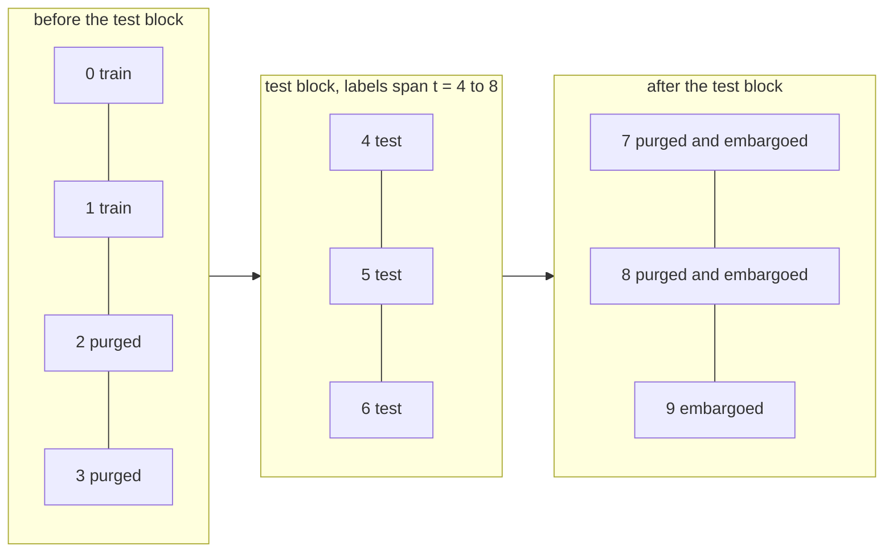

Purging works on both sides of the block and removes any training row whose label window `[t0, t1]` touches the test span; the embargo, `floor(embargo_pct n)` rows, works only after it, where serial correlation carries information forward (rulings J-7, J-8). Numbers from Tutorial 23, `t1 = t0 + 2`, embargo 0.3.

### Combinatorial purged CV: splits to paths

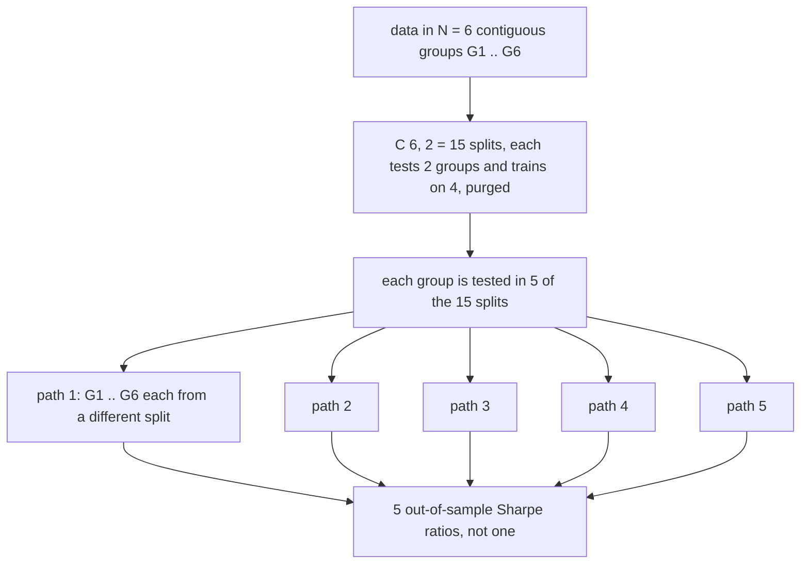

`n_splits = C(N, k)` and `n_paths = k C(N, k) / N`, an integer because `k C(N, k) = N C(N-1, k-1)` (`research.cv.cpcv_paths`; López de Prado 2018, section 12.4). The operation returns the counts; assigning splits to paths is left to the research package.

### Portfolio pipeline

```mermaid
flowchart LR
  accTitle: Stage J wave 2 portfolio pipeline, from returns to a tested risk model
  accDescr: Returns go into Ledoit-Wolf, which gives a shrunk covariance. The covariance and market weights give the prior returns, which Black-Litterman moves towards the investor's views. Mean-variance takes the posterior returns, the covariance and the weight limits and gives weights; risk parity takes the covariance and risk budgets instead and ignores expected returns. Euler contributions split either portfolio's volatility by asset. After the portfolio has been held, its realised losses and the model's VaR and ES forecasts go into the Z2 backtest, and a Baum-Welch fit describes the calm and turbulent regimes of the same period.
  R[returns T x N] --> LW[research.estimate.ledoit_wolf: shrunk Sigma]
  LW --> PI[prior pi = delta Sigma w_mkt, caller]
  PI --> BL[research.estimate.black_litterman: views P, q, Omega]
  BL --> MV[research.portfolio.mean_variance: weights within limits]
  LW --> MV
  LW --> RP[research.portfolio.risk_parity: weights from risk budgets]
  MV --> EU[risk.contrib.euler: volatility by asset]
  RP --> EU
  EU --> H[hold, record losses and VaR, ES forecasts]
  H --> Z2[risk.backtest.es_z2: tail size tested]
  H --> BW[research.regime.baum_welch: regimes of the period]
```

Estimate, optimise, look at where the risk sits, then test the risk model on what happened. Every arrow is an input the caller passes; no operation calls another, so each step can be replaced or checked on its own. The prior `pi` is computed by the caller, as in [Tutorial 25](../getting-started/tutorial-25-build-and-stress-a-portfolio.md); the Z2 and Baum-Welch steps are in [Tutorial 26](../getting-started/tutorial-26-test-es-and-fit-regimes.md). Specs: `07-portfolio/estimation.md`, `07-portfolio/optimisation.md`, `06-risk/es-backtest.md`, `11-research/baum-welch.md` (rulings J-W2-1 to J-W2-15).

### Baum-Welch: the EM loop and its stop rule

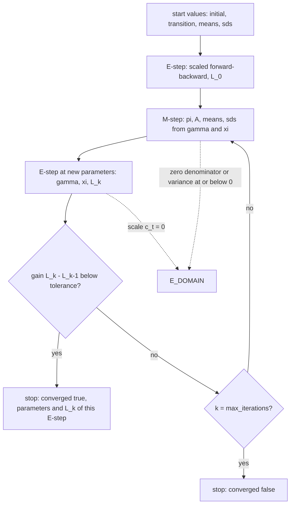

One iteration is an M-step followed by an E-step, and the outputs are the parameters and log-likelihood of the last E-step (ruling J-W2-11). The likelihood never falls [Rab89, DLR77], so gains shrink towards zero; each golden's tolerance sits at least `1e-11` from every gain it tests, so all four builds stop at the same iteration (J-W2-12). In Tutorial 26 a two-state fit on 24 returns stops after iteration 7 with tolerance `1e-6`, and after iteration 3, not converged, with `max_iterations` 3.

### A study's order of work: power and trials before results

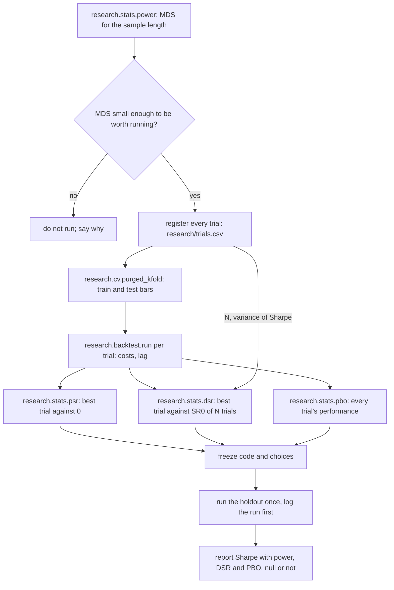

The arrows run one way: nothing computed from the holdout goes back into the choices. This is the order the R3 studies followed (freeze `faadaa4`, run log committed first, one run each; `research/r3/RESULTS.md`), and it is why their null results can be reported at all. [Tutorial 30](../getting-started/tutorial-30-trials-and-power.md) does the power and trial arithmetic; [Tutorial 31](../getting-started/tutorial-31-leakage-and-purging.md) the purging.

### Net P&L against the half spread: the break-even point

```mermaid
xychart-beta
  accTitle: Net P&L against half spread, Tutorial 27
  accDescr: Net P&L falls in a straight line from 452.43 at 0 bp to 405.91 at 5, 359.38 at 10, 266.32 at 20 and 0 at the break-even half spread of 48.62 bp.
  title "Tutorial 27: net P&L of one rule against the half spread"
  x-axis "half spread (bp)" [0, 5, 10, 20, 48.62]
  y-axis "net P&L" 0 --> 500
  line [452.43, 405.91, 359.38, 266.32, 0]
```

Spread cost is turnover times the half spread over `10^4`, and nothing else in `research.backtest.run` depends on it, so net P&L is a straight line with slope `-turnover / 10^4` (here -9.31 per basis point) and the break-even half spread follows from one costless run: `(461.73 - 9.30) / 9.3056 = 48.62` bp. The points are the printed output of [Tutorial 27](../getting-started/tutorial-27-what-costs-do-to-a-backtest.md); the x-axis is categorical, so the spacing is not to scale.

### Black-Litterman view confidence: one view, five variances

```mermaid
flowchart LR
  accTitle: How the variance of one Black-Litterman view sets the posterior
  accDescr: The prior spread between assets 1 and 2 is 0.038 and the view says 0.08. The prior's variance along the view is 0.0019. The view's weight c is 0.0019 divided by 0.0019 plus Omega. Omega of 1e-8 gives c close to 1 and a posterior spread of 0.08; Omega 0.0002 gives c 0.905 and 0.076; Omega 0.0019 gives c one half and 0.059; Omega 0.019 gives c 0.091 and 0.0418; Omega 1 gives c close to 0 and 0.0381.
  PR[prior spread P pi = 0.038] --> C["c = 0.0019 / (0.0019 + Omega)"]
  V[view q = 0.08, variance Omega] --> C
  C --> O1["Omega 1e-8: c = 1.000, spread 0.0800"]
  C --> O2["Omega 0.0002: c = 0.905, spread 0.0760"]
  C --> O3["Omega 0.0019: c = 0.500, spread 0.0590"]
  C --> O4["Omega 0.019: c = 0.091, spread 0.0418"]
  C --> O5["Omega 1: c = 0.002, spread 0.0381"]
```

The posterior spread is `0.038 + c x 0.042` in every case ([Tutorial 29](../getting-started/tutorial-29-view-confidence.md)); only `Omega / tau` matters for the mean (ruling J-W2-8, `07-portfolio/estimation.md`).

### Purging cost against label horizon

```mermaid
xychart-beta
  accTitle: Training rows kept against label horizon, Tutorial 31
  accDescr: In a middle fold of 100 rows split five ways, purging keeps 80 training rows for a horizon of 0 bars, 70 for 5 bars and 40 for 20 bars.
  title "Tutorial 31: training rows kept in a middle fold, 100 rows, 5 folds"
  x-axis "label horizon (bars)" [0, 5, 20]
  y-axis "training rows kept" 0 --> 80
  bar [80, 70, 40]
```

A middle test block loses about `h` rows on each side to purging, so with 100 rows in five folds a 20-bar horizon leaves 40 training rows of 80. Plain k-fold would keep all 80 and let 160 overlapping labels leak across the five folds ([Tutorial 31](../getting-started/tutorial-31-leakage-and-purging.md); rulings J-7 to J-9).

### Historical shock replay: from a stored move to book P&L

```mermaid
flowchart LR
  accTitle: How a stored historical shock becomes book P&L
  accDescr: A shock of 10, 50 and 20 basis points at 1, 5 and 30 years is interpolated linearly in tenor onto the book tenors 2 and 10 years, giving 20 and 44 basis points. The shocked yields are the old yields plus the applied move over 100. With DV01s of 1,000 and 2,000 per basis point the P&L is minus 1,000 times 20 minus 2,000 times 44, which is minus 108,000.
  S["shock: 1Y 10 bp, 5Y 50 bp, 30Y 20 bp"] --> I["linear in tenor, flat outside (J-W3-4)"]
  I --> A["applied: 2Y 20 bp, 10Y 44 bp"]
  A --> Y["shocked yields = yield + applied / 100"]
  A --> P["pnl = -(1,000 x 20 + 2,000 x 44) = -108,000"]
```

The worked example of `risk.scenario.replay` (`examples/risk_scenario_replay_j.json`, `06-risk/scenario-stress.md`). Tutorial 33 replays the 2008, 2013, 2020 and 2022 Treasury moves from the shock library the same way.

### Drift detectors on a mean shift: CUSUM against Page-Hinkley

```mermaid
xychart-beta
  accTitle: Alarm days of CUSUM and Page-Hinkley after a shift at day 60, Tutorial 33
  accDescr: A ten-day pattern with mean 0 shifts up by 1.5 at day 60. CUSUM with k 0.5 and h 5 alarms on days 64, 70, 76, 82 and 88, five alarms. Page-Hinkley with delta 0.5 and lambda 5 alarms once, on day 64.
  title "Tutorial 33: alarms after a +1.5 shift at day 60"
  x-axis "detector" ["CUSUM", "Page-Hinkley"]
  y-axis "alarms by day 89" 0 --> 6
  bar [5, 1]
```

Both alarm first on day 64, a delay of four days. CUSUM measures against a fixed `mu0`, so after each restart the shift is still there and it alarms every six days (64, 70, 76, 82, 88); Page-Hinkley measures against its own running mean, which absorbs the new level after the restart (J-W3-10, J-W3-11; [Tutorial 33](../getting-started/tutorial-33-stress-test-and-watch-for-drift.md)). Count the first alarm after a break, not the alarms.
### Term financing: from quotes to an equity forward

```mermaid
flowchart LR
  accTitle: How term repo and borrow quotes become an equity forward
  accDescr: Each term repo quote and the funding curve give one pillar of the financing spread S. Borrow quotes give the cumulative fee B. The carry factor C of t is exp of minus Z t minus S plus B, and the forward is spot less dividends carried by C, divided by C at the horizon.
  Q["term repo quotes R_i at T_i"] --> S["S(T_i) = ln(1 + R_i T_i) - Z(T_i) T_i, linear between pillars"]
  Z["funding curve Z(t)"] --> S
  B["borrow quotes b_j"] --> BF["B(T_j) = b_j T_j, never falling"]
  S --> C["C(t) = exp(-Z(t) t - S(t) + B(t))"]
  BF --> C
  C --> F["F = (S_0 - sum A_i C(t_i)) / C(T)"]
```

Flat 4 % funding and one 5 % one-year repo give `S(1) = ln 1.05 - 0.04 = 0.00879`, and spot 100 carries to exactly 105 ([Tutorial 34](../getting-started/tutorial-34-financing-term-structure.md), ruling J-C-5).

### Liquidity cost: impact against timing risk

```mermaid
flowchart LR
  accTitle: The three parts of the liquidity cost curve and the optimal horizon
  accDescr: Cost per unit is the half spread plus impact, which falls as the horizon h grows, plus timing risk, which rises with h. Their sum has a minimum at h star equal to two delta a over b, to the power one over delta plus one half.
  H[horizon h days] --> I["impact a h^-delta, a = Y sigma (Q/V)^delta"]
  H --> T["timing risk b sqrt h, b = z sigma / sqrt 3"]
  I --> C["c(Q, h) = s + a h^-delta + b sqrt h"]
  T --> C
  SP[half spread s] --> C
  C --> HS["h* = (2 delta a / b)^(1/(delta + 1/2))"]
```

For 1,000,000 shares against a 10 million daily volume, `sigma` 2 %, `z = 1.645`, the cheapest horizon is 0.3330 days at 224 bp ([Tutorial 35](../getting-started/tutorial-35-liquidity-curve.md), ruling J-C-8).

## Stage H: execution and microstructure (v0.10.0)

The operations drawn here are implemented in all four languages from v0.10.0 (spec version 0.1.0, confirmed 2026-11-18); the boxes use the names the specs fix. Simulated parts are drawn with dashed borders; real recorded data with a solid border. Every venue is simulated; the only real data is one crypto venue's recorded book. Specs: `specifications/09-microstructure/` and `specifications/10-execution/`.

### Order lifecycle

```mermaid
flowchart LR
  accTitle: Order lifecycle from parent order to cost analysis
  accDescr: A parent order is cut into child orders by a schedule, TWAP, VWAP or POV, or by an Almgren-Chriss trajectory. A router splits each child across simulated venues, a lit engine and a dark pool. Their fills go to implementation shortfall analysis, which compares them with the decision, arrival and end prices.
  PO[parent order X, side, decision price] --> SCH["exec.schedule.twap / vwap / pov<br/>exec.ac.trajectory"]
  SCH -->|child slices| SOR["exec.sor.allocate"]
  SOR -->|market and limit lots| LIT["exec.sim.lit.run"]
  SOR -->|dark lots| DARK["exec.sim.dark.run"]
  LIT -->|fills| TCA["exec.tca.shortfall"]
  DARK -->|fills| TCA
  LIT -.->|lit mid| DARK
  classDef sim stroke-dasharray: 5 5
  class SOR,LIT,DARK sim
```

Each step has one owner: the schedule and trajectory operations decide how much to trade when, the router decides where, the simulated venues decide what fills, and `exec.tca.shortfall` measures the cost afterwards. Worked through in [Tutorial 36](../getting-started/tutorial-36-slice-an-order.md) to [Tutorial 38](../getting-started/tutorial-38-implementation-shortfall.md).

### Matching engine state

```mermaid
flowchart TB
  accTitle: Lit matching engine book state and order handling
  accDescr: Each side of the book holds price levels; each level holds a first-in first-out queue of orders. An incoming order trades against the best opposite level while it is marketable, at the resting order's price, displayed orders first by arrival, then pegged hidden orders, then iceberg hidden quantity. What is left rests, is cancelled, or is rejected according to its type.
  IN[incoming order] --> M{marketable?}
  M -->|yes| T["trade at resting price<br/>displayed by seq, then PEG_MID, then iceberg hidden"]
  T --> M
  M -->|no, LIMIT or ICEBERG or PEG| R[rest at the back of its level's FIFO queue]
  M -->|no, IOC or MARKET| C[cancel the remainder]
  IN -->|FOK, not fully fillable| X1[reject: FOK_UNFILLABLE]
  IN -->|POST_ONLY that would cross| X2[reject: POST_ONLY_WOULD_CROSS]
  subgraph Book["book, one instrument, integer ticks"]
    B1["bid level p: order seq 3, seq 7, seq 9"]
    A1["ask level p + 1: order seq 2, seq 5"]
  end
  R --> Book
```

Price-time priority: best price first, then arrival order (`seq`) within a price. A quantity decrease keeps `seq`; a price change or increase takes a new one; an iceberg refresh joins the back of the queue (rulings HR-25 to HR-28, after CME's FIFO steps). Every output is labelled "simulated venue; not a real exchange". Spec: `10-execution/lit-matching.md`.

### Simulated venue topology

```mermaid
flowchart LR
  accTitle: Simulated venues and the one real data source
  accDescr: The recorded Kraken book is the only real data. It can supply a reference mid to the simulated dark pool. Two simulated lit engines with different fees and one simulated dark pool form the multi-venue world in which the router is scored, driven by planted order flow from a seeded random number generator. A fill simulator for passive orders sits beside the lit engines.
  KR["Kraken L2 book, recorded<br/>crypto venue; not equities or rates"]
  FLOW["planted order flow<br/>core.rng, fixed seed"]
  L1["lit engine A"]
  L2["lit engine B, other fees"]
  DP["dark pool"]
  FS["queue fill model<br/>Cont-Stoikov-Talreja"]
  RT["router exec.sor.allocate"]
  FLOW --> L1 & L2 & DP
  KR -.->|lit mid, labelled| DP
  L1 & L2 --> FS
  RT --> L1 & L2 & DP
  classDef sim stroke-dasharray: 5 5
  class FLOW,L1,L2,DP,FS,RT sim
```

Only the Kraken box is real data, and it is a single lit venue: it is never routed across. The router comparison against single-venue routing is a result inside this simulated world (ruling HR-40). See [Simulators](../simulators/README.md).

### Multi-asset venues

```mermaid
flowchart LR
  accTitle: The three simulated venues added for equities, FX and rates
  accDescr: Equity orders pass the tick, lot and fee conventions and enter the simulated lit engine. With a session the engine collects orders before the open, uncrosses them in an opening auction, trades continuously, collects on-close orders and uncrosses them in a closing auction. An FX request goes to a simulated dealer venue that quotes around a mid path and applies last look, giving a fill or a reject. A Treasury futures order has its price in 32nds turned into integer ticks and is matched by the same lit engine, which then reports fees and profit and loss per trader. All three venues are simulated and label every output.
  subgraph EQ["equities, H-22"]
    EC["micro.eq.round_price / round_lot / fee_check<br/>rule text chosen by as_of (HR-120)"] --> PO["PRE_OPEN: orders collect"]
    PO --> OA["opening auction<br/>exec.sim.auction.uncross"]
    OA --> CT["CONTINUOUS<br/>exec.sim.lit.run, price-time"]
    CT --> PC["PRE_CLOSE: on-close orders only"]
    PC --> CA["closing auction<br/>exec.sim.auction.uncross"]
  end
  subgraph FX["FX, H-23"]
    FC["micro.fx.pip_value / spot_date"] --> QS["exec.sim.fx.stream<br/>bid and ask around a mid path"]
    QS --> RQ{"exec.sim.fx.request<br/>last look"}
    RQ -->|mid moved past threshold| R1[LL_PRICE reject]
    RQ -->|draw below reject rate| R2[LL_RANDOM reject]
    RQ -->|otherwise| FL[FILL at the quote]
  end
  subgraph RT["rates, H-24"]
    RC["micro.rates.parse_32nds<br/>exec.sim.fut.to_ticks"] --> FR["exec.sim.fut.run<br/>lit engine in integer ticks"]
    FR --> PL["fees and profit and loss per trader<br/>marked at the last trade"]
  end
  classDef sim stroke-dasharray: 5 5
  class PO,OA,CT,PC,CA,QS,RQ,R1,R2,FL,FR,PL sim
```

Every dashed box is simulated; there is no real equity, FX or rates data here. The equity phases run inside `exec.sim.lit.run` when it is given a `session` and `PHASE` events (HR-112, golden `ses_h-0001`); the continuous book does not join the closing cross. The futures venue is the same lit engine, not a second matcher. Paper trading does not route to these three venues: its path is the lit engine, the dark pool and the router ([ledger flow](#paper-trading-ledger-flow)). Worked through in [Tutorial 49](../getting-started/tutorial-49-trading-conventions.md) and [Tutorial 50](../getting-started/tutorial-50-auction-fx-and-futures-venues.md). Specs: `10-execution/auction.md`, `fx-rfq-venue.md`, `rates-futures-venue.md`.

### Shortfall decomposition

```mermaid
flowchart LR
  accTitle: Implementation shortfall from decision price to end price
  accDescr: The decision price is set when the order is decided. Delay cost is the move from decision to arrival on the filled quantity. Execution cost is the fills against the arrival price. Opportunity cost is the unfilled quantity times the move from decision to end price. Fees are added. The four parts sum to the total.
  PD["decision price P_d"] -->|"delay = s Q (P_0 - P_d)"| P0["arrival price P_0"]
  P0 -->|"execution = s sum q_i (p_i - P_0)"| F["fills (q_i, p_i)"]
  PD -->|"opportunity = s (X - Q)(P_c - P_d)"| PC["end price P_c"]
  F --> TOT["total = delay + execution + opportunity + fees"]
  PC --> TOT
```

For a buy of 1,000 with 800 filled, delay 80, execution 100, opportunity 200 and fees 5 give a total of 385, 38.5 bp (golden `tca_h-0001`, [Tutorial 38](../getting-started/tutorial-38-implementation-shortfall.md), ruling HR-8).

### AC frontier: cost against variance

```mermaid
flowchart LR
  accTitle: Almgren-Chriss frontier, two points from the goldens
  accDescr: At zero risk aversion the straight-line schedule has expected cost 662,500 and variance 1.083e12. At risk aversion 1e-6 the sinh schedule has expected cost 911,227 and variance 3.641e11. Raising risk aversion moves along the frontier towards lower variance and higher cost.
  A["lambda = 0, straight line (TWAP)<br/>E = 662,500, V = 1.083e12"] -->|raise lambda| B["lambda = 1e-6, sinh schedule<br/>E = 911,227, V = 3.641e11"]
  B -->|raise lambda further| C["towards selling at once<br/>higher E, lower V"]
```

The risk-neutral end of the frontier is the TWAP schedule (ruling HR-5). Values from goldens `ac_h-0001` and `ac_h-0002` on the paper's test parameters ([AC00] Table 1); see the [frontier page](../curves/ac-frontier.md).

### Simulator flow

```mermaid
flowchart LR
  accTitle: How a simulated venue turns inputs into labelled outputs
  accDescr: Inputs arrive as decimal strings: tick and lot sizes, events, fee schedule, and optionally a recorded book snapshot and a seed. They are converted to integer ticks and lots and sorted into a logical event sequence. The engine, lit, dark or router cost model, processes events one at a time, drawing any randomness from core.rng with the given seed. Outputs are converted back to decimal strings and every output gets the simulated label.
  IN["inputs as decimal strings<br/>tick, lot, events, fees"] --> INT["integer ticks and lots<br/>off-grid input is an error"]
  SNAP["recorded book snapshot, optional"] --> INT
  SEED["seed for core.rng"] --> ENG
  INT --> SEQ[logical event sequence]
  SEQ --> ENG["engine: exec.sim.lit.run, exec.sim.dark.run,<br/>or the exec.sor.allocate cost model"]
  ENG --> OUT["fills, rejects, book, fees<br/>as decimal strings"]
  OUT --> LBL["label on every output<br/>simulated venue; not a real exchange"]
  classDef sim stroke-dasharray: 5 5
  class INT,SEQ,ENG,OUT sim
```

The same inputs and seed give byte-identical outputs in every language; that is what lets paper trading replay a venue's goldens through its own path (test A7). Specs: `10-execution/lit-matching.md`, `dark-pool.md`, `smart-order-router.md`.

### Paper-trading ledger flow

```mermaid
flowchart TB
  accTitle: Paper trading from order to ledger and daily explain
  accDescr: An order first meets the deterministic pre-trade check. A rejection is written to the ledger as a REJECT record. An accepted order is written as ORDER and sent to a simulated venue seeded with the recorded book snapshot. Fills update the book's positions and cash and are written as FILL records; remainders are written as CANCEL. When the order is final, a TCA record is written. At the end of the day the book is marked to the close, financing is posted, and an EOD record carries the P&L explain. Every record carries the hash of the record before it.
  O[order, mode simulated] --> PT{"pre-trade check<br/>HR-49, eight checks"}
  PT -->|rejected| R[REJECT record]
  PT -->|accepted| OR[ORDER record]
  OR --> V["simulated venue<br/>LIT, DARK or SOR"]
  SN["recorded snapshot at order time"] -.-> V
  V -->|fills| B["book: positions, average cost, cash"]
  V -->|fills| F[FILL records]
  V -->|IOC or close remainder| C[CANCEL record]
  F --> T["TCA record<br/>exec.tca.shortfall"]
  B --> E["EOD record<br/>market + trading + fees + financing = NAV change"]
  R & OR & F & C & T & E --> L[("ledger, JSON Lines<br/>each record hashes the one before")]
  classDef sim stroke-dasharray: 5 5
  class V sim
```

Only the snapshot is real data, and it is read, never traded against. The ledger lives in the `forward-log` branch, not `main` (HR-46). The book, explain, checks, ledger and venue fill path are implemented in Python (`paper.py`, `paper_fills.py`); the `paper.*` CLI operations are in all four languages. Worked through in [Tutorial 44](../getting-started/tutorial-44-paper-trading.md). Spec: `10-execution/paper-trading.md`.

### Order lifecycle in paper trading

```mermaid
stateDiagram-v2
  accTitle: States of a paper order
  accDescr: A new order is either rejected by the pre-trade check or accepted as NEW. A NEW order can be partially filled, filled, or cancelled. A partially filled order can fill further, become filled, or have its remainder cancelled, either at once for IOC or at the daily close for a resting order.
  [*] --> REJECTED: pre-trade check fails
  [*] --> NEW: accepted
  NEW --> PARTIALLY_FILLED: fill below quantity
  NEW --> FILLED: fill for the whole quantity
  NEW --> CANCELED: IOC with no fill, or daily close
  PARTIALLY_FILLED --> PARTIALLY_FILLED: further fill
  PARTIALLY_FILLED --> FILLED: last fill
  PARTIALLY_FILLED --> CANCELED: IOC remainder, or daily close (HR-48)
  FILLED --> [*]
  CANCELED --> [*]
  REJECTED --> [*]
```

State names follow the FIX 4.4 ExecutionReport vocabulary, recalled in the spec and used for names only. A fill above the remaining quantity is `E_INPUT`, so there is no overfilled state. Every final state writes one `TCA` record, except a rejection, which never reached a venue.

### Crypto data path: recorder to aggregate

```mermaid
flowchart LR
  accTitle: Crypto order book data path from recorder to published aggregate
  accDescr: The recorder subscribes to Kraken's public book at 100 levels and writes per-second snapshots with the venue checksum result, trades and gap rows to local files, never to git. The study first checks the recorded dates against the prereg holdout. The book rebuild counts checksum agreement, crossed books and gaps. The study then computes its statistics and publishes aggregates only, labelled crypto venue.
  WS["wss://ws.kraken.com/v2<br/>book depth 100, trades"] --> REC["tools/recorder/crypto_l2.py"]
  REC --> FILES["local gzip JSON lines, per symbol per hour<br/>snapshot + ok flag, trades, gap rows"]
  FILES --> HD{"dates outside the prereg holdout?"}
  HD -->|yes| RB["micro.book.rebuild<br/>checksum, crossed, gaps counted"]
  HD -->|no| STOP[not read]
  RB --> ST["study: impact proxy, walk-the-book"]
  ST --> AG["aggregates only<br/>crypto venue; not equities or rates"]
```

The crypto files carry no hash chain yet; integrity rests on the per-row checksum flag and the gap rows ([Recorded feeds](../data/recorded-feeds.md)). Raw messages exist for one 14-minute sample (ruling HR-11) and, from 2026-11-19 11:41:24 UTC, for the one R2 timing window, recorded by owner authorisation and switched off after it (`specifications/09-microstructure/low-latency-book.md`, HR-130).

### Low-latency book (H-9): targets before timing

```mermaid
flowchart LR
  accTitle: H-9 low-latency order book benchmark
  accDescr: Targets are committed before any timing run. A pre-decoded message stream, synthetic workload S or the recorded Kraken workload R, is replayed in-process into the low-latency book in C++, Rust and Java on one pinned thread, with a monotonic clock read per message. Every answer is compared with micro.book.rebuild on the same stream. The percentiles are compared with the fixed targets; workload R passed correctness and missed timing at p99 and p99.9 in every language, recorded as a miss.
  TGT["targets fixed first<br/>low-latency-targets.md"] --> CMP
  S["workload S: synthetic stress"] & R["workload R: recorded Kraken window<br/>crypto venue; not equities or rates"] --> BK["low-latency book<br/>C++, Rust, Java; no CLI operation"]
  BK -->|"one pinned thread, clock per message"| H["p50, p99, p99.9"]
  BK --> EQ{"same answers as micro.book.rebuild?"}
  H --> CMP{"met?"}
  CMP --> RES["workload R: MISS at p99 and p99.9, recorded as a miss"]
```

Plain idea: a latency figure is a claim about one machine, one workload and one method, so the targets are written down and committed before the first timing run, and a miss is reported as a miss. Formally (`specifications/09-microstructure/low-latency-book.md`, `low-latency-targets.md`, rulings HR-18 to HR-24): the book is a second implementation of `micro.book.rebuild` in C++, Rust and Java, held to the same answers on the same replay (L6); messages are pre-decoded and replayed in-process with no I/O, on one pinned thread, with a per-message monotonic clock whose own cost is published and not subtracted; C++ and Rust must make zero heap allocations after warm-up (L4). Result on workload R, the recorded window 2026-11-18 21:49:17 to 2026-11-19 03:49:17 UTC, median of 5 runs: 0 correctness mismatches in all three languages, and timing misses p99 and p99.9 in every language and symbol (for example C++ BTC/USD p99 9,223 ns against 500 ns; `benchmarks/results/h9/README.md`). The targets are unchanged. Every figure is from a local laptop, not the acceptance machine: in-process, simulated feed; no network or venue latency. Workload R2 (raw venue messages) and the per-level row L7 were fixed on 2026-11-19 before any R2 timing (HR-130, HR-131); the fresh R2 measurement is in progress.

## Stage K: risk platform and capital

Stage K round 1 is merged to main by 2026-11-20 (pull requests #58 and #59), and the parts toward v1.0.0 followed the same day (pull requests #60 to #64: the wrong-way-risk root fix KR-257, release evidence, K-3 adapters, wave 2 capital and K-5 snapshots, K-6 soak and rehearsal); none is tagged, all are released with v1.0.0. The last tag is v0.10.0. Each diagram names the spec it was drawn from (read 2026-11-19). All four rendered in the locally built site of the docs lane with every node drawn and no parse error (checked in the built-in browser, 2026-11-19); the site is rebuilt on `k-r1` (`program/STAGE_K_DOCS_PENDING.md`). The three diagrams added on 2026-11-20 (platform pieces, daily curve run, error order) follow the same syntax and the site build passes with 0 broken links. On 2026-11-20 `tools/check_site_view.py` opened this page in headless Chrome at 1280 px and at 375 px in light and dark mode: all 57 diagrams on the page, the three new ones included, drew an SVG with no Mermaid syntax error, and the page was no wider than the window (measured on the owner's laptop, not the acceptance machine; `benchmarks/results/k7/site-view-local-2026-11-20.md`). The check reads whether a diagram rendered, not whether it reads well; that still needs a person's eye. The same check runs in CI as `docs-site-view` (not yet run there). Seven diagrams were added on 2026-11-21 by the docs lane `k-v1-docs-b` (K-5 snapshot, K-3 boundary, round trip and gap detector, K-6 judging, wave 2 capital map, wrong-way CVA root); on 2026-11-21 `tools/check_site_view.py --page docs/diagrams/README.html` on a site built from that branch drew all 64 diagrams on the page as SVG with no Mermaid syntax error at 1280 px light, 375 px light and 375 px dark, with the page no wider than the window (measured, local laptop, not the acceptance machine). Three more were added later that day (curve build, error-order decision table, K-7 release evidence chain); the same check then drew all 67 (measured).

### SA-CCR: from trades to EAD

```mermaid
flowchart TB
  accTitle: SA-CCR calculation flow from trades to exposure at default
  accDescr: Each trade gets an adjusted notional, a maturity factor and a supervisory delta, whose product is its effective notional. Trades are grouped into hedging sets by asset class; inside each set the effective notionals are aggregated by the regulator's formula and multiplied by the supervisory factor to give an add-on. The add-ons are summed into the aggregate add-on. Separately the market value V and collateral C give the replacement cost and the multiplier. PFE is the multiplier times the aggregate add-on, and EAD is 1.4 times the replacement cost plus PFE; a margined EAD is capped at the unmargined one.
  T["trades: class, notional, market value,<br/>maturity, start and end, position, kind"] --> D1["adjusted notional d<br/>IR and credit: N x SD"]
  T --> MF["maturity factor MF<br/>unmargined or margined (MPOR)"]
  T --> DL["supervisory delta<br/>+1 or -1; options Phi(d1); CDO tranches"]
  D1 & MF & DL --> EN["effective notional D = d x MF x delta"]
  EN --> HS{"hedging sets"}
  HS -->|"IR: per currency"| IR["3 maturity buckets<br/>offset formula 1.4, 1.4, 0.6"]
  HS -->|"FX: per pair"| FX["SF x abs(sum D)"]
  HS -->|"credit, equity"| CE["single-factor aggregation<br/>rho per entity"]
  HS -->|commodity| CO["4 hedging sets, rho 0.4"]
  IR & FX & CE & CO --> AO["AddOn aggregate<br/>sum over the five classes"]
  VC["V = sum of market values<br/>C = collateral held"] --> RC["RC = max(V - C, 0)<br/>margined: with TH + MTA - NICA"]
  VC --> M["multiplier m<br/>1 if V - C >= 0, else floored at 0.05"]
  AO & M --> PFE["PFE = m x AddOn"]
  RC & PFE --> EAD["EAD = 1.4 x (RC + PFE)<br/>margined: capped at unmargined"]
```

The order follows `specifications/06-risk/sa-ccr.md` steps 1 to 8 (CRE52 read 2026-11-19 by the SA-CCR lane). Worked through on Basel CRE99 Example 1 in [Tutorial 56](../getting-started/tutorial-56-sa-ccr-example-1.md): the two USD swaps meet in the IR offset formula and give 59,270 from 114,948 gross; EAD 569.47, printed 569. All four builds; scope limits KR-39 (no multiple or shared margin agreements, no haircut computation, no central counterparty floors).

### Bitemporal as-of query

```mermaid
flowchart LR
  accTitle: Bitemporal query at knowledge time K for valid instant V
  accDescr: The log of records is filtered twice, first to the records whose knowledge time is at or before K, then to those whose valid interval contains V. If none is left the answer is NONE. Otherwise the record with the largest sequence number wins; if it is a deletion the answer is WITHDRAWN, else FOUND with that record. Records learned after K never reach the decision, which is why appending them cannot change an answer as of K.
  LOG[("append-only log<br/>sequence, valid_from, valid_to,<br/>knowledge_time, value, deleted")] --> K1{"knowledge_time <= K?"}
  K1 -->|"no: learned later"| X["ignored as of K<br/>(KR-4: cannot change the answer)"]
  K1 -->|yes| V1{"valid_from <= V < valid_to?"}
  V1 -->|no| X2[not about V]
  V1 -->|yes| C["candidate set C"]
  C --> E{"C empty?"}
  E -->|yes| NONE[NONE]
  E -->|no| W["winner: largest sequence in C"]
  W --> DEL{"deleted?"}
  DEL -->|yes| WD["WITHDRAWN, row null"]
  DEL -->|no| F["FOUND, the winner's row"]
```

Rule KR-2 of `specifications/01-core/bitemporal-store.md`. `valid_to` is exclusive and null means open; instants are whole seconds (KR-16). The "ignored as of K" branch is why the acceptance property KR-4 holds: 10,000 generated logs, 500,000 query pairs, zero failures in Python and Java. Worked through in [Tutorial 51](../getting-started/tutorial-51-bitemporal-store.md).

### Daily paper ledger: run, hash chain and anchor

```mermaid
flowchart TB
  accTitle: Daily paper ledger run with its hash chain and anchor
  accDescr: The scheduled job reads the Treasury par yields the recorder already wrote to the forward-log branch. For each due business day it marks four constant-maturity exposures on a linear curve through five par yields, sends the fixed rule's one order through the pre-trade estimate and limit check to the simulated lit venue, computes the post-trade TCA and the P&L explain, and refuses the day unless the unexplained term is exactly zero. The row is hashed with the previous row's hash and appended to the ledger on the paper-ledger branch. The whole ledger is verified, the summary written, and the new head hash with the row count is stamped with OpenTimestamps on the paper-ledger-anchors branch. A day with no recorded curve becomes a GAP row; a day past its cut-off becomes a late row with no order.
  FL[("forward-log branch<br/>five recorded par yields a day")] -.->|"read only"| RUN["run_day.py<br/>scheduled on main since 2026-11-20"]
  RUN --> DUE{"curve recorded<br/>for the business day?"}
  DUE -->|"no, cut-off passed"| GAP[GAP row]
  DUE -->|yes| MK["marks: 4 constant-maturity exposures<br/>paper marks on a fitted curve; not tradable"]
  MK --> ORD["fixed-rule order<br/>pre-trade estimate: placeholder weights<br/>limit check"]
  ORD --> SIM["exec.sim.lit.run<br/>simulated fills"]
  SIM --> EX{"explain: carry + roll + curve + fills<br/>unexplained exactly 0?"}
  EX -->|no| REF["REFUSED, nothing written"]
  EX -->|yes| ROW["DAY row<br/>prev = previous hash<br/>hash = SHA-256 of canonical bytes"]
  GAP --> ROW2["row hashed the same way"]
  ROW & ROW2 --> L[("paper-ledger branch<br/>ledger/ledger.jsonl")]
  L --> VER["verify_ledger.py verify<br/>chain, config, dates, holdout,<br/>exact replay, CLI rebuild"]
  VER --> ANC[("paper-ledger-anchors branch<br/>count, head hash, OpenTimestamps")]
  classDef sim stroke-dasharray: 5 5
  class SIM sim
```

From `specifications/12-platform/paper-ledger-daily.md` and `docs/developer-guides/paper-ledger.md` (rulings KR-70 to KR-89, confirmed 2026-11-19). The `schedule:` trigger, withheld 2026-11-19 (commit 1d184366), is restored on main 2026-11-20 (pull request #59) after rulings KR-200 to KR-214 (audit C fixes, 03772bf6) were confirmed by the coordinator; the slots are after the recorder's run, with cron fallbacks at 03:00 and 06:00 UTC (KR-206). The job writes only to its own two branches, never to `main` or `forward-log`. **0 of 20 recorded trading days as of 2026-11-20 13:00 UTC; 1 of 20 on 2026-11-21 (verifier with Bitcoin headers, measured by the coordinator)**; the first scheduled run follows. No performance claim is made: the order rule ignores the market and fills are simulated. The chain shows rows were not edited after writing; the anchor catches a consistent rewrite of old rows and a truncated tail. Worked through in [Tutorial 58](../getting-started/tutorial-58-daily-paper-ledger.md). The stage H paper book's ledger, a different file, is in the [paper-trading ledger flow](#paper-trading-ledger-flow).

### Stage K platform pieces: how a caller composes them

```mermaid
flowchart LR
  accTitle: How a caller composes the four stage K platform operations
  accDescr: A new quote arrives. The caller appends it to its own append-only log and can ask the bitemporal query what was known at any knowledge time. The caller passes its previous quotes, its cached discount factors and the new quotes to the incremental update, which refuses a stale cache, copies the pillars before the first changed quote and solves the rest. The caller passes the recent one-day changes and the move since the last calibration to the trigger check, which fires or not and states its false-alarm rate. The caller passes its positions and a move to the intraday operation, which returns an estimate and a bound. Each box is a separate stateless request; the caller holds the log, the cache and the calibration point. No code in the repository chains these calls.
  Q["new quote<br/>held by the caller"] --> LOG[("caller's append-only log")]
  LOG --> BT["core.store.bitemporal_query<br/>what was known at K about V"]
  Q --> INC["curve.incremental.update<br/>stale cache: E_INPUT<br/>copy pillars before the first change"]
  CACHE[("caller's cached<br/>discount factors")] --> INC
  INC -->|"new discount factors"| CACHE
  HIST["recent one-day changes<br/>move since last calibration"] --> TRG{"calib.trigger.check<br/>move above k sigma sqrt d?"}
  TRG -->|"fire"| RECAL["caller recalibrates<br/>outside these operations"]
  TRG -->|"no fire"| KEEP["keep the calibration<br/>false_alarm_rate stated"]
  POS["positions: zero-coupon<br/>notional, maturity, yield"] --> IDR["risk.intraday.delta_gamma_bound<br/>estimate and bound"]
  IDR --> SHOW["show estimate with bound<br/>latency-aware analytics on simulated data"]
  classDef caller stroke-dasharray: 5 5
  class Q,LOG,CACHE,HIST,POS,RECAL caller
```

The dashed boxes are the caller's own state and actions; the solid boxes are the four operations, each a separate request (`ARCHITECTURE.md`, [Stage K round 1](../../ARCHITECTURE.md#how-the-four-platform-operations-fit-together); specs `01-core/bitemporal-store.md`, `02-curves/incremental-update.md`, `03-calibration/recalibration-triggers.md`, `06-risk/intraday-risk-bounds.md`, read 2026-11-20). No code in the repository chains them and there is no persistent store. Worked numbers for each box, all from goldens: `bt_k-0002`, `inc_k-0002`, `trig_k-0001`, `idr_k-0001`; the requests are in the [cookbook](../../COOKBOOK.md#stage-k-desk-recipes).

### Daily curve run: fetch, fit, compare and chain

```mermaid
flowchart TB
  accTitle: Daily curve run from the Treasury file to a hash-chained row
  accDescr: A scheduled run on a GitHub runner finds the next business day that is due. It downloads the Treasury par yield file into memory. If the file has no row for the day, a stale input row is written and the day is tried again later. Otherwise each of the thirteen par yields becomes a par bond, weighted by one over modified duration squared, and the library's Nelson-Siegel bond fit is run for forty values of tau; the best tau wins. Zero rates at one to thirty years and per-tenor fit errors in basis points go into a DAY row with the file's SHA-256. When the Fed later posts its fitted curve for the same day, a CONSISTENCY row compares the two zero curves; the status is within or outside a tolerance fixed before any real day. Every row is hashed with the previous row's hash and appended to the curve-daily branch, and the head is stamped with OpenTimestamps on the curve-daily-anchors branch. The verifier can recompute every check from the stored rows.
  RUN["run_day.py on a GitHub runner<br/>cron 23:45, 03:30, 06:30 UTC"] --> DUE{"next business day due?"}
  DUE -->|"none"| NOP["write nothing"]
  DUE -->|"day D"| F["download Treasury par yield file<br/>kept in memory; SHA-256 recorded"]
  F --> HAS{"file has a row for D?"}
  HAS -->|"no"| ST["stale_input row<br/>D retried later"]
  HAS -->|"yes"| PB["13 par bonds<br/>weights 1 / MD squared"]
  PB --> FIT["bond.fit.nelson_siegel<br/>40 tau values, best objective"]
  FIT --> DAY["DAY row: betas, tau, zeros 1 to 30 y,<br/>errors_bp, rmse_bp, within_fit_flag"]
  FED["Fed fitted curve file<br/>posted weekly, days later"] --> CON{"consistency: rmse at most 15 bp<br/>and max at most 40 bp?"}
  DAY --> CON
  CON -->|"yes"| WI["CONSISTENCY row, within"]
  CON -->|"no"| OUT["CONSISTENCY row, outside<br/>kept, never retried to pass"]
  ST & DAY & WI & OUT --> CH[("curve-daily branch<br/>prev and hash, SHA-256")]
  CH --> ANC[("curve-daily-anchors<br/>count, head, OpenTimestamps")]
  CH --> VER["verify_chain.py verify<br/>chain, order, gaps, holdout,<br/>DIAG and VERDICT recomputed"]
```

From `specifications/12-platform/daily-curve-run.md` 0.2.0 (rulings KR-90 to KR-107, KR-109, KR-111, KR-203 to KR-209, KR-254, KR-255; read 2026-11-20). Scheduled on main since 2026-11-20 (pull request #59); 0 days recorded as of 2026-11-20 13:00 UTC, one row (for 2026-11-20) on 2026-11-21. Row label "fitted to public US Treasury par yields with a library Nelson-Siegel fit; not an official curve"; the Fed comparison is a "consistency check, not proof". **Recorded miss:** on the one real day tried by hand, 2026-11-13, the comparison gave RMSE 17.36 bp against the 15 bp tolerance fixed before the run, largest 25.71 bp at 22 years; tolerance and method unchanged (`program/STAGE_K_CURVE_DAILY_HANDOVER.md`). The fit weights were changed once after one real day had been seen, and the spec records that. The diagram leaves out the failure rows (`fetch_failed`, `fit_failed`, `not_published`, `holdout_blocked`); the spec's verifier table lists them.

### Error order: one request, two faults

```mermaid
flowchart LR
  accTitle: The repo-wide order of input checks
  accDescr: A request is checked in a fixed order in every build. First the schema, which gives E_SCHEMA for a wrong shape, type or unlisted enum value. Then size limits on the input, E_LIMIT. Then the finite rule, E_DOMAIN for a NaN or infinite Real. Then structural rules, E_INPUT for empty lists, counts below the minimum, lengths and cross-field consistency. Then domain rules, E_DOMAIN for one value outside its domain. The first failing step gives the error, so a request with two faults gets the code of the earlier step in every build.
  R["request"] --> S{"schema"}
  S -->|"fail"| ES["E_SCHEMA"]
  S --> L{"size limit"}
  L -->|"fail"| EL["E_LIMIT"]
  L --> FN{"every Real finite?"}
  FN -->|"fail"| EF["E_DOMAIN"]
  FN --> ST{"structure: counts,<br/>lengths, consistency"}
  ST -->|"fail"| EI["E_INPUT"]
  ST --> DM{"each value in its domain?"}
  DM -->|"fail"| ED["E_DOMAIN"]
  DM --> OK["compute"]
```

HR-66 (`specifications/stage-h-rulings-w2-exec.md`), applied to stage H by HR-122 and to stage K by KR-230. Two stage K goldens with two faults each: `e2_k-0008` (`calib.trigger.check`, one change and `k = 0`) stops at the structural step, `E_INPUT`; `e2_k-0011` (`risk.intraday.delta_gamma_bound`, no positions and shift `"NaN"`) stops at the finite rule, `E_DOMAIN`. A limit that can only be found after validation comes after these steps (HR-122).

### Blind re-derivation: packet, deriver, compare

```mermaid
flowchart LR
  accTitle: Blind re-derivation, the project's main outside-check method
  accDescr: The spec lane writes the spec and the goldens. A script strips every expected value, derivation and worked example from the spec to make a packet, records the packet's hashes, and lists any leak. A blind lane, a separate session with a different model, sees only the packet, the rulings and the cited sources, works outside the repository with no repository imports, writes its own small reference, and freezes its results with a SHA-256 hash committed before any comparison. A compare script, whose field mapping and tolerances were committed before its first run, compares the frozen results with the goldens. A case counts only if no output fact leaked and every compared output matches at the golden's tolerance. A mismatch is investigated, never fixed by rerunning the blind lane.
  SPEC["spec lane<br/>spec + goldens"] --> STRIP["strip script<br/>removes expected values,<br/>derivations, worked examples"]
  STRIP --> PK[("packet<br/>MANIFEST.sha256<br/>leak list")]
  PK --> BL["blind lane<br/>different model, packet only,<br/>no repo imports"]
  BL --> FR[("blind_results.json<br/>SHA-256 committed<br/>before any compare")]
  MAP["compare script<br/>mapping and tolerances<br/>committed before run 1"] --> CMP{"every compared output<br/>matches at the golden's tolerance?"}
  FR --> CMP
  SPEC -.->|goldens| CMP
  CMP -->|"yes, no leak"| CNT["counted toward the 60% rule"]
  CMP -->|"yes, but a fact leaked"| NC["MATCH, not counted"]
  CMP -->|no| INV["investigated; the blind lane<br/>is never rerun to agree"]
```

Process `program/STAGE_H_BLIND_LANE.md` (decision DR-H2), used for stage H and for stage K. Stage K records: wave 1, 38 of 38 matched, 36 fully blind (`program/STAGE_K_BLIND_W1.md`); SA-CCR, 11 of 11 matched, 7 counted and 4 excluded because the lane had read the unstripped spec once before the packet existed (`program/STAGE_K_BLIND_W1B.md`); K-5a, 5 of 5 (`program/STAGE_K_BLIND_K5A.md`); the K-8 method, 7 of 7 (`program/STAGE_K_BLIND_K8.md`); FRTB backtesting, 12 of 12 matched and 11 counted, one case whose answer the rules text states being excluded (`program/STAGE_K_BLIND_BTK.md`). Its limit: the blind lane reads the same rules, so it catches arithmetic and convention slips but not a wrong rule (the stage H SEC date, HR-120). The counts feed the [status ladder page](../validation/status-ladder.md).

### Lock-free snapshot (K-5): one writer, many readers, hazard pointers

```mermaid
sequenceDiagram
  accTitle: Publish and read of a K-5 snapshot with hazard pointers
  accDescr: The writer scans the hazard slots of all readers and picks a pool slot that is neither current nor announced by any reader. It writes the new snapshot into that slot with plain writes, then stores the slot index into current. A reader loads current, announces that slot in its own hazard slot, and loads current again. If current has not moved, the reader uses the snapshot, recomputes its checksum, checks that its version did not go down, and then clears its hazard slot. If current moved between the two loads, the reader retries. The writer never writes a slot that a reader announced before the writer's scan, and a reader that announced a slot later sees the newer current on its second load.
  participant W as Writer thread
  participant C as current, atomic slot index
  participant H as hazard slots hp 0 to R-1
  participant P as pool of R+2 slots
  participant Rd as Reader i
  W->>H: scan all R hazards, seq_cst loads
  W->>P: pick slot f, not current and not announced
  W->>P: write new snapshot into slot f, plain writes
  W->>C: store f, seq_cst
  Rd->>C: load s, acquire
  Rd->>H: hp i = s, seq_cst
  Rd->>C: load again, seq_cst
  alt current still s
    Rd->>P: read slot s, recompute check, version not lower
    Rd->>H: hp i = NONE, release
  else current moved
    Rd->>C: retry from the first load
  end
```

From `specifications/12-platform/lock-free-snapshots.md` 1.0.0, section 2 (rulings KR-280 to KR-282, confirmed 2026-11-20; read 2026-11-21). This is the C++ and Rust scheme. Java publishes with `AtomicReference.setRelease` and reads with `getAcquire`, and the garbage collector reclaims old records; Python takes a `threading.Lock` to refuse a second writer and is not lock-free (it is the reference for the numbers). Why a free slot always exists: at most `R` slots are announced and one is current, so of `R + 2` slots at least one is free. Progress: writer wait-free (one scan of `R` hazards), readers lock-free, not wait-free (KR-282). Race evidence so far is local only (`program/stage_k_k5/K5_RACE_EVIDENCE.md`, local laptop, not the acceptance machine); the CI jobs `sanitizers-tsan`, `rust-tsan` and `java25-jcstress` have not yet run green (`docs/known-issues.md`). No timing has been run, so no latency is claimed: latency-aware analytics on simulated data.

### Adapter boundary (K-3): the libraries build without services

```mermaid
flowchart LR
  accTitle: Where the K-3 adapters sit relative to the four libraries
  accDescr: On the left are the four library source trees, Python quantforge_core and quantforge_research, Rust, Java and C++. A dependency check on every pull request refuses any import or manifest entry that names an adapter or service client, and a CI job imports every library module on a fresh runner and checks no service module was loaded. On the right is the separate quantforge-adapters distribution with the five simulated feed codecs, which use the Python standard library only, and the adapters for REST, gRPC, Arrow, Kafka, PostgreSQL, ClickHouse, Prometheus and Aeron, which use client libraries as optional extras. The adapters may read the library's committed outputs, such as the 10,000 records generated with the library's random generator and their SHA-256, but the libraries never import the adapters. The containers run only on GitHub Actions and have not yet run.
  subgraph LIB["four library trees"]
    PY["python/quantforge_core<br/>quantforge_research"]
    RS["rust/"]
    JV["java25/src"]
    CP["cpp26/"]
  end
  GATE{"tools/check_adapter_deps.py<br/>job libraries-without-services"}
  LIB --> GATE
  GATE -->|"forbidden import or manifest entry"| FAIL["gate fails"]
  subgraph PLAT["platform/: separate distribution"]
    FEEDS["quantforge_adapters.feeds<br/>QF-FIX-S, QF-ITCH-S, QF-OUCH-S,<br/>QF-FAST-S, QF-MOLD-S<br/>standard library only"]
    AD["adapters, services, smoke<br/>REST, gRPC, Arrow, Kafka, PostgreSQL,<br/>ClickHouse, Prometheus, Aeron"]
  end
  REC[("datasets/adapters/records-10000.jsonl<br/>and its SHA-256, committed")] -.->|"read only"| AD
  PY -.->|"core.rng at generation only"| REC
  AD --> CI["Compose stacks, digest-pinned images<br/>GitHub Actions only, not yet run"]
```

From `specifications/12-platform/adapters.md` 0.2.0, section 4 (rulings KR-270 to KR-283, confirmed 2026-11-20; read 2026-11-21). The arrows point one way: the platform may read what the library committed; nothing in a library tree may name `quantforge_adapters`, `grpc`, `pyarrow`, `kafka`, `psycopg`, `pg8000`, `clickhouse`, `prometheus_client`, `io.aeron`, `tonic`, `rdkafka` or `libpq`. Rust and C++ are covered by the static check only (KR-281). Every container result is "untested until CI" (`docs/known-issues.md`, KI-K3-CI). All five feed formats are this project's own simplified formats: "simulated; not a certified implementation; not connected to any venue".

### Adapter round trip (K-3): count first, then one hash

```mermaid
flowchart TB
  accTitle: The K-3 round-trip rule for every adapter
  accDescr: The driver sends the 10,000 committed records through one adapter into its store, restarts the store container where there is one, and reads every record back. It first checks the count: every sequence number from 1 to 10,000 exactly once, otherwise the verdict is COUNT. Then it computes one SHA-256 over the canonical form of the records sorted by sequence number, on the sent side and on the read side; a difference gives HASH. Where the store has a count query that disagrees with 10,000 while the read list looks right, the verdict is BYPASS, which catches a reader that returns the sender's list without reading the store. Otherwise PASS. Before a real verdict is accepted, planted faults are applied to the read-back list and must give their expected verdicts.
  S["10,000 records sent<br/>H_sent over canonical form"] --> A["adapter writes to the store"]
  A --> RS["store restarted<br/>PostgreSQL, ClickHouse, Kafka"]
  RS --> RD["read every record back"]
  RD --> CNT{"each seq 1 to 10,000<br/>exactly once?"}
  CNT -->|no| VC["COUNT"]
  CNT -->|yes| HS{"H_read equals H_sent?<br/>records sorted by seq"}
  HS -->|no| VH["HASH"]
  HS -->|yes| BY{"store count query<br/>equals 10,000?"}
  BY -->|no| VB["BYPASS"]
  BY -->|yes| VP["PASS"]
  PL["planted faults on the read list:<br/>drop, duplicate, one byte, next float up,<br/>reorder two records"] -.->|"must give COUNT, COUNT,<br/>HASH, HASH, PASS"| CNT
```

From `specifications/12-platform/adapters.md` sections 1.2 to 1.4 (read 2026-11-21). The hash is over the canonical form, not the stored text, so PostgreSQL `jsonb` reordering keys still passes, while a changed price character does not. A reorder of two records is meant to pass, because the hash is taken over records sorted by `seq`. The planted faults are applied in the same workflow job as the real run.

### Multicast gap detector (K-3): what a receiver does with each packet

```mermaid
flowchart TB
  accTitle: Receiver logic of the QF-MOLD-S gap detector
  accDescr: For each packet with first sequence s and n blocks, the receiver first refuses a packet from a different session, or any packet after end of session, with E_SESSION. If s is above the next expected number, it records the gap from expected to s minus 1 and delivers every block. If s plus n is at most expected, the packet is a duplicate and nothing is delivered. Otherwise the packet overlaps and only the blocks from expected onward are delivered. Finally expected becomes the larger of expected and s plus n. No retransmission is simulated, so a gap stays recorded.
  P["packet: session, first sequence s,<br/>n blocks"] --> SE{"same session and<br/>not after end of session?"}
  SE -->|no| ES["E_SESSION"]
  SE -->|yes| G{"s > expected?"}
  G -->|yes| GAP["record gap expected to s - 1<br/>deliver all n blocks"]
  G -->|no| D{"s + n <= expected?"}
  D -->|yes| DUP["duplicate: deliver nothing"]
  D -->|no| OV["overlap: deliver blocks<br/>from expected - s onward"]
  GAP & DUP & OV --> UP["expected = max of expected and s + n"]
```

Section 3.5 of `specifications/12-platform/adapters.md` (KR-278, KR-279). Worked example, measured 2026-11-21 with `quantforge_adapters.feeds.mold.GapDetector` (Windows Python, this worktree): packets starting at 1 (3 blocks), 4 (2 blocks), 8 (1 block), a heartbeat at 9 and a repeat of the first packet deliver sequences 1 to 5 and 8, record one gap `[6, 7]` and one duplicate, and leave `expected = 9`, as the spec states. The multicast smoke's planted fault drops packet 37 and must make both listeners report exactly one gap `[361, 370]`; that container run has not yet happened (KI-K3-CI).

### Soak and end-of-day rehearsal (K-6): how a run is judged

```mermaid
flowchart TB
  accTitle: How the K-6 soak and end-of-day rehearsal are judged
  accDescr: The soak feeds every golden case to one long-lived batch process in a loop for at least two hours. Every ten seconds it pauses, waits until no case is in flight, and reads memory. Samples before the later of 600 seconds and the end of the first full pass are dropped. The remaining series passes only if its least-squares slope is at most 1 MiB per hour, its range is at most 5 percent of its median, there are at least 660 samples over at least 7,200 seconds, and there was no drift, golden failure, error, stderr output, death or stall. Anything else is a MISS. The end-of-day rehearsal runs eight steps from E1, read and verify the recorded log, to E8, archive; a failing step stops the run and the rest are not run. Each of seven planted faults must make its own step fail and no earlier step.
  subgraph SOAK["soak, per build"]
    L["golden cases in a loop<br/>at most 32 in flight"] --> I["every 10 s: drain, then read memory"]
    I --> WU["drop samples before<br/>max of 600 s and first full pass"]
    WU --> R{"slope <= 1 MiB/h, range <= 5 % of median,<br/>>= 660 samples, >= 7,200 s,<br/>no DRIFT, GOLDEN, ERRORS, STDERR,<br/>EXIT, DIED, NO_FULL_PASS, STALL?"}
    R -->|yes| PS["PASS"]
    R -->|no| MS["MISS, written down"]
  end
  subgraph EOD["end-of-day rehearsal"]
    E1["E1 read and verify log"] --> E2["E2 holdout check"] --> E3["E3 curve run, dry"] --> E4["E4 paper ledger, dry"]
    E4 --> E5["E5 intraday risk"] --> E6["E6 render pages"] --> E7["E7 site checks"] --> E8["E8 archive"]
  end
  PF["planted: GAP, HOLDOUT, HASH,<br/>EXPLAIN, DOMAIN, LABEL, WIDTH"] -.->|"each fails its own step,<br/>E1 to E7 in that order"| EOD
```

From `specifications/12-platform/soak-eod-capacity.md` 0.2.0 (rulings KR-217 to KR-221, confirmed 2026-11-20; read 2026-11-21); the rule lives in `RULES` of `benchmarks/soak/analyse.py`. Recorded results (local laptop, not the acceptance machine): the 145-minute Python soak is a **MISS on SLOPE**, 2.32 MiB/h (95 % CI 1.70 to 3.80) against 1 MiB/h, range 3.0 % of the median, no drift or errors, cause not found; the proposed planted leak (1 KiB per 100 cases) was **not caught**, because at about 23 cases a second it grows about 0.8 MiB an hour, under the bound; the declared 1 KiB-per-case planted run was caught at 171.9 MiB/h. The rehearsal on the recorded date 2026-11-19 passed all eight steps, and each of the seven planted runs failed at its own step with every earlier step passing (read 2026-11-21 from `benchmarks/results/k6/eod-2026-11-19-*.json`). Java, C++ and Rust soaks have not run (`docs/known-issues.md`).

### Wave 2 regulatory capital: which operation takes what

```mermaid
flowchart LR
  accTitle: Inputs and outputs of the stage K wave 2 capital operations
  accDescr: Every wave 2 operation takes numbers the caller has already computed and applies a Basel formula. Positions with jump-to-default amounts go to the default risk charge for non-securitisations, securitisations and the correlation trading portfolio; exotic and other residual risk notionals go to the residual risk add-on. Liquidity horizon categories go to the liquidity horizon lookup; expected shortfall by horizon goes to the liquidity-adjusted expected shortfall; reduced, full and current-period expected shortfalls go to the stressed expected shortfall and the IMCC; stress scenario charges go to the SES; the IMCC, SES, exception count, DRC and desk standardised charges go to the IMA capital. Counterparty EAD and maturity go to BA-CVA; CVA sensitivities go to SA-CVA. Balance sheet exposures go to the leverage ratio and large exposures. Each output carries a label saying it is a regulatory formula on caller inputs and not a regulatory return.
  POS["positions: JTD, seniority,<br/>credit quality, buckets"] --> DRC["risk.frtb.drc_nonsec<br/>.drc_sec_nonctp, .drc_ctp"]
  RR["exotic and other<br/>residual notionals"] --> RRAO["risk.frtb.rrao"]
  LHI["risk factor category"] --> LH["risk.frtb.ima.lh"]
  ESH["ES by horizon j = 1 to 5"] --> ESL["risk.frtb.ima.es_lh"]
  TRI["ES_R,S, ES_F,C, ES_R,C<br/>portfolio and classes"] --> IMCC["risk.frtb.ima.imcc<br/>uses es_stressed"]
  SC["stress scenario charges"] --> SES["risk.frtb.ima.ses"]
  LH -.->|"horizon"| ESL
  ESL -.->|"caller combines"| TRI
  IMCC & SES & DRC --> CAP["risk.frtb.ima.capital<br/>m_c, C_A, surcharge, ACR"]
  BT["exceptions from<br/>risk.frtb.backtest.count"] --> CAP
  CTP["counterparties: EAD, M,<br/>sector, quality"] --> BA["risk.cva.ba"]
  SENS["CVA sensitivities"] --> SA["risk.cva.sa"]
  BS["balance sheet exposures,<br/>tier 1"] --> LEV["risk.capital.leverage<br/>risk.capital.large_exposures"]
```

From `specifications/06-risk/frtb-drc-rrao.md`, `frtb-ima.md`, `cva-capital.md` and `leverage-large-exposures.md` (MAR22, MAR23, MAR31 to MAR33, MAR50, LEV and LEX of the Basel Framework, read by the spec lane 2026-11-19; specs read here 2026-11-21). The dotted arrows are steps the caller takes between calls: no operation calls another, except that `risk.frtb.ima.imcc` applies the `es_stressed` formula to each triple. None of the 18 operations computes a sensitivity, a scenario or an expected shortfall from P&L on its own data; each is "regulatory formula on caller inputs; not a regulatory return" (the leverage ratio says "simplified leverage ratio (LEV30 subset); not a regulatory return"). Most wave 2 rulings are still PROPOSED (`specifications/stage-k-rulings-w2.md`). Worked numbers are in [LEARN](../../LEARN.md#capital-numbers-worked-by-hand-imcc-ima-capital-ba-cva-leverage).

### Wrong-way CVA root (KR-257): one bucket, bracketed

```mermaid
flowchart TB
  accTitle: How xva.wwr.cva_hw solves for the hazard level in each time bucket
  accDescr: After the G-44 domain checks, every path and time must have the absolute value of b times V at most 700, else E_DOMAIN; then the survival target and the bucket default probability must be normal binary64 numbers, else E_NON_FINITE. For each bucket the level a is bracketed between ln h minus the largest b V minus 1 and ln h minus the smallest b V plus 1, which always contains the root because each path's default probability increases with a. A safeguarded Newton iteration starts at ln h minus the survival-weighted mean of b V, takes a Newton step only if it stays in the bracket and at least halves the step before last, and bisects otherwise, stopping at a step of 1e-15 relative. The bucket's CVA contribution is added and each path's survival is updated before the next bucket.
  IN["times, values V_p, discount factors,<br/>hazard h, recovery R, b"] --> DOM["G-44 domain checks"]
  DOM --> LIM{"abs of b V <= 700<br/>on every path and time?"}
  LIM -->|no| ED["E_DOMAIN, field wwr_b"]
  LIM -->|yes| NRM{"e^-h t_i and 1 - e^-h dt_i<br/>normal binary64?"}
  NRM -->|no| EN["E_NON_FINITE, field hazard_rate"]
  NRM -->|yes| BR["bucket i: bracket a in<br/>ln h - max bV - 1 to ln h - min bV + 1"]
  BR --> NW["safeguarded Newton, rtsafe:<br/>Newton step only if inside and halving,<br/>else bisect; stop at 1e-15 relative"]
  NW --> CV["bucket CVA: D_i mean of max V, 0<br/>x S_p x 1 - e^-x_p"]
  CV --> SV["survival S_p = S_p e^-x_p"]
  SV -->|"next bucket"| BR
```

Ruling KR-257 (`specifications/stage-k-rulings-wwr.md`, confirmed 2026-11-20; read 2026-11-21). The old solver started Newton at `ln h` with no finite bracket and returned an unconverged root without an error; the reported case (two paths, `V = 10`, `b = 1`, `h = 0.01`) gave `a = -2.56e33` and `cva = 0`. After the fix the Python build returns `a = -14.605170185988092` in both buckets and `cva = 0.11347051247504979`, against the closed form `ln 0.01 - 10` and 0.11347051247504984 (golden `wwr_g-0007`, measured 2026-11-21 in this worktree; the two CVA figures differ by 4e-16 relative, inside the 1e-12 tolerance). Worked through in [LEARN](../../LEARN.md#wrong-way-risk-cva-and-a-root-that-must-be-bracketed-kr-257).

### Curve build: from quotes to solved curves, Jacobian and risk

```mermaid
flowchart TB
  accTitle: Data flow of a curve build from quotes to curves, Jacobian and risk
  accDescr: Market quotes, a curve set in dependency order and the interpolation choice enter one request. The request is checked in the repo-wide error order. A single OIS curve can be bootstrapped directly; a set of curves goes to the joint solve, which solves block by block because each curve depends only on earlier ones, with meeting steps and year-end turns as extra unknowns. The solve stops when every instrument reprices to 1e-13 or fails with E_NO_CONVERGENCE. It returns the curves and the Jacobian of every curve unknown to every quote. Pricers read the curves. Par risk bumps quotes and rebuilds; key-rate risk shifts zero rates on the fixed curve; the Jacobian links the two by the chain rule. When one quote ticks, the incremental update copies pillars before the change and solves the rest, and must equal a full rebuild bit for bit.
  Q["quotes: OIS, futures, deposits,<br/>FRAs, swaps, basis swaps"] --> RQ["one request: as_of, curves in<br/>dependency order, interpolation,<br/>step dates, turns"]
  RQ --> EO{"error order:<br/>schema, limit, finite,<br/>structure, domain"}
  EO -->|"fault"| ERR["E_SCHEMA, E_LIMIT,<br/>E_DOMAIN or E_INPUT"]
  EO -->|"one OIS curve"| BOOT["rates.ois.bootstrap"]
  EO -->|"curve set"| JS["rates.curve.joint_solve<br/>block lower triangular,<br/>solve curve by curve"]
  ST["meeting steps and turns<br/>rates.ois.step_curve, fit_steps"] -.->|"OIS_STEPS, turn unknowns"| JS
  JS --> CONV{"every residual<br/>at most 1e-13?"}
  CONV -->|"no"| NC["E_NO_CONVERGENCE"]
  CONV -->|"yes"| OUT["curves: pillars or base and steps,<br/>turn factors"]
  CONV -->|"yes"| JAC["Jacobian d unknown / d quote<br/>implicit function theorem"]
  BOOT --> OUT
  OUT --> PR["pricers: OIS, bonds, FRAs, swaps"]
  OUT --> KR["risk.curve.key_rate<br/>zero shifts, no rebuild"]
  Q --> PAR["risk.curve.par<br/>bump quote, rebuild"]
  KR & JAC -->|"chain rule, PILLAR keys"| PAR
  TICK["one quote ticks"] --> INC["curve.incremental.update<br/>copy pillars before the change,<br/>stale cache: E_INPUT"]
  OUT -.->|"cached curve, held by the caller"| INC
```

From `specifications/02-curves/joint-solve-and-funding.md`, `meeting-steps.md`, `incremental-update.md` and `specifications/06-risk/par-and-key-rate.md` (read 2026-11-21). Worked numbers for each box are on the Curves method pages: [joint solve](../curves/joint-solve.md), [meeting steps](../curves/meeting-steps.md), [curve risk](../curves/curve-risk.md) and [incremental update](../curves/incremental-update.md). `curve.incremental.update` works on the stage K annual par bootstrap, not on the joint solve; the dotted arrow says only that the caller keeps the cached curve between calls.

### Error order (HR-66) as a decision table, with two-fault goldens

```mermaid
flowchart TB
  accTitle: Which error a request with two faults gets, by the repo-wide order
  accDescr: For a request with two faults, compare the steps at which each fault is found, in the order schema, size limit, finite rule, structure, domain. The earlier step wins. A schema fault beats a domain fault, as in cap_ke-0008, where an unlisted zone and a negative exception count give E_SCHEMA. A structural fault beats a domain fault, as in e2_k-0008, imcc_ke-0005 and wwr_g-0023, which give E_INPUT. A non-finite input beats a structural fault, as in e2_k-0011, which gives E_DOMAIN for the NaN shift although the position list is empty. Two faults at the same step give that step's code. A limit that can only be known after validation, such as the wrong-way limit on the absolute value of b times V, is a domain check placed after the earlier domain checks.
  A{"fault 1 at step s1,<br/>fault 2 at step s2"} --> B{"s1 = s2?"}
  B -->|"yes"| SAME["that step's code"]
  B -->|"no"| C["the earlier step wins:<br/>schema, limit, finite, structure, domain"]
  C --> X1["schema and domain:<br/>E_SCHEMA, cap_ke-0008"]
  C --> X2["structure and domain:<br/>E_INPUT, e2_k-0008, imcc_ke-0005, wwr_g-0023"]
  C --> X3["finite and structure:<br/>E_DOMAIN, e2_k-0011"]
  C --> X4["schema and domain in leverage:<br/>E_SCHEMA, lev_ke-0003"]
```

The rule is HR-66 (`specifications/stage-h-rulings-w2-exec.md`), applied to stage H by HR-122 and to stage K by KR-230; the one-request flow is drawn in [Error order: one request, two faults](#error-order-one-request-two-faults). The codes of the six goldens named were read from `datasets/golden/` on 2026-11-21, and the Python build returned the same codes for `cap_ke-0008`, `imcc_ke-0005` and `wwr_g-0023` that day (measured). A step that needs a computed quantity (the KR-257 limit `|b V| <= 700`) is a domain check that runs after the operation's other domain checks.

### Release evidence chain (K-7): what a v1.0.0 claim rests on

```mermaid
flowchart LR
  accTitle: The K-7 release evidence checks and what each leaves behind
  accDescr: A release tag starts release.yml, which builds the assets, writes SHA256SUMS before the attest step, attests every asset with build provenance and ships an SBOM. The release-verify job downloads every asset and runs gh attestation verify on each. Beside the tag, separate checks each leave a file or a run: every example and tutorial on clean Windows, macOS and Linux runners; runbook commands that name scripts and workflows that exist; a known-issues register that holds every recorded miss; one validation report per model; a public results page with misses first and an evidence path for every verdict; every site page at desktop and phone width in light and dark mode plus pa11y accessibility. The ruleset's strict setting is the owner's and was off when read; registry publishing is not done by owner decision. Each check is first shown failing on a planted fault.
  TAG["tag v1.0.0"] --> REL["release.yml<br/>assets, SHA256SUMS, SBOM,<br/>attestations"]
  REL --> RV["RE2 release-verify<br/>gh attestation verify per asset"]
  RE1["RE1 examples and tutorials<br/>clean runners, three OSes"] --> CLAIM{"v1.0.0 evidence"}
  RV --> CLAIM
  RE3["RE3 runbooks<br/>check_runbooks.py"] --> CLAIM
  RE4["RE4 known-issues register<br/>check_known_issues.py"] --> CLAIM
  RE5["RE5 model validation reports<br/>model_reports.py, 120 reports"] --> CLAIM
  RE6["RE6 results page<br/>results_page.py, misses first"] --> CLAIM
  RE9["RE9 site view and pa11y<br/>check_site_view.py, check_site_a11y.py"] --> CLAIM
  RE7["RE7 ruleset strict on<br/>owner setting; off when read"] -.-> CLAIM
  RE8["RE8 registries<br/>not done, owner decision"] -.-> CLAIM
  PF["planted fault per check"] -.->|"must fail first"| RE3 & RE4 & RE5 & RE6
```

From `specifications/12-platform/release-evidence.md` 0.3.0 (rulings KR-222 to KR-227, confirmed 2026-11-20; read 2026-11-21). State at that read: the checks are built and pass locally with their planted faults failing; none has run on a tag; RE7 fails because the ruleset's strict setting was off when read on 2026-11-20 (`benchmarks/results/k7/ruleset-2026-11-20.json`); RE8 is not done by owner decision (no registry accounts). The dashed arrows are items that do not support the claim today.

## Per-domain flows

One small flow per domain, from the operation names in the generated name map (`specifications/name-map.json`, 358 operations) and the spec folder of each domain (`specifications/01-core/` to `12-platform/`). Boxes name operation families; arrows show which outputs become which inputs. A family is placed in the domain whose folder holds its spec, which is not always its prefix: FX forwards and the equity forward are curve specs (02), FX options and caps are volatility specs (05), Euler contributions are a portfolio spec (07). Plan section 14.5 assigns these diagrams to stage K.

### Domain 01: Foundation

```mermaid
flowchart LR
  accTitle: Domain 01 foundation flow
  accDescr: Dates and conventions feed every schedule; quotes pass data checks into the as-of store and a snapshot hash; numerical kernels for random numbers, roots, integration, interpolation, linear algebra and statistics are called by every later domain.
  D["core.daycount, core.calendar, core.time, core.conventions"] --> SCH[schedules and accruals in domains 02 and 04]
  Q[quotes] --> DC[core.data.check_quotes] --> ST["core.store: snapshot, query_as_of, replay, chain"] --> H[core.snapshot.hash]
  K["core.rng, core.sobol, core.root, core.integrate, core.interp, core.linalg, core.diff"] --> NUM[every later domain]
  K --> M["core.mc, core.pde, core.cos"]
  TS["core.stats, core.ts"] --> NUM
  U["core.units, core.compounding"] --> NUM
```

Domain 01 owns no market model: it holds the dates, conventions, units and numerical kernels the other domains call, and the as-of store and snapshot hash that tie a result to its inputs (`01-core/asof-store.md`, `snapshot-hash.md`). The random generator is specified bit for bit (`rng.md`), which is what makes Monte Carlo goldens possible in four languages.

### Domain 02: Curves

```mermaid
flowchart LR
  accTitle: Domain 02 curves flow
  accDescr: OIS and projection quotes are bootstrapped or solved jointly into discount and projection curves; those curves, with FX, equity, financing, inflation and commodity inputs, build the derived curves used by pricing.
  Q[OIS, FRA, swap, futures quotes] --> OIS["rates.ois.bootstrap, rates.projection.bootstrap"]
  Q --> JS["rates.curve.joint_bootstrap, joint_solve"]
  OIS & JS --> C["discount and projection curves<br/>rates.curve.discount, forward"]
  C --> FX["fx.forward, fx.swap, fx.curve.implied, fx.xccy.bootstrap"]
  C --> EQ["eq.forward, eq.dividend.implied, eq.borrow.implied, repo.term.curve"]
  C --> OT["infl.curve.cpi, cmdty.curve.forward, rates.csa.discount, rates.funding.curve"]
  C --> PR[pricing, domain 04]
```

A curve here is the output of one CLI call on given quotes; nothing is stored between calls, and a solve that fails is an error, never a clamped curve (`02-curves/curve-framework.md`). Joint solves return the IFT Jacobian used by book risk (ruling F-25).

### Domain 03: Calibration

```mermaid
flowchart LR
  accTitle: Domain 03 calibration flow
  accDescr: Quotes with bid and ask are checked, fitted by least squares or by smooth and robust curve fits, and reported with repricing errors; the stability report reruns calibrations on moved data.
  Q[quotes with bid and ask] --> BA[calib.check_bid_ask]
  BA --> LS["calib.fit: Gauss-Newton, Levenberg-Marquardt, BFGS"]
  BA --> CF["calib.curve.smooth, calib.curve.robust"]
  LS & CF --> REP[calib.curve_report: repricing errors]
  REP --> STAB[stability report C1 to C7]
```

Calibration is judged on what it must achieve (repricing inside the spread, the objective), never on an iteration path (`03-calibration/least-squares.md`, `curve-fits.md`, `stability.md`). Model calibrations (SABR, SVI, Hull-White) live with their models in domains 04 and 05.

### Domain 04: Pricing

```mermaid
flowchart LR
  accTitle: Domain 04 pricing flow
  accDescr: Curves from domain 02 and vols from domain 05 feed the bond, credit, equity index, inflation, MBS, exotic and short-rate pricers; use cases compose these pricers.
  C[curves, domain 02] --> B["bond.*, repo.forward, repo.implied_rate"]
  C --> CR["credit.cds, credit.index, credit.curve.composite"]
  C --> EI["eq.index, eq.trs, eq.futures.basis"]
  C --> IN["infl.linker, infl.zcis, mbs.*"]
  C --> SR["rates.shortrate.*, rates.g2pp.*, rates.lmm.*"]
  V[vols, domain 05] --> EX["exotic.*, credit.cdsoption, credit.cdsindex.option_price"]
  CR --> CO["credit.copula.joint_default, credit.lhp.*"]
  B & CR & EX & SR --> UC["usecase.*"]
```

The five parts of the pricing framework (instrument, product model, market data, pricing model, valuation result) are kept apart in each build's API (`04-pricing/pricing-framework.md`); use cases define nothing but their sums (`use-cases.md`).

### Domain 05: Volatility

```mermaid
flowchart LR
  accTitle: Domain 05 volatility flow
  accDescr: Option prices and vol quotes feed Black-type pricers and implied vols, smile fits and surfaces, local and stochastic vol models, rates and FX vol, and the time-series vol tools.
  OQ[option quotes] --> BL["vol.option.price, implied; vol.equity.price; vol.delta.*"]
  BL --> SM["vol.svi.*, vol.ssvi.*, vol.sabr.*, vol.smile.*"]
  SM --> SU["vol.surface.check, query"] --> LV["vol.local.dupire, vol.forward.vol"]
  SM --> SV["vol.heston, vol.bates, vol.merton, vol.slv.leverage"]
  FXQ[FX vol quotes] --> FXV["fx.option, fx.delta, fx.atm, fx.smile"]
  RQ[rates vol quotes] --> RV["rates.swaption.*, rates.cap.*, rates.bondfut.*, infl.cap.*"]
  RET[returns, strikes] --> TS["vol.garch.*, vol.varswap.*, vol.vix.*"]
```

Surfaces are SVI slices joined linearly in total variance, so Dupire local vol has closed-form derivatives (ruling E-A4). `E_ARBITRAGE` covers smiles, surfaces, local vol and cap quotes that cannot be stripped.

### Domain 06: Risk and xVA

```mermaid
flowchart LR
  accTitle: Domain 06 risk and xVA flow
  accDescr: Pricers are rerun on bumped inputs for curve and vol sensitivities and P&L explain; scenario P&L feeds VaR, ES and backtests; sensitivities feed FRTB standardised capital; a shock library feeds scenario replay; exposure feeds the xVA adjustments.
  PR[pricers, domains 02 to 05] --> SEN["risk.ois.dv01, risk.curve.*, risk.vol.*, risk.sens.*, risk.book.ois_sensitivity"]
  SEN --> PNL[risk.pnl.explain]
  SEN --> FRTB["risk.frtb.*: delta, vega, curvature, sbm_total"]
  PR -->|scenario P&L| VAR["risk.var.*"] --> BT["risk.backtest.*"]
  SH[shock library] --> SC["risk.scenario.historical_shock, replay; risk.stress.reverse"]
  PR --> XV["xva.exposure.*, then xva.adjustments.value"]
```

Plain idea: risk is the existing pricers run again on moved inputs, so the risk layer owns the moves and the arithmetic and no pricing rule (ADR-0010). Not drawn, to keep the picture small: `risk.limits.check`, `risk.concentration.measures`, `risk.credit.jtd`, `risk.corr.*`, `risk.mc.greeks` and `risk.model_reserve.dispersion`. FRTB DRC, RRAO and CSR securitisations are not built. The xVA part is drawn under [Stage G](#stage-g-rates-models-and-xva).

### Domain 07: Portfolio

```mermaid
flowchart LR
  accTitle: Domain 07 portfolio flow
  accDescr: Trades and lifecycle events build the book and quote sources resolve marks; separately, a covariance is shrunk and combined with views, then optimised by mean-variance or risk parity, and risk is split by Euler contributions.
  EV[trades and lifecycle events] --> BK[book.lifecycle.apply]
  MK[quote sources and IPV prices] --> MR[book.marks.resolve]
  BK & MR --> VAL[book valuation by the pricers]
  RET[returns] --> LW[research.estimate.ledoit_wolf] --> BLP[research.estimate.black_litterman]
  BLP --> OPT["research.portfolio.mean_variance, risk_parity"]
  OPT -->|weights| EU[risk.contrib.euler]
```

The book needs pricers; the optimisation and estimation operations take returns, a covariance and weights as numbers and depend on nothing above domain 01 (`07-portfolio/book-lifecycle.md`, `optimisation.md`, `estimation.md`). The full chain is under [Portfolio pipeline](#portfolio-pipeline).

### Domain 08: Hedging

```mermaid
flowchart LR
  accTitle: Domain 08 hedging flow
  accDescr: Book risks and hedge-instrument risks form a least-squares problem solved by one constrained solver with costs; Greek, credit, correlation, cross-asset, beta and minimum-variance hedges build their inputs and call it or stand beside it; frontier and selection call it repeatedly; backtests and slippage judge hedges afterwards.
  R[book and instrument risks] --> QP[hedge.qp.solve]
  G["hedge.greeks, hedge.credit, hedge.correlation, hedge.crossasset"] --> QP
  QP --> FS["hedge.frontier.solve, hedge.select.solve"]
  R --> INT[hedge.integer.solve]
  QP --> RES[hedge.residual.report]
  P[spot path, orders and fills] --> AFT["hedge.backtest.delta, hedge.effectiveness, hedge.slippage.report"]
```

One solver sits at the centre, with a fixed check order so a bad problem gives the same error code in every build (rulings I-3, I-14). `hedge.beta.futures` and `hedge.minvar.ratio` are closed forms beside it; the stage B `hedge.solve` and `hedge.spread_cost` remain for use cases 1 and 2. Detail under [Stage I](#stage-i-hedging-around-one-solver).

### Domain 09: Microstructure

```mermaid
flowchart LR
  accTitle: Domain 09 microstructure flow
  accDescr: Recorded crypto book messages are rebuilt into a book; the low-latency book reproduces the same answers for timing; estimators turn event counts and price moves into rates with standard errors; market-making quotes and trading conventions are pure functions.
  F["recorded Kraken L2 messages<br/>crypto venue; not equities or rates"] --> RB[micro.book.rebuild]
  RB -.->|same answers| LL["low-latency book, H-9<br/>C++, Rust, Java; no CLI operation"]
  EV[event counts, fills, mid moves] --> EST["micro.est.*: rates with standard errors"]
  IN[mid, inventory, risk aversion] --> AS[micro.mm.as_quotes]
  PX[prices, dates, quotes] --> CV["micro.eq.*, micro.fx.*, micro.rates.*"]
```

Every operation here is a pure function of its inputs; conventions are exact decimal arithmetic and carry no label (HR-111). The only real data in stage H is the recorded crypto book (`09-microstructure/order-book.md`).

### Domain 10: Execution

```mermaid
flowchart LR
  accTitle: Domain 10 execution flow
  accDescr: A parent order is scheduled by TWAP, VWAP, POV, Almgren-Chriss or an adaptive algorithm, priced by impact models and the liquidity curve, routed across simulated venues, and measured by shortfall TCA, attribution and venue analytics; paper trading drives the simulated venues and keeps a ledger.
  ORD[parent order] --> SCH["exec.schedule.*, exec.ac.*, exec.algo.*"]
  IMP["exec.impact.*, liq.curve.cost, exec.tca.pretrade"] --> SCH
  SCH --> SOR[exec.sor.allocate]
  SOR --> SIM["exec.sim.*: lit, dark, auction, FX, futures<br/>simulated venue"]
  SIM -->|fills| TCA["exec.tca.shortfall, exec.tca.attribution, exec.venue.analytics"]
  SIM --> PT["paper.*: book, ledger, pre-trade, session<br/>never live orders"]
```

Formula operations are pure functions; the venues are deterministic simulators with integer ticks and lots, seeded draws from `core.rng` and a fixed "simulated" label on every output. Paper trading drives the lit engine, dark pool and router only. Detail under [Stage H](#stage-h-execution-and-microstructure-v0100).

### Domain 11: Research

```mermaid
flowchart LR
  accTitle: Domain 11 research flow
  accDescr: Prices and target positions feed the backtester; purged cross-validation chooses train and test bars; Sharpe statistics, PBO and power judge the result; regime labels describe the sample; drift detectors and interpolation backtests monitor models.
  IN[prices, targets, labels] --> CV["research.cv.purged_kfold, cpcv_paths"] --> BT[research.backtest.run]
  BT --> ST["research.stats.psr, dsr, pbo, power"]
  RET[returns] --> RG["research.regime.viterbi, baum_welch"]
  SER[a statistic over time] --> DR["research.drift.cusum, page_hinkley, psi, ks"]
  K[curve knots, smile strikes] --> IB["research.backtest.interp_loo, surface_holdout"]
```

The research module depends on nothing above domain 01: a backtest takes prices and target positions, not a pricer (`11-research/`). Regime labels describe the sample and never feed a signal. Detail under [Stage J](#stage-j-research-tools).

### Domain 12: Platform

```mermaid
flowchart LR
  accTitle: Domain 12 platform, two daily jobs and no operations
  accDescr: Domain 12 has no CLI operations. Its two specs from stage K round 1, the daily paper ledger and the daily curve run, are jobs in tools that send cases to the Python CLI and write hash-chained rows to their own branches, stamped with OpenTimestamps. The rest of the domain's capability list is not built. Pieces it builds on sit elsewhere: the CLI contract, the as-of store and snapshot hash in domain 01, and the recorder and forward log in tools.
  CAP["12-platform/README.md<br/>capability list"]
  PL["paper-ledger-daily.md<br/>tools/paper_daily, paper-ledger branch"] --> CAP
  CR["daily-curve-run.md<br/>tools/curve_daily, curve-daily branch"] --> CAP
  CLI["CLI contract: run, batch, version, operations"] -.->|"used by both jobs"| PL & CR
  REC["tools/recorder, forward-log branch"] -.->|"read by the paper ledger"| PL
  STO["core.store, core.snapshot.hash, domain 01"] -.->|"exists elsewhere"| CAP
```

Domain 12 has no operation in the name map. Two specs from stage K round 1 sit in it, `specifications/12-platform/paper-ledger-daily.md` and `daily-curve-run.md`, implemented as jobs in `tools/` that send cases to the Python CLI (scheduled on main since 2026-11-20, pull request #59; 0 days recorded as of 2026-11-20 13:00 UTC; on 2026-11-21 one row each, and the paper ledger verifier counted 1 of 20 recorded trading days). The rest of the capability list (`specifications/12-platform/README.md`: stable APIs, model registry, observability, audit and replay, orchestration, release governance) is not built. Dotted arrows are pieces that exist elsewhere in the repository. Services and adapters are planned for stage K (ARCHITECTURE, "Libraries first, services last").
