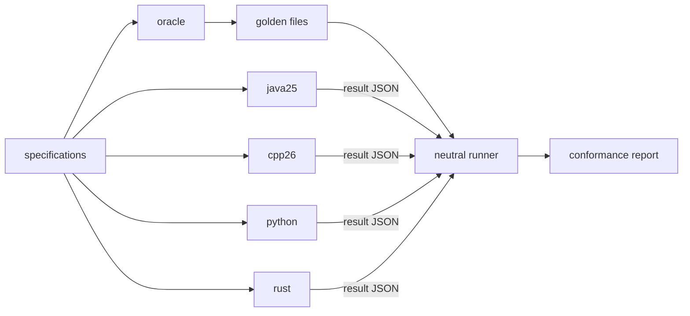
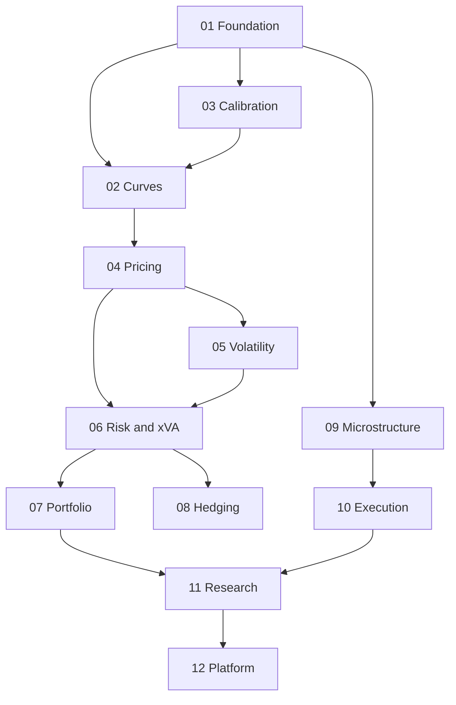
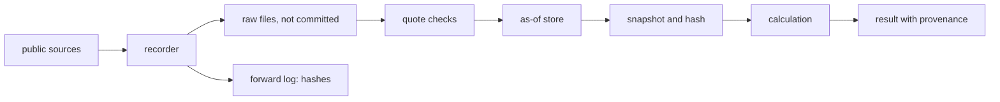
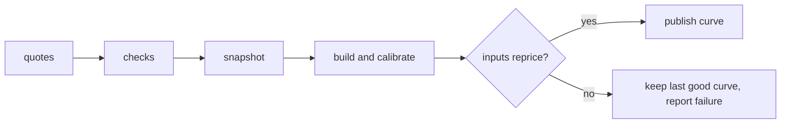
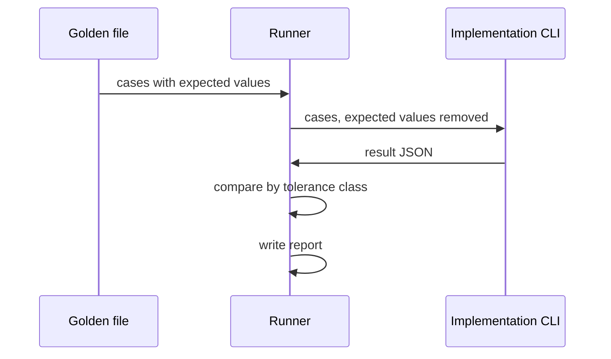

# Diagrams

Mermaid, which GitHub draws directly. Per-domain flows are added with each domain's specs.

## System

## Domain dependencies

## Data flow

## Curve lifecycle

## Conformance flow

