# Diagrams

Mermaid, which GitHub draws directly and the site draws in its light or dark theme. The stage J diagrams carry a title and a description for screen readers (`accTitle`, `accDescr`), and the paragraph under it says the same in words. Per-domain flows are added with each domain's specs.

## System

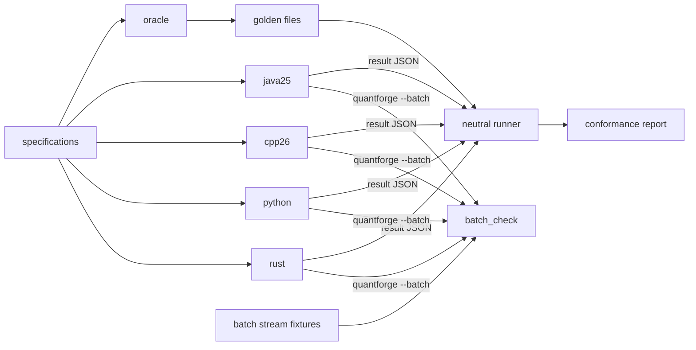

From R1 (contract 1.6.0), batch mode is checked on its own: `datasets/batch/streams.json` feeds `conformance/runner/batch_check.py`, apart from the goldens.

## Domain dependencies

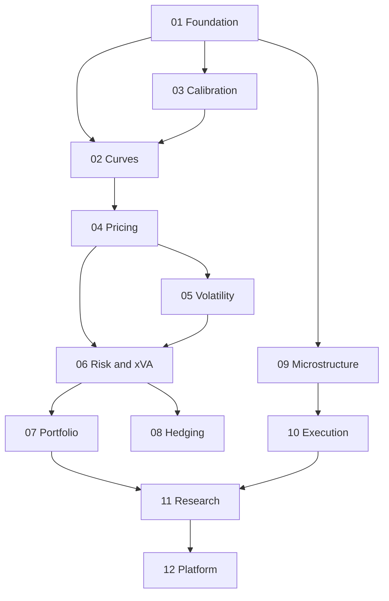

Domain 11 has CLI operations from stage J wave 1 (backtester, purged CV, Viterbi regimes, research statistics). Its `research` module in each build uses only domain 01; the arrows from 07 and 10 are where studies will take their inputs, not code dependencies.

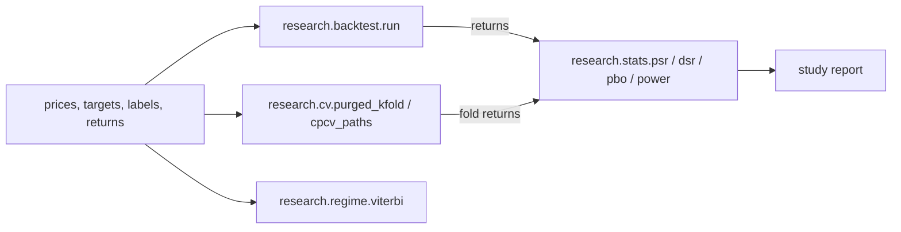

## Data flow

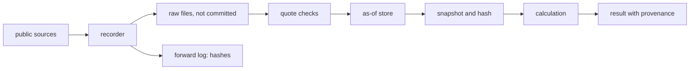

## R1 scheduled jobs

GitHub Actions, free runners, no secrets beyond `GITHUB_TOKEN`. Raw data stays on the runner.

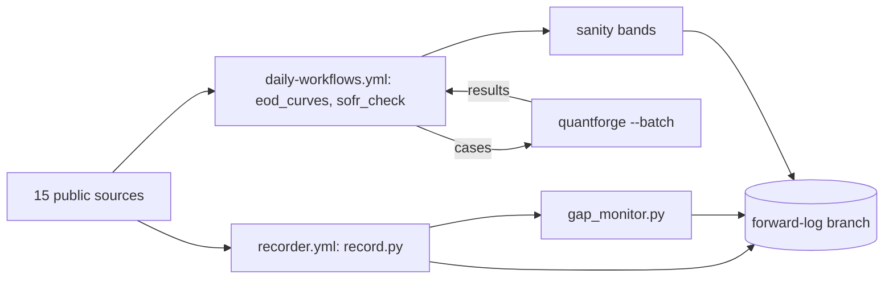

## Curve lifecycle

What stage B builds. Each step is one call to the CLI on the inputs it is given, and nothing is stored between calls. A solve that fails is an error, never a clamped curve.

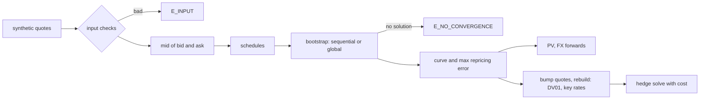

The target for later stages, not built yet: quotes pass the data checks, are frozen in a hashed snapshot, and a curve is published only if its inputs reprice.

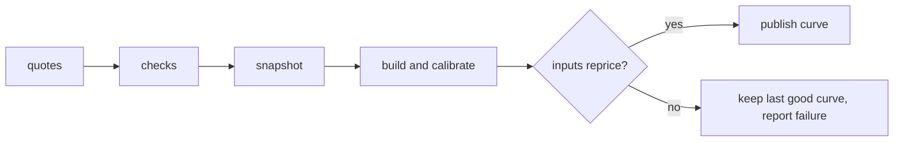

## Valuation parts

The five parts of `specifications/04-pricing/pricing-framework.md`.

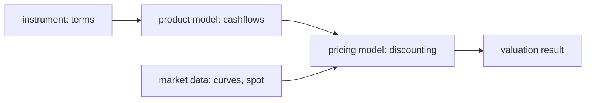

## Conformance flow

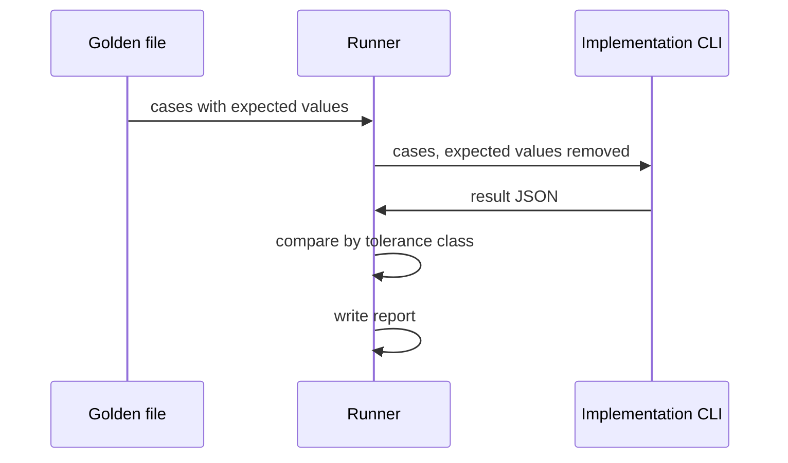

## Stage E: volatility and exotics

Plain idea: stage E builds on the stage D curves and pricers rather than beside them. Each box names its slice and spec page; the goldens for spec A live in `datasets/golden/stage_e/` (446 cases) and for spec B in `datasets/golden/stage_e_b/` (449 cases).

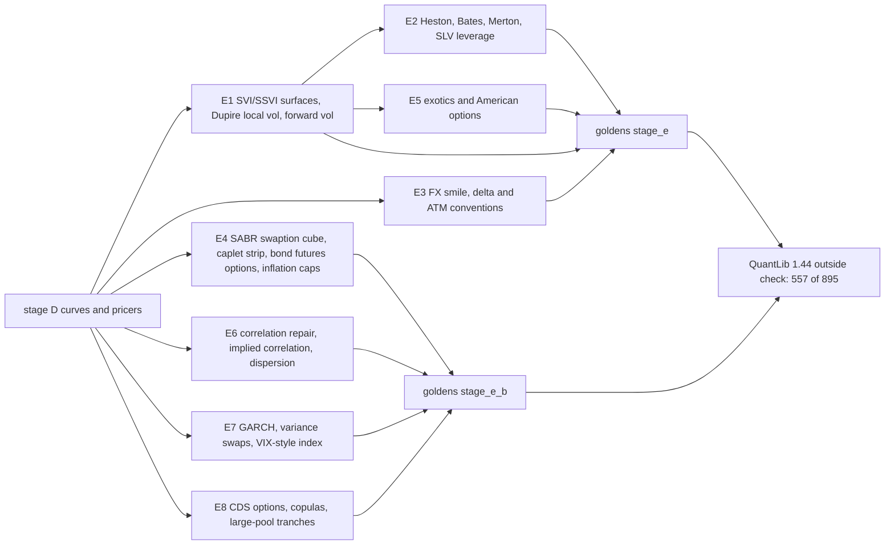

## Stage F: from quotes to capital and the book

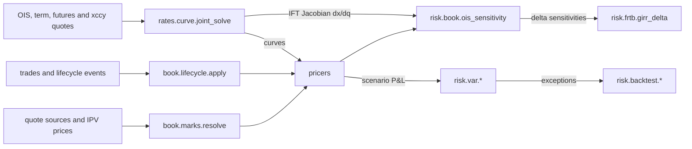

The joint solve feeds both the prices and the Jacobian that AAD carries back to the quotes (ruling F-29). VaR and the backtests work on P&L scenarios; FRTB-SA works on sensitivities. Specs: `02-curves/joint-solve-and-funding.md`, `06-risk/book-sensitivities.md`, `06-risk/var-es-and-backtests.md`, `06-risk/frtb-sa-girr.md`, `07-portfolio/book-lifecycle.md`.

## Stage I: hedging around one solver

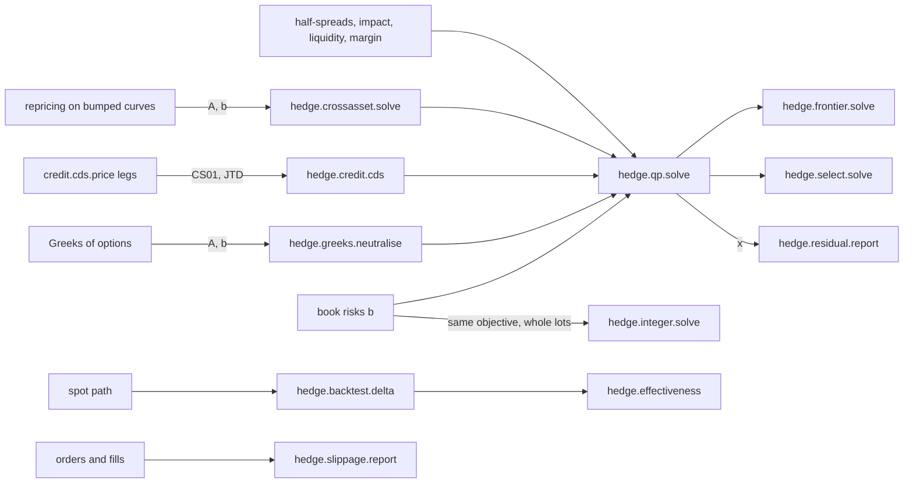

Every hedge that builds a risk matrix passes it to one constrained least-squares solve; the frontier and instrument selection call that solve repeatedly. The checks run in a fixed order, so a bad problem returns the same error code in every build (rulings I-3, I-14). Costs are solved by sign state (long, short or held at zero), with no cap below 200 instruments in the method (I-48), though at v0.8.0 no golden was larger than 6 by 4 (R6-6 adds n = 50 and 200) and exact answers at a switch point (I-54). Specs: `08-hedging/hedge-solvers.md`, `credit-and-correlation-hedges.md`, `cross-asset-hedge.md`, `hedge-costs-and-frontier.md`, `instrument-selection.md`, `dynamic-hedge-and-effectiveness.md`, `hedge-slippage.md`.

## Stage J: research tools

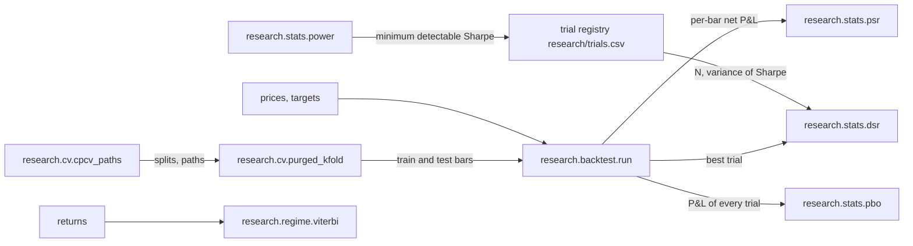

A study fixes its power and trial count first, backtests each trial with costs and a lag, and reports DSR and PBO beside the Sharpe ratio (plan 11.3). Regime labels describe the sample and never feed a signal (spec limitation). Specs: `11-research/backtester.md`, `purged-cv.md`, `regimes.md`, `research-statistics.md`. Worked through in [Tutorial 23](../getting-started/tutorial-23-backtest-honestly.md), [Tutorial 24](../getting-started/tutorial-24-is-the-sharpe-real.md) and the gallery page [Research workflow](../curves/research-workflow.md).

### Backtest timing: signal at t, trade at t + lag, P&L on the bar after

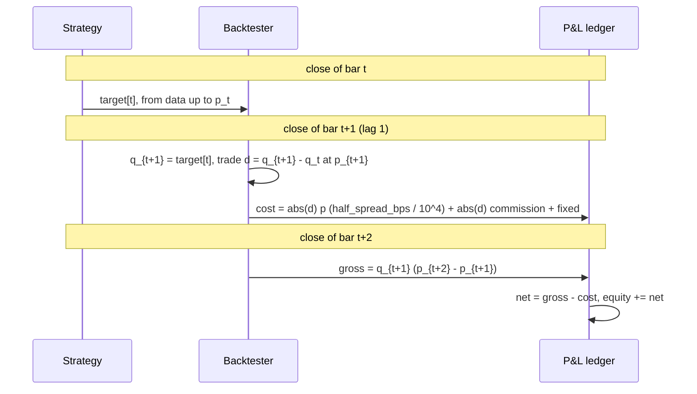

The position that earns a bar's move is the one held before that bar's trade (ruling J-2). A rule computed from `p_t` and traded at `p_t` (lag 0) earns moves it could not have known; the canary in Tutorial 23 makes 21 at lag 0 and loses 10 at lag 1 on the same twelve prices.

### Purged k-fold with an embargo

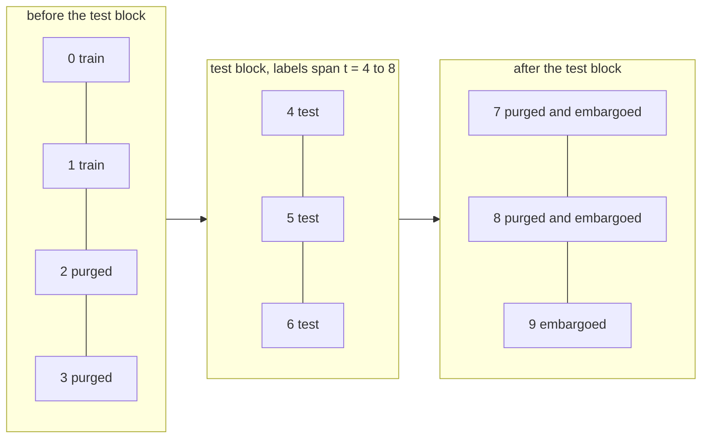

Purging works on both sides of the block and removes any training row whose label window `[t0, t1]` touches the test span; the embargo, `floor(embargo_pct n)` rows, works only after it, where serial correlation carries information forward (rulings J-7, J-8). Numbers from Tutorial 23, `t1 = t0 + 2`, embargo 0.3.

### Combinatorial purged CV: splits to paths

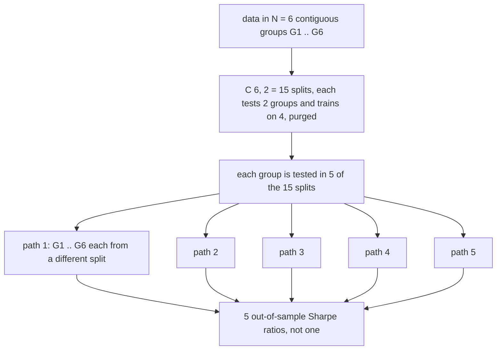

`n_splits = C(N, k)` and `n_paths = k C(N, k) / N`, an integer because `k C(N, k) = N C(N-1, k-1)` (`research.cv.cpcv_paths`; López de Prado 2018, section 12.4). The operation returns the counts; assigning splits to paths is left to the research package.

### Portfolio pipeline

```mermaid
flowchart LR
  accTitle: Stage J wave 2 portfolio pipeline, from returns to a tested risk model
  accDescr: Returns go into Ledoit-Wolf, which gives a shrunk covariance. The covariance and market weights give the prior returns, which Black-Litterman moves towards the investor's views. Mean-variance takes the posterior returns, the covariance and the weight limits and gives weights; risk parity takes the covariance and risk budgets instead and ignores expected returns. Euler contributions split either portfolio's volatility by asset. After the portfolio has been held, its realised losses and the model's VaR and ES forecasts go into the Z2 backtest, and a Baum-Welch fit describes the calm and turbulent regimes of the same period.
  R[returns T x N] --> LW[research.estimate.ledoit_wolf: shrunk Sigma]
  LW --> PI[prior pi = delta Sigma w_mkt, caller]
  PI --> BL[research.estimate.black_litterman: views P, q, Omega]
  BL --> MV[research.portfolio.mean_variance: weights within limits]
  LW --> MV
  LW --> RP[research.portfolio.risk_parity: weights from risk budgets]
  MV --> EU[risk.contrib.euler: volatility by asset]
  RP --> EU
  EU --> H[hold, record losses and VaR, ES forecasts]
  H --> Z2[risk.backtest.es_z2: tail size tested]
  H --> BW[research.regime.baum_welch: regimes of the period]
```

Estimate, optimise, look at where the risk sits, then test the risk model on what happened. Every arrow is an input the caller passes; no operation calls another, so each step can be replaced or checked on its own. The prior `pi` is computed by the caller, as in [Tutorial 25](../getting-started/tutorial-25-build-and-stress-a-portfolio.md); the Z2 and Baum-Welch steps are in [Tutorial 26](../getting-started/tutorial-26-test-es-and-fit-regimes.md). Specs: `07-portfolio/estimation.md`, `07-portfolio/optimisation.md`, `06-risk/es-backtest.md`, `11-research/baum-welch.md` (rulings J-W2-1 to J-W2-15).

### Baum-Welch: the EM loop and its stop rule

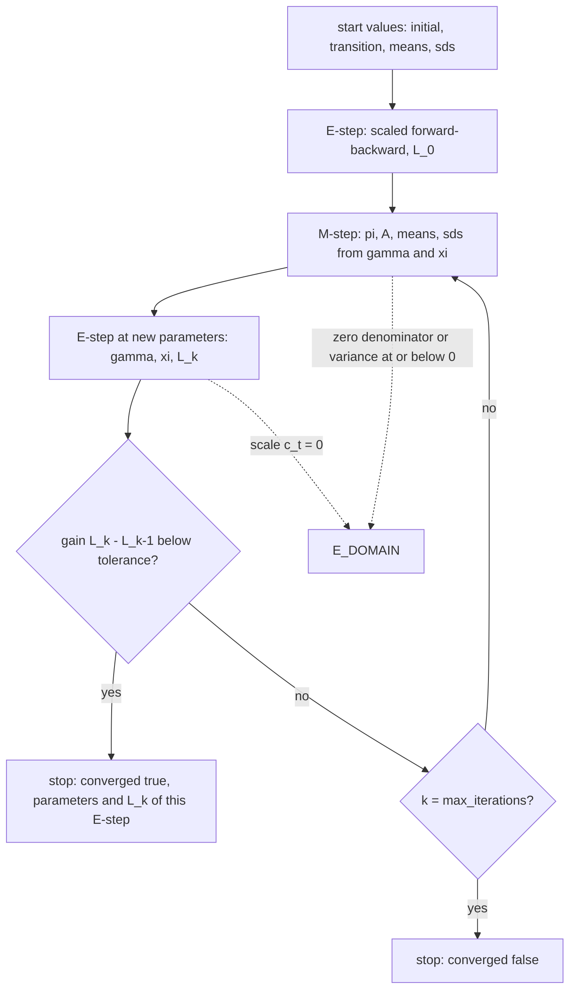

One iteration is an M-step followed by an E-step, and the outputs are the parameters and log-likelihood of the last E-step (ruling J-W2-11). The likelihood never falls [Rab89, DLR77], so gains shrink towards zero; each golden's tolerance sits at least `1e-11` from every gain it tests, so all four builds stop at the same iteration (J-W2-12). In Tutorial 26 a two-state fit on 24 returns stops after iteration 7 with tolerance `1e-6`, and after iteration 3, not converged, with `max_iterations` 3.
