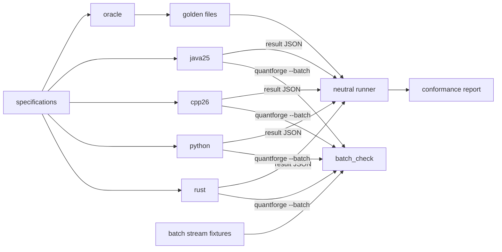
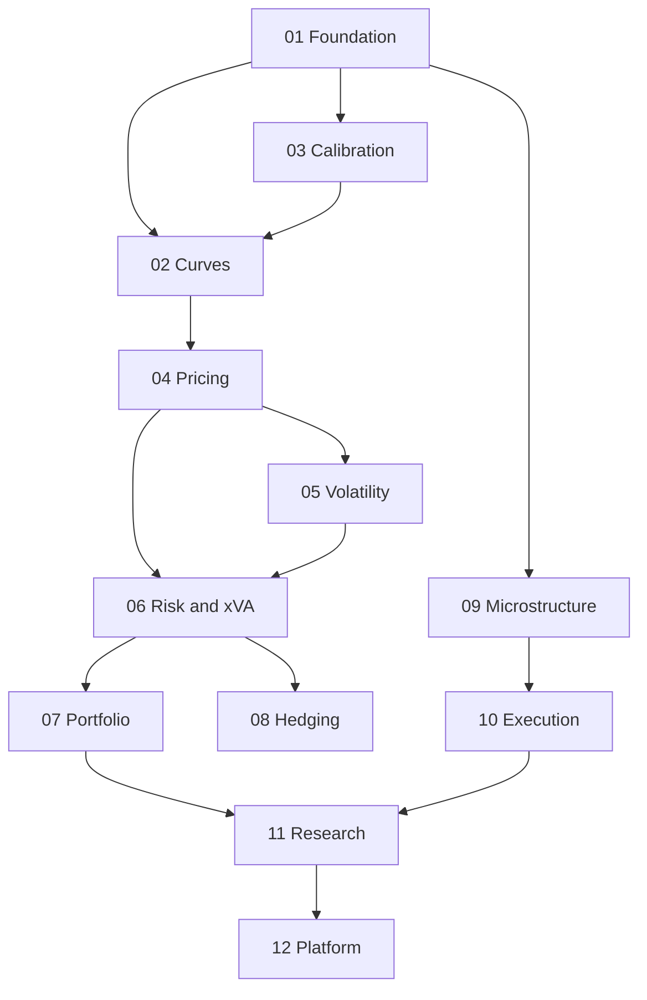
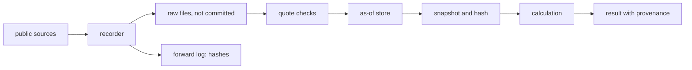
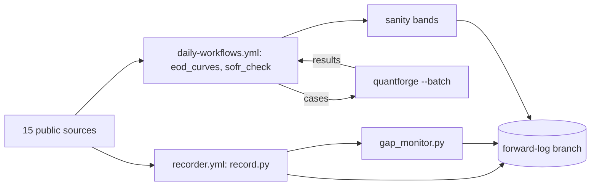
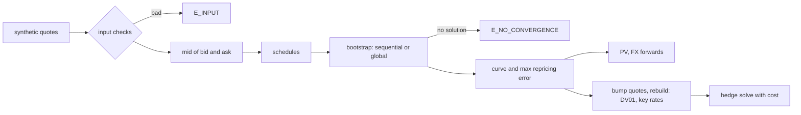
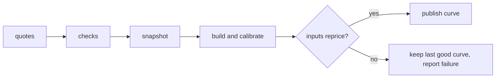
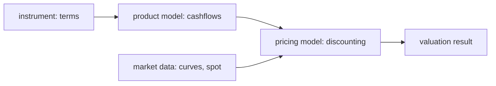
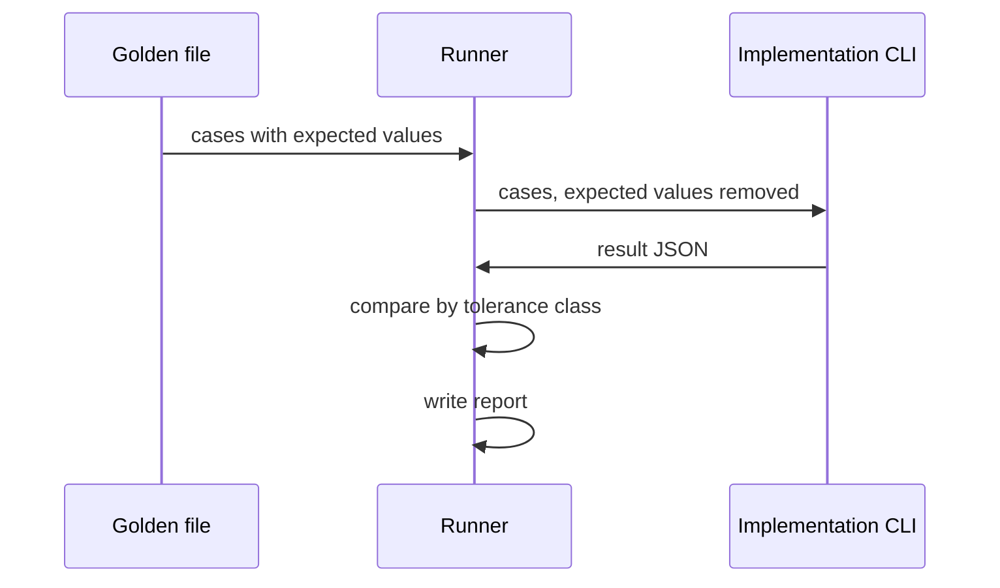
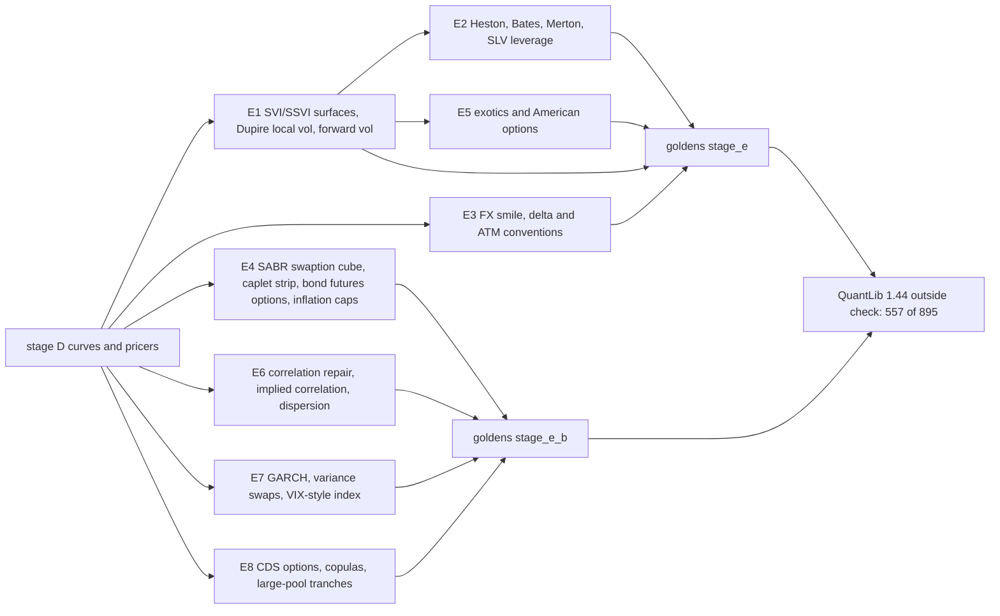
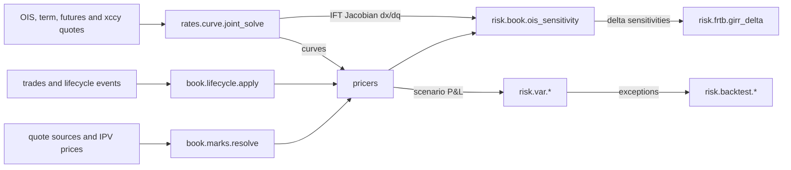

# Diagrams

Mermaid, which GitHub draws directly. Per-domain flows are added with each domain's specs.

## System

From R1 (contract 1.6.0), batch mode is checked on its own: `datasets/batch/streams.json` feeds `conformance/runner/batch_check.py`, apart from the goldens.

## Domain dependencies

## Data flow

## R1 scheduled jobs

GitHub Actions, free runners, no secrets beyond `GITHUB_TOKEN`. Raw data stays on the runner.

## Curve lifecycle

What stage B builds. Each step is one call to the CLI on the inputs it is given, and nothing is stored between calls. A solve that fails is an error, never a clamped curve.

The target for later stages, not built yet: quotes pass the data checks, are frozen in a hashed snapshot, and a curve is published only if its inputs reprice.

## Valuation parts

The five parts of `specifications/04-pricing/pricing-framework.md`.

## Conformance flow

## Stage E: volatility and exotics

Plain idea: stage E builds on the stage D curves and pricers rather than beside them. Each box names its slice and spec page; the goldens for spec A live in `datasets/golden/stage_e/` (446 cases) and for spec B in `datasets/golden/stage_e_b/` (449 cases).

## Stage F: from quotes to capital and the book

The joint solve feeds both the prices and the Jacobian that AAD carries back to the quotes (ruling F-29). VaR and the backtests work on P&L scenarios; FRTB-SA works on sensitivities. Specs: `02-curves/joint-solve-and-funding.md`, `06-risk/book-sensitivities.md`, `06-risk/var-es-and-backtests.md`, `06-risk/frtb-sa-girr.md`, `07-portfolio/book-lifecycle.md`.
