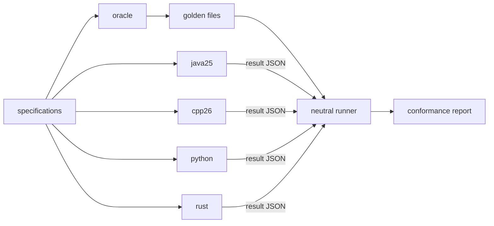
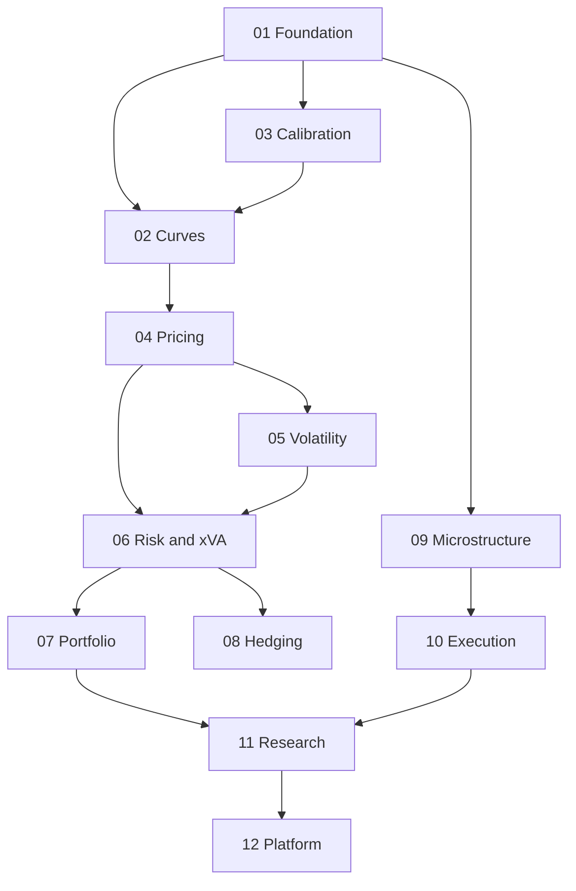
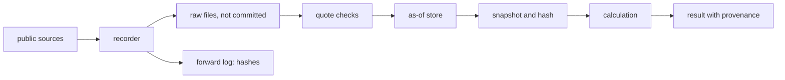
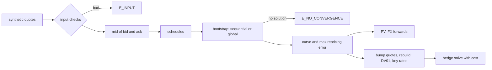
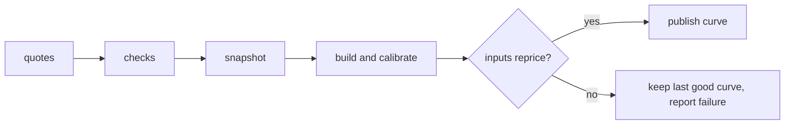
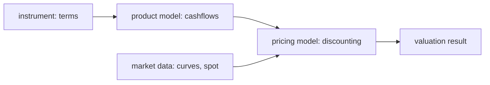
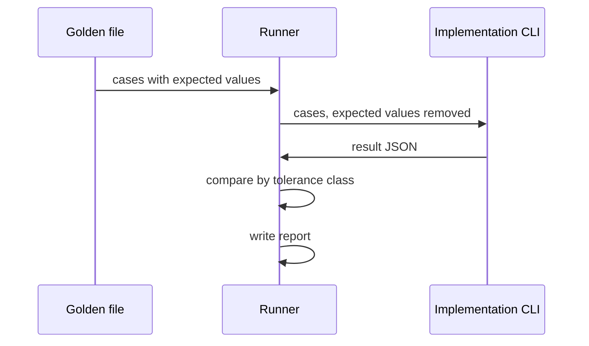

# Diagrams

Mermaid, which GitHub draws directly. Per-domain flows are added with each domain's specs.

## System

## Domain dependencies

## Data flow

## Curve lifecycle

What stage B builds. Each step is one call to the CLI on the inputs it is given, and nothing is stored between calls. A solve that fails is an error, never a clamped curve.

The target for later stages, not built yet: quotes pass the data checks, are frozen in a hashed snapshot, and a curve is published only if its inputs reprice.

## Valuation parts

The five parts of `specifications/04-pricing/pricing-framework.md`.

## Conformance flow

